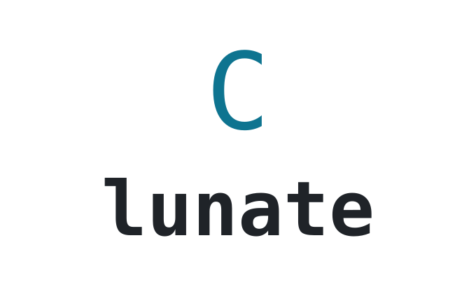
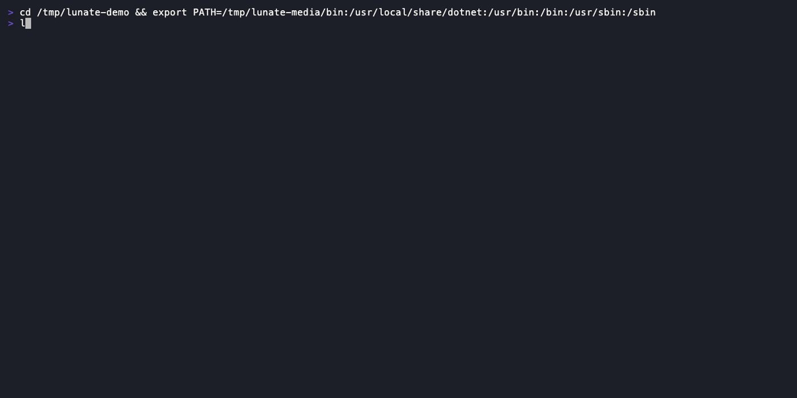
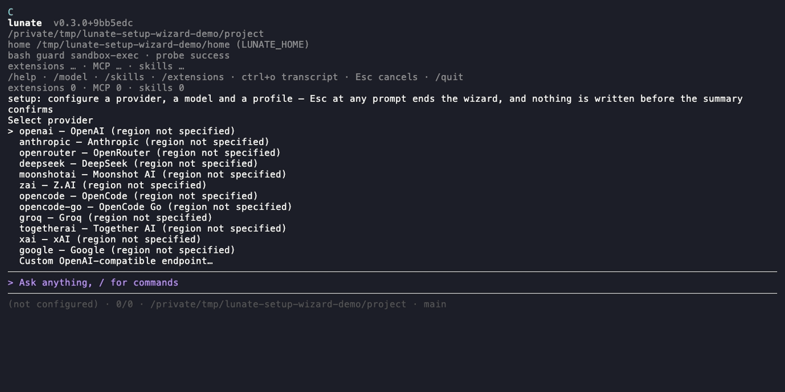

# Lunate

<picture>
  <source media="(prefers-color-scheme: dark)" srcset="assets/brand/lunate-logo-dark.png">
  
</picture>

**Small, native, yours: a coding agent you can customise in C#.**

Lunate is a native coding agent for the terminal that .NET developers can make their own —
extended in C# from a single file to a NuGet package, with the deepest C# understanding of any
agent and at home in polyglot repositories.

[](https://github.com/lunate-agent/lunate/actions/workflows/ci.yml)
[](https://github.com/lunate-agent/lunate/actions/workflows/release.yml)
[](LICENSE)



## Why Lunate

- **Native and lightweight.** One self-contained binary per platform — no Node, no Python, no .NET
  runtime to install — and `lunate --version` starts in tens of milliseconds. CI holds the startup
  median to 250 ms on Ubuntu, 300 ms on macOS and 350 ms on Windows ([ADR-0005](adr/0005-budget-calibration.md)).
- **Understands C#.** Roslyn semantics with no plugin and no language server to install:
  `cs_diagnostics`, `cs_find_symbol`, `cs_find_references`, `cs_outline`, `cs_rename` — the
  diagnostics tool is a compile check after an edit, and an edit is verified against the compiler,
  not the model's guess. The published benchmark evidence is a five-instance SWE-bench Verified
  pilot, not a C# suite: Lunate resolved 2/5 with the budget model and 3/5 with the frontier model,
  while the mini-swe-agent baseline resolved 4/5 and 3/5 on the same subset; the write-up states
  the failures and the pilot's limits
  ([`docs/dev/eval/swebench-first-run.md`](docs/dev/eval/swebench-first-run.md)).
- **Yours to extend in C#.** Start from **one `.cs` file** — a header declares its tools and the
  NuGet packages it needs, you approve it once, and it compiles into the running session — and grow
  it into a NuGet package you install by id ([`docs/extensions/`](docs/extensions/README.md) owns the
  contract). The open protocols are there when you want them: an MCP client, an ACP server, Agent
  Skills and `AGENTS.md` project rules.
- **Safe by default.** Every write and command asks first, with the edit's diff on screen;
  repository-provided code asks once per repository and again when it changes; and on macOS and
  Linux `bash` runs under an OS-level guard for Lunate's own state. Lunate says plainly that this
  is not a sandbox ([`docs/security.md`](docs/security.md); [`SECURITY.md`](SECURITY.md) is the
  reporting policy).

## Get started

**1. Install.**

<!-- docs-sync: version -->
The current stable release is [**0.3.0**](https://github.com/lunate-agent/lunate/releases/tag/v0.3.0).
<!-- /docs-sync: version -->

```bash
# macOS (arm64) and Linux (x64)
curl -fsSL https://raw.githubusercontent.com/lunate-agent/lunate/main/install.sh | sh
```

```powershell
# Windows (x64)
irm https://raw.githubusercontent.com/lunate-agent/lunate/main/install.ps1 -OutFile install.ps1
./install.ps1
```

Or through Homebrew (`brew tap lunate-agent/tap`, `brew install lunate`), Scoop, or as a .NET tool
(`dotnet tool install --global lunate`). Winget follows once its manifest is accepted.

**2. Run `lunate` in a repository.** On a fresh install the first prompt opens the setup wizard: it
walks provider, credential, connection test, model, chat profile and an optional decisions layer,
and writes nothing until you confirm the summary — `Esc` leaves without changing anything.



**3. Give it a task.** `/help` lists the built-in commands, `/model` switches the model, `Esc`
interrupts the running turn, `/quit` leaves. For a script or CI, `lunate -p "summarise what changed
on this branch"` prints one prompt's final answer and `--json` emits every event as one JSON line.

Next: [Documentation](docs/index.md) · [Quickstart](docs/quickstart.md) ·
[Models and providers](docs/models-and-providers.md) · [Customize](docs/configuration.md) ·
[Automate](docs/print.md)

<details>
<summary>Explore capabilities and extending Lunate</summary>

The [documentation](docs/index.md) groups the pages by the task they serve, and each page states its
answer in the first paragraph. The list below is the short tour.

## What it can do

- **Approvals with diffs** — writes and commands stop at a panel that shows what will happen; the
  [details](docs/usage.md#edits-you-approve-with-the-diff).
- **Full transcripts** — finished tool calls commit as one line; `ctrl+o` opens every block with
  its whole output and diff ([usage](docs/usage.md#tool-calls-commit-as-one-line)).
- **Narrow terminals** — one layout that keeps every choice on screen down to 40 columns
  ([terminal setup](docs/terminal-setup.md#fit-a-narrow-terminal)).
- **C# tools** — `cs_diagnostics`, `cs_find_symbol`, `cs_find_references` and `cs_outline` with no
  plugin to install ([usage](docs/usage.md#c-the-compiler-agrees-with)); `lunate mcp roslyn` serves
  the read-only versions to any MCP host ([`docs/mcp-roslyn.md`](docs/mcp-roslyn.md)).
- **Reasoning you can watch** — `/thinking low|medium|high` streams live and collapses to one line
  ([usage](docs/usage.md#you-can-watch-it-think)).
- **A second model for approvals and routing** — a decision layer that can only tighten an approval,
  never grant one ([decisions](docs/decisions.md)).
- **Copy and export** — `/copy` works over ssh via OSC 52; `/export html` writes a hardened,
  credential-redacted document, `/export jsonl` the session file
  ([copy, export and debug](docs/export-copy-debug.md)).
- **Sessions that fork** — `/fork` continues under a new id, `/clone` restarts from an earlier
  turn ([usage](docs/usage.md#fork-a-session-without-losing-the-tail)).
- **Long sessions** — tool results spill to a file and old turns are masked without losing the
  transcript ([usage](docs/usage.md#long-sessions-keep-their-place)).
- **Trust for repository code** — project extensions, MCP servers and skills ask once per
  repository, recorded in `trust.json` for scripted runs
  ([usage](docs/usage.md#repository-code-asks-once)).
- **Extensions in C#** — one `.cs` file at a time: approve it once and it compiles into the running
  session, no project and no SDK on your `PATH` ([reference](docs/extensions/single-file.md)).
- **Extensions as packages** — `lunate install <id>@<version>` with an uninstall record that names
  exactly what was written ([reference](docs/extensions/packages.md)).
- **Out-of-process extensions** — an extension can be its own process speaking JSON-RPC over stdio,
  with a checked-in wire schema ([reference](docs/extensions-remote.md)).
- **MCP client** — the servers you already run; Lunate withholds its own credentials from their
  child processes ([MCP servers](docs/mcp-servers.md)).
- **Agent Skills** — `SKILL.md` directories, project or user scope
  ([skills](docs/skills.md)).
- **`AGENTS.md`** — project rules from the root down to the launch directory, appended under their
  relative path ([AGENTS.md](docs/agents-md.md)).
- **Update check** — one GitHub Releases check a day, no telemetry, `updateCheck: false` to stop
  ([configuration](docs/configuration.md)).

## Extending

An extension is an assembly plus a manifest. The factory is the whole entry point:

```csharp
public sealed class HelloFactory : IExtensionFactory
{
    public IExtension Create(IExtensionContext context)
    {
        context.RegisterTool(new ExtensionToolRegistration
        {
            Name = "hello", Description = "Greets a name.",
            ParametersSchema = Schema, Handler = new HelloHandler(),
        });
        return new HelloExtension();
    }
}
```

The model calls that tool as `<extension-id>__hello`, it goes through the same approval policy as
the core tools, and hook handlers, UI renderers and widgets, MCP servers, model providers and skill
sources register the same way.

- Get started: [`templates/extension/README.md`](templates/extension/README.md) — manifest, wiring
  and the test kit
- Authoring guide: [`docs/extensions/`](docs/extensions/README.md) — quickstart, manifest reference,
  one page per contribution, lifecycle and trust, testing and troubleshooting
- Contract and hook catalogue: [`docs/dev/spec/extensibility.md`](docs/dev/spec/extensibility.md)
- Reference extensions that run in CI: [`samples/extensions/`](samples/extensions/)
- Supported extensions (`Lunate.Extensions.*`): [`extensions/`](extensions/)

</details>

<details>
<summary>Security, platform, and project background</summary>

## Security model

Lunate asks before every write and command and guards its own state at the OS level; it is not a
sandbox. [`docs/security.md`](docs/security.md) owns the full posture; [`SECURITY.md`](SECURITY.md) is
the reporting policy.

- File tools resolve paths canonically — symlinks included — and refuse anything outside the
  working directory.
- On macOS and Linux every `bash` command runs under an OS-level deny for Lunate's own state, via
  `sandbox-exec` or bubblewrap/Landlock ([ADR-0024](adr/0024-bash-guard.md)); Windows reports that
  it has no mechanism instead of running unconfined silently.
- Repository-provided code — project extensions, project MCP servers, project skills — asks once
  per repository, and the answers live in `~/.lunate/trust.json`.
- In-process extensions are fully trusted; out-of-process ones isolate dependencies and crashes,
  not permissions.

## Platform support

Three targets, each built and verified in CI on every commit, plus a performance budget per runner
([ADR-0005](adr/0005-budget-calibration.md)):

| Platform | Release target | CI runner |
| --- | --- | --- |
| macOS (Apple Silicon) | `osx-arm64` | `macos-latest` |
| Linux (x86_64) | `linux-x64` | `ubuntu-latest` |
| Windows (x86_64) | `win-x64` | `windows-latest` |

Terminals: Windows Terminal, conhost, VS Code's integrated terminal, Git Bash, macOS Terminal.app,
iTerm2, Ghostty, WezTerm, Kitty, Alacritty, the common Linux terminals, and tmux/screen over SSH —
the full matrix is in [terminal setup](docs/terminal-setup.md); pipes, CI and `TERM=dumb` are print
mode.

## Acknowledgements

Lunate stands on two lightweight agents that came first — **Pi** and **Tau** — for the shape of the
loop, the tool set and the idea that an agent's harness should be small enough to read. The
head-to-head suite that calibrates the claims above runs Pi and Tau beside Lunate
([`docs/dev/eval/t35-head-to-head.md`](docs/dev/eval/t35-head-to-head.md)).

## Contributing

Building from source, the verification gate, the repository map and the OpenSpec workflow are in
[`CONTRIBUTING.md`](CONTRIBUTING.md); [`AGENTS.md`](AGENTS.md) holds the rules coding agents follow
in this repository.

</details>

## License

MIT — see [`LICENSE`](LICENSE).
