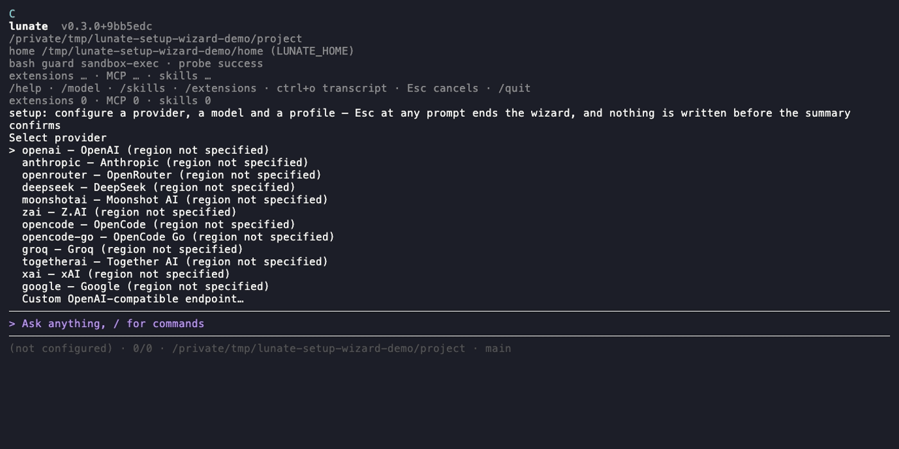

# First run

Lunate's first run is the setup wizard. It has two depths on one walk: **Quick** (the default) asks
provider, credential, connection test, model, model check and chat profile; **Detailed** asks every
setting as well — a custom provider's fields, thinking level, fast/decision profiles and the
decisions layer. Either depth can collect several providers in one run, each with its own
credential, connection test, model, model check and chat profile, before the fast/decision
profiles, the decisions layer and the summary. Nothing is written until the summary is confirmed.
Re-run it at any time with `/setup` in a session or `lunate setup` from a shell.



## The setup wizard

Start `lunate` in a repository with no usable configuration. When stdin and stdout are terminals,
the wizard opens instead of the prompt:

- **Mode** — the first step defaults to Quick; choose the mode row to switch to Detailed. Switching
  keeps every answer already collected. `/setup`'s scoped entries stay detailed.
- **Provider** — the twelve presets in [`providers.json`](../src/Lunate.Ai/providers.json) order,
  plus a custom OpenAI-compatible endpoint. Quick asks a custom provider's id and endpoint only;
  Detailed also asks its API family, credential placement, region and models URL.
- **Credential** — type a key (masked, stored only in `auth.json`), name an `env:`/`auth:`
  reference, or skip. A provider environment variable always wins over a stored key.
- **Connection test** — one discovery request to the provider's models URL; skippable.
- **Model** — search the discovered list or enter an id manually. The id is resolved against the
  catalogue in the provider entry's scope, so a custom endpoint's bare id — the wire form it
  serves — is staged as listed; only an id that several unrelated providers serve is asked about,
  by qualified id.
- **Model check** — one minimal completion that verifies the resolved family; it costs one short
  request, and `--no-model-check`, `--no-test` or the skip row avoids it.
- **Chat profile and thinking** — the name the session uses; Detailed also asks the reasoning level
  the model declares.
- **Fast and decision profiles** — Detailed only; both default to skip. Each offers a flat
  `provider/model` list across the provider configured in this run, every provider already
  configured on the machine, and any provider added inline with **Set up another provider inline…**
  (which runs the provider, credential, connection-test and model steps without leaving the usage
  step). The model check runs after the selection, states its cost first, and a skip stays marked
  unverified. A `systemone` model is labelled native Jev, any other adapter model is labelled
  adapter. The decision profile is written as the `decisions` profile, so a chat profile with that
  name skips the decision step instead of being replaced by it.
- **Another provider** — after a provider's steps, the provider list returns with **Add another
  provider…** and **Done**. Adding walks the provider, credential, test, model and profile steps
  again; **Done** continues to the decisions layer. Each provider keeps its own credential, and a
  later one may reuse an `env:`/`auth:` reference instead of storing a second key. A name already
  collected asks for a different name, so the first entry is never overwritten.
- **Decisions** — Detailed only; each switch is shown with the value it holds now and one explanatory
  line; the list stays open after each change and refreshes every row, and **Done — leave the
  decisions settings** leaves it.
- **Summary** — a manifest grouped by the file it will write (`providers.json`, `auth.json`,
  `settings.json`), one fact per line, with the connection/model-check results and a **Left at
  default / unchanged** block naming what the walk skipped and the command that changes it later
  (`/setup`, `/settings`, `lunate auth login`). A Quick walk's block names every setting Quick did
  not ask, the default it left, and that command. After the write, a short receipt names each
  touched file, the change-later commands and returns to the session. Both surfaces stay readable
  at 40 columns and never print a secret.

Quick never hides a default: a setting it skips appears in that block. `Esc` at any prompt ends the
run with nothing written. The full walk is the only path that writes several stores; the entry menu
below writes only the answers it collects.

## `lunate setup` — non-interactive and scripted

`lunate setup` runs the same walk without a TTY. Every answer is a flag; an absent flag skips its
step and invents nothing. The connection test and the model check run unless suppressed: `--no-test`
sends no provider request at all (it skips both), while `--no-model-check` skips only the paid model
check and keeps the free discovery request. The file manifest and the post-write receipt go to
stdout and never contain a credential.

```bash
printf '%s\n' "$OPENAI_API_KEY" |
  lunate setup \
    --provider openai --credential env:OPENAI_API_KEY \
    --model gpt-4.1 --profile chat-main --thinking medium
```

The flag set is `--provider`, `--endpoint`, `--api-family`, `--credential-placement`,
`--models-url`, `--credential` (an `env:`/`auth:` reference), `--key-stdin`, `--model`, `--profile`,
`--thinking`, `--fast`, `--as-decision`, `--no-test` (offline: skips the connection test and the
model check, so no provider request is sent), `--no-model-check` (skips the model check only), and
`--force`. A run without a terminal exits 2 and names the missing answer when a value needs
interaction; 0 after a real commit or a no-op; 1 for a store/load failure.

## `/setup` — re-run from a session

On a configured install, `/setup` opens the entry menu instead of the full walk:

- add a provider,
- add a profile,
- change the chat profile,
- edit the decisions layer,
- walk everything.

Each entry is prefilled with the current values and writes only what changed, through the same
store writers as the full walk. `/setup` refuses while a turn is running. `/auth` remains the
shorter path for a missing credential.

## The manual `auth login` path

The CLI path below stays available for scripted bootstrap and for users who prefer one command at
a time.

From a terminal:

```bash
lunate auth login
```

With no provider argument the command prints the supported provider ids and names and exits —
0 on a terminal, and 2 with the same list on stderr when stdin is a pipe. It never waits for a key
nobody can type. Then choose one:

```bash
lunate auth login anthropic
```

On a terminal the key is read through a masked prompt. In a script, pipe one line to the command:

```bash
printf '%s\n' "$ANTHROPIC_API_KEY" | lunate auth login anthropic --key-stdin
```

Neither path echoes the value. A pipe without `--key-stdin` exits 2 with the hint instead of
guessing.

`lunate auth login` is one of four subcommands:

| Command | What it does |
| --- | --- |
| `lunate auth list` | One line per provider entry with credential presence and bounded reachability (`reachable`, `unreachable`, or `unknown`). Never prints a credential or header value. Exits 0 even when nothing is stored. |
| `lunate auth login <provider>` | Stores a key under the provider entry name. Use `--key-stdin` to read one line from a pipe. |
| `lunate auth logout <provider>` | Removes the stored entry, names a still-set environment variable without its value, and exits non-zero when nothing was stored. |
| `lunate auth status` | Reports the resolved default provider and whether a credential exists; exits 0 when it does and 1 when it does not, so a bootstrap script can branch on it. |

## Provider instances and credentials

The twelve built-in provider kinds are templates for adapters and defaults. A user may define
multiple named provider entries of one kind in `~/.lunate/providers.json`:

```json providers
{
  "schemaVersion": 1,
  "providers": [
    {
      "name": "work-anthropic",
      "kind": "anthropic",
      "baseUrl": "https://api.anthropic.com",
      "credentialReference": "auth:work-anthropic",
      "region": "eu"
    }
  ]
}
```

`credentialReference` and optional header values are references, never secret values. Supported
sources are `auth:<key>` and `env:<VARIABLE>`. The credential itself stays in `auth.json` or the
environment. `region` (`eu`, `us`, or `local`) is
descriptive metadata only: it does not choose an endpoint or guarantee data residency.

On load, Lunate idempotently migrates legacy stored keys and custom endpoints into matching provider
entries. An explicit provider entry wins, and migration never copies the secret out of `auth.json`.
Environment credentials continue to take precedence over stored keys, including in CI. Reachability
shown by `auth list` is a bounded unauthenticated probe; it sends neither credentials nor optional
headers.

Project settings may refer to user-defined providers and profiles or lower user limits. They cannot
define a provider, endpoint, credential reference, or header secret. This prevents a repository from
redirecting a user's credentials to its own server.

## Profiles and usages

`~/.lunate/settings.json` binds a profile name to a provider entry and catalog model, then assigns
profiles to existing usages; every settings key with its type, default and scope is in the
generated [configuration reference](configuration.md). For example:

```json settings
{
  "schemaVersion": 2,
  "profiles": {
    "chat-main": { "provider": "work-anthropic", "model": "claude-sonnet-5-5" },
    "reviewer": { "provider": "work-anthropic", "model": "claude-opus-5-5" },
    "quick": { "provider": "work-anthropic", "model": "claude-sonnet-5-5" }
  },
  "usages": { "chat": "chat-main" },
  "decisions": {
    "profile": "reviewer",
    "approvals": "enforce",
    "approvalsThreshold": 0,
    "routing": "shadow",
    "routingProfiles": ["chat-main", "quick"],
    "tool": "off",
    "questions": "suggest"
  }
}
```

Profiles may set supported reasoning, output, temperature, context-window, and capability-override
fields. Unsupported settings are refused by field and profile name before a request. `/model`
changes only the chat profile; `provider/model` selects through a named provider, and a bare model
id must be unique. A profile's own `model` is read in its `provider`'s scope first, so a profile on
a custom endpoint may carry that endpoint's bare model id even when the catalogue holds the same id
under other providers. A custom endpoint is checked by the API family it serves rather than by the
adapter its kind names: a model the catalogue only knows under another provider resolves through
the endpoint, and that catalogue entry contributes the model's facts (context window, capabilities)
but never its pricing. Subagents and compaction default to chat when unassigned; compaction uses
`fast` only when explicitly selected.

## Decisions

Decision consumption is configured by one `decisions` block, with the same shape for every consumer.
It is part of `settings.json` (JSON only — nothing reads YAML), shown in the example above. Without
`profile` the layer is unavailable and nothing is offered; enabling a consumer without a profile is
not an error — the layer stays off. The generated [configuration reference](configuration.md)
lists every accepted settings key with its type, default, scope and allowed values.

`routing` records a suggested profile without changing the configured chat model in shadow, or uses
the selected profile in enforce; routing picks the most probable profile and uses no threshold. An
unavailable decision profile or an invalid response leaves the configured chat model in use.
Decision spend is charged to the `decision` usage and `/cost` distinguishes the `native` and
`adapter` methods. The approval gate acts by escalation only: with `enforce`, a risk signal whose
chosen `yes` answer reaches `approvalsThreshold` confidence turns the ask into a user prompt (and
denies it when no user is present); below the threshold the ordinary approval flow runs unchanged.
The key is a confidence, not a probability — `0.5` there means a `0.75` probability of the risk —
and its default `0` is the confidence form of the shipped `0.5` probability gate.

With `questions: suggest`, the decision model adds a probability marker beside its top option. The
user still chooses; the suggestion never selects an option, answers a skipped question, or approves a
tool call. Without a configured decision profile, the ordinary question picker remains available and
the layer reports unavailable without an error state.

Decision use is the user's choice, not a model-intelligence verdict. The consumer is off by default
and must be enabled in user settings. Any configured model may be used; known structured-output
support is checked as a technical requirement, while unknown capability facts are allowed. A
decision response must name a defined option and provide valid probabilities; a malformed response
is retried once and then fails with the model named. Provenance labels `native` or `adapter` and
records the model id. Decisions can only tighten approvals: they never override deny or approve

outside the user's allow envelope. See [`guide.md`](guide.md) for the full model and cost behavior.

## The in-session picker

Start `lunate` in a repository. When the session has no usable credential and stdin and stdout are
terminals, the first run opens the auth picker once. It lists the twelve presets in
[`providers.json`](../src/Lunate.Ai/providers.json) order, followed by
`Custom OpenAI-compatible endpoint…`:

- `↑`/`↓` or `j`/`k` move the selection.
- `Enter` selects.
- `Esc` dismisses the picker without writing anything.

Selecting a preset opens the same masked prompt as `lunate auth login`. After a successful save the
notice names the provider and points at `/model`; it never contains the key. Lunate then offers an
optional verification: one minimal request, asked first, and a failure reports the reason while
keeping the stored key. Skip it if the network is metered or the machine is air-gapped.

`/auth` opens the picker again at any time. `/login <provider>` remains an alias that skips the
picker and opens the masked prompt directly; `/logout <provider>` removes a stored key. While a
turn is running, `/auth` and `/login` refuse rather than prompt.

Print mode, ACP and runs with piped stdin never prompt. A missing credential stays the explicit
error that names the key and the environment variable, and the empty-session banner names `/auth`
as the next step whenever nothing is configured.

## A custom OpenAI-compatible endpoint

For Ollama, vLLM, LM Studio or any other OpenAI-compatible server, choose the custom row at the
bottom of the `/auth` picker, or run:

```bash
lunate auth login --custom
```

The interactive flow asks for provider id, base URL, API family, credential placement, an optional
models URL, model id and key. The family defaults to `openai-chat`, because every existing custom
provider is OpenAI-compatible — an omitted flag never silently re-routes one. A script supplies the
values as flags and the key on stdin:

```bash
printf '%s\n' "$LOCAL_KEY" |
  lunate auth login --custom \
    --id local --base-url http://localhost:11434/v1 --model llama3 --key-stdin
```

An Anthropic-compatible endpoint names its family and placement:

```bash
printf '%s\n' "$ANTHROPIC_KEY" |
  lunate auth login --custom \
    --id my-anthropic --base-url https://api.example.com/v1 \
    --api-family anthropic-messages --credential-placement x-api-key \
    --models-url https://api.example.com/v1/models \
    --model claude-example --key-stdin
```

Placements are `bearer` (the default), `x-api-key`, `header:<name>` (for example Azure's `api-key`),
`header:<name>;scheme=<scheme>` (for example `header:Authorization;scheme=Token`) and `query:<name>`
(for example Google's `key`). The entry is written in the v2 shape — `baseUrls`
keyed by family, `credentialPlacement`, optional `modelsUrl`, headers — and the key stays in
`auth.json`, never in `providers.json`.

Saving validates the entry:

- The base URL must be absolute and `https`, or `http` only for a loopback host.
- The model id is required.
- The API family must be one the client wires; an unknown family is refused by name.
- Discovery through `--models-url` stays inside the entry's configured endpoint: a redirect that
  changes the host, scheme or port is refused before any request is sent there.
- The provider id must be non-empty, must not contain spaces or `/`, and must not shadow a built-in
  preset.

A refused entry is not echoed and writes nothing. `lunate auth login --custom` remains available for
legacy single-endpoint setup. Its endpoint is migrated into the named provider store while the key
remains in `auth.json`; new multi-provider setups should use `providers.json` and a profile in
`settings.json`. The model can then be selected in `/model` by its qualified provider/model id.

## Your own model catalog

`~/.lunate/models.json` is your catalog of model entries; a user entry overrides a built-in one with
the same id, and adding a model never needs a code change. An entry carries `id`, `provider`
(`openai` for any OpenAI-compatible endpoint, `anthropic`), optional `endpoint`, `contextWindow`,
`supportsTools` and an `auth` reference naming a key in `lunate auth login`'s `auth.json`. An
optional `reasoning` declares the model's reasoning style:

- `effort` — OpenAI-compatible reasoning effort.
- `budget` — Anthropic extended thinking.
- `inline` — the model embeds thinking markers in its text stream.

Absent means no reasoning support. A profile in `settings.json` may narrow this further per use
with `reasoningLevel` and `reasoningBudget`; every profile key is in the generated
[configuration reference](configuration.md).

For an endpoint that is not in the catalog at all, `lunate --discover <name-or-url>` prints a
`models.json`-shaped draft of the model's entry to stdout — you review it and copy it into the file;
nothing is written for you.

## Where the credential lives

Stored keys live in `~/.lunate/auth.json` under `keys`, schema 1, with owner-only permissions where
the platform has file modes. `providers.json` and `settings.json` contain only provider/profile
configuration and credential references, never resolved secret values.

Every preset also has a provider environment variable — `OPENAI_API_KEY`, `ANTHROPIC_API_KEY`,
`GROQ_API_KEY` and so on; Google also accepts `GEMINI_API_KEY`. When that variable is set it wins
over the key stored in the file. `lunate auth list` shows which source is in use, and
`lunate auth status` answers whether the resolved default provider has a credential at all.

## If the first run refuses

[Troubleshooting](troubleshooting.md#the-first-run-refuses) names each message, its cause and the
fix, including the print-mode error that exits 1.
