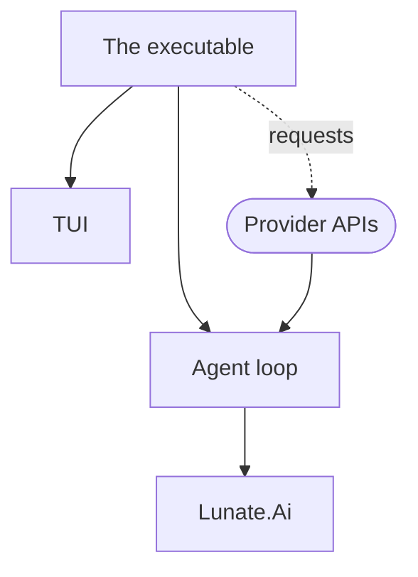
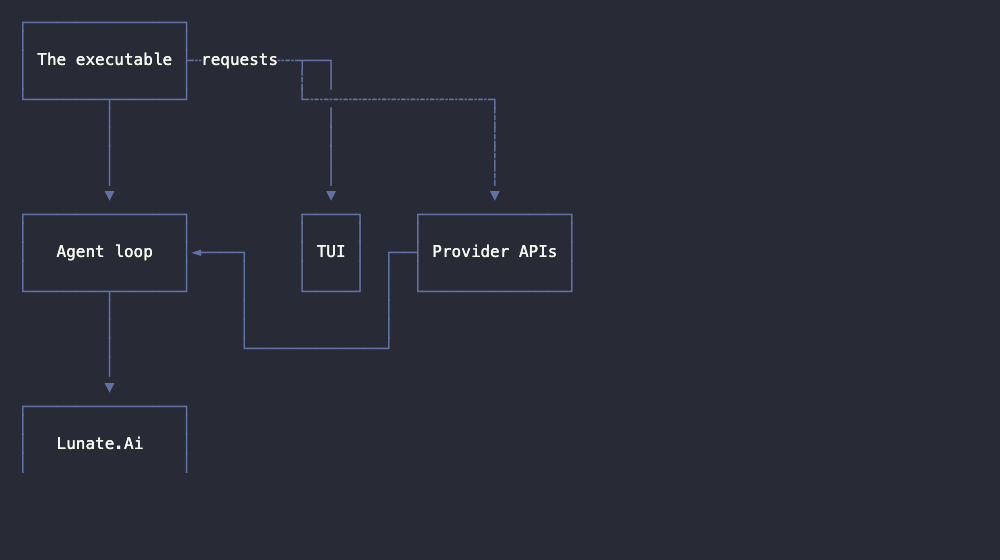
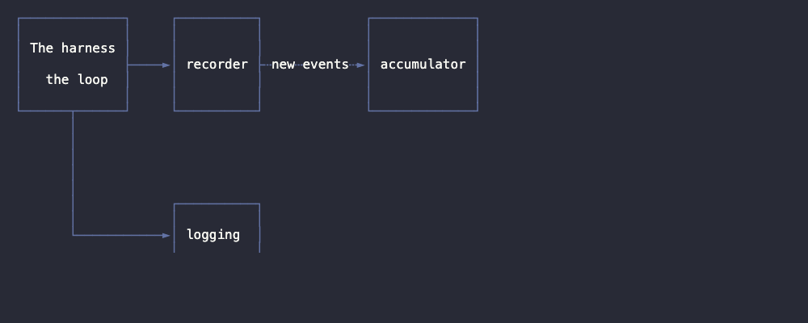
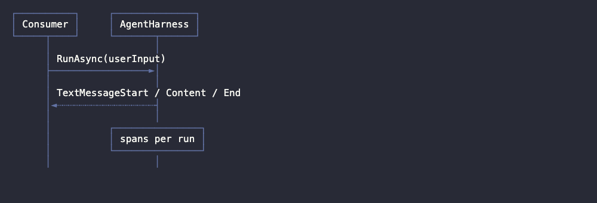
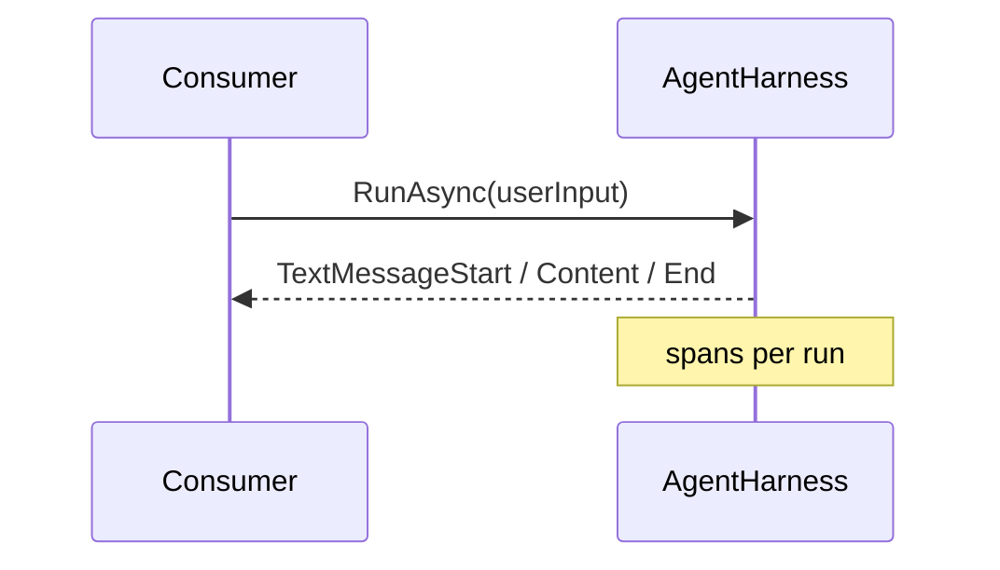
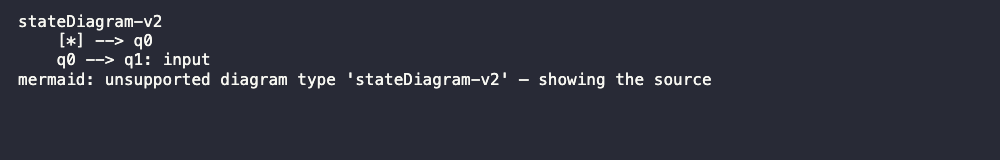

# Mermaid diagrams

This page answers what the terminal does with a `mermaid` fenced block in an answer. The short
answer: a `flowchart`/`graph` or a `sequenceDiagram` is drawn as a box diagram in the answer, and
anything else — another diagram type, a fence the parser cannot read, a drawing wider than the
terminal — shows the fence's own source in a code block followed by one line saying why.

Rendering is all-or-nothing: a diagram is either drawn whole or its source is shown whole, so an
answer never carries half a picture and a fence never fails an answer.

## What is drawn

| Fence | What appears |
| --- | --- |
| `flowchart TD`, `flowchart TB`, `graph TD`, `graph TB` | Boxes in layers from the top down, the edges as arrows between them |
| `flowchart LR`, `graph LR` | The same, in layers from left to right |
| `sequenceDiagram` | The participant boxes on one row, their lifelines below, and the messages and notes between them |

The grammar is deliberately bounded, so a fence outside it degrades instead of erroring:

| Diagram | In scope |
| --- | --- |
| flowchart / graph | node labels in `[]`, `()`, `([])` and `{}`; quoted labels and `<br/>` line breaks inside them; edges `-->`, `---` and `-.->`; an edge label as `-->\|text\|` or `-- text -->` |
| sequenceDiagram | `participant A as Name`, or an actor implied by its first message; messages over `->`, `-->`, `->>` and `-->>`; `Note over A, B: text` |

Everything else falls back to the source: `subgraph`, `style`, `classDef`, `click`, another diagram
type such as `stateDiagram-v2` or `gantt`, and any statement the parser cannot read. The one line
under the source names what it could not use.

## What a diagram looks like

A fence like this one:



is drawn as:



The same renderer draws a `flowchart LR` to the right, and a `sequenceDiagram` as participant boxes
with their lifelines:





The layout and drawing are a C# port of the MIT-licensed
[mermaid-ascii](https://github.com/AlexanderGrooff/mermaid-ascii) renderer, in the `Mermaid.Terminal`
package; see [third-party licences](third-party-licences.md). The fence keeps its `mermaid` label line
the way every fenced block in an answer does. The frame is drawn with the terminal's dim attribute
and the labels are plain text, so the drawing reads in every theme.

### A sequence diagram

A sequence names its participants and sends messages between them:



is drawn as:

```text
┌──────────┐     ┌──────────────┐
│ Consumer │     │ AgentHarness │
└─────┬────┘     └───────┬──────┘
      │                  │
      │ RunAsync(userInp…│
      ├─────────────────►│
      │                  │
      │ TextMessageStart…│
      │◄┈┈┈┈┈┈┈┈┈┈┈┈┈┈┈┈┈┤
      │                  │
      │          ┌───────────────┐
      │          │ spans per run │
      │          └───────────────┘
      │                  │
```

The participant boxes sit on the top row and a lifeline runs down from each one. A message arrow
carries its label on the row below it, cut with an ellipsis when it is longer than the room between
the two lifelines. A note is a box across the lifelines it names.

## When it does not draw

The source comes back in a code block and one line follows it:



| What happened | The line under the source |
| --- | --- |
| The diagram type is not one of the two | `mermaid: unsupported diagram type 'stateDiagram-v2' — showing the source` |
| The fence did not parse | `mermaid: line 2: a participant needs a display name after 'as' — showing the source` |
| The drawing is wider than the terminal | `mermaid: diagram is 64 columns wide, this terminal has 58 — showing the source` |

A terminal narrower than 40 columns never draws a diagram, whatever the source says:
`mermaid: this terminal has 39 columns, 40 is the minimum — showing the source`. A parse line
carries the parser's message and the line of the fence it came from, so the source above it is
unchanged and can be copied into another renderer.

## Glyphs follow the terminal

A terminal that reports Unicode gets mermaid-ascii's light box-drawing set — `┌ ┐ └ ┘ ─ │ ├ ┤ ┬ ┴
┼`, the dotted `┄` and `┆`, and the filled heads `► ▼ ◄ ▲` — and a terminal that reports no Unicode
gets `+`, `-` and `|` for the frame and `<`, `>`, `^` and `v` for the arrowheads. Only the glyphs
change: the layout, the column widths and the number of lines are the same, so a diagram that fits
the terminal at one depth of glyph support fits it at the other. A theme never changes the glyphs —
the tokens paint text, and the drawing keeps its dim frame. The same `flowchart TD` fence with the
ASCII set is still shown as text:

```text
+----------------+
|                |
| The executable |-requests--+--+
|                |           :  |
+----------------+           +- - - - - - - - - -+
         |                      |                :
         |                      |                :
         |                      |                :
         |                      |                :
         v                      v                v
+----------------+           +-----+     +---------------+
|                |           |     |     |               |
|   Agent loop   |<----+     | TUI |  +--| Provider APIs |
|                |     |     |     |  |  |               |
+----------------+     |     +-----+  |  +---------------+
         |             |              |
         |             |              |
         |             +--------------+
         |
         v
+----------------+
|                |
|   Lunate.Ai    |
|                |
+----------------+
```

## Where diagrams appear

The interactive session draws a diagram to the terminal's columns, and the transcript viewer
(`Ctrl+O`) draws it to the width its frame is wrapped to, so the same answer can draw in one and
fall back in the other. [Print mode](print.md), the [JSON event stream](json-events.md) and
[ACP](acp.md) never draw: they carry the answer's Markdown as text.

## Related

- [Use the terminal](usage.md) — the session the answer arrives in, and the transcript viewer
- [Themes](themes.md) — the tokens the surrounding text is painted with
- [Terminal setup](terminal-setup.md) — narrow terminals, Windows and tmux/SSH
- [Architecture overview](dev/architecture.md) — the maintainer's own diagrams, in the same fences
