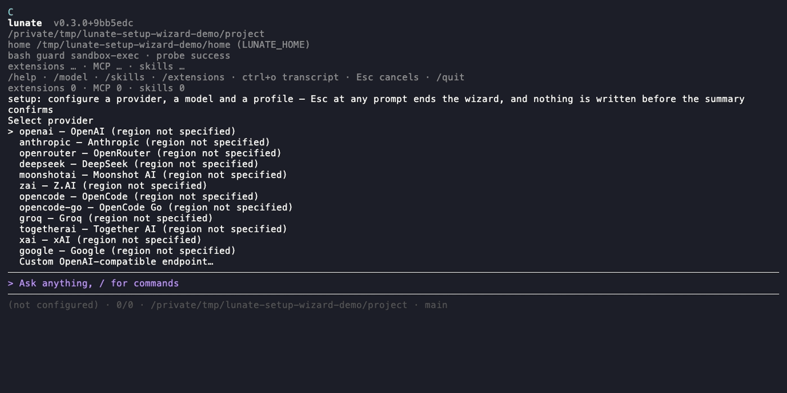

# Quickstart

This page answers how to go from a fresh install to your first task. The short answer: install one
binary, run `lunate` in a repository, confirm the setup wizard, and type a task.

## Install

The current stable release is on [GitHub Releases](../README.md#get-started). Install it with the
script for your platform:

<!-- run: no installs a release from the network -->
```bash
# macOS (arm64) and Linux (x64)
curl -fsSL https://raw.githubusercontent.com/lunate-agent/lunate/main/install.sh | sh
```

```powershell
# Windows (x64)
irm https://raw.githubusercontent.com/lunate-agent/lunate/main/install.ps1 -OutFile install.ps1
./install.ps1
```

Homebrew (`brew tap lunate-agent/tap`, `brew install lunate`), Scoop and the .NET tool package
(`dotnet tool install --global lunate`) install the same binary. The
[distribution runbook](dev/distribution.md) owns the release assets and channel operations.

## Start in a repository

Lunate's first run is the setup wizard. It has two depths on one walk: **Quick** (the default) asks
provider, credential, connection test, model, model check and chat profile; **Detailed** asks every
setting as well — a custom provider's fields, thinking level, fast/decision profiles and the
decisions layer. Nothing is written until the summary is confirmed. Re-run it at any time with
`/setup` in a session or `lunate setup` from a shell.



Start `lunate` in a repository with no usable configuration. When stdin and stdout are terminals,
the wizard opens instead of the prompt:

- **Mode** — the first step defaults to Quick; choose the mode row to switch to Detailed. Switching
  keeps every answer already collected. `/setup`'s scoped entries stay detailed.
- **Provider** — the twelve presets in [`providers.json`](../src/Lunate.Ai/providers.json) order,
  plus a custom OpenAI-compatible endpoint. Quick asks a custom provider's id and endpoint only;
  Detailed also asks its API family, credential placement, region and models URL.
- **Credential** — type a key (masked, stored only in `auth.json`), name an `env:`/`auth:`
  reference, or skip. A provider environment variable always wins over a stored key.
- **Connection test** — one discovery request to the provider's models URL; skippable.
- **Model** — search the discovered list or enter an id manually. The id is resolved against the
  catalogue in the provider entry's scope, so a custom endpoint's bare id — the wire form it
  serves — is staged as listed; only an id that several unrelated providers serve is asked about,
  by qualified id.
- **Model check** — one minimal completion that verifies the resolved family; it costs one short
  request, and `--no-model-check`, `--no-test` or the skip row avoids it.
- **Chat profile and thinking** — the name the session uses; Detailed also asks the reasoning level
  the model declares.
- **Fast and decision profiles** — Detailed only; both default to skip. Each offers a flat
  `provider/model` list across the provider configured in this run, every provider already
  configured on the machine, and any provider added inline with **Set up another provider inline…**
  (which runs the provider, credential, connection-test and model steps without leaving the usage
  step). The model check runs after the selection, states its cost first, and a skip stays marked
  unverified. A `systemone` model is labelled native Jev, any other adapter model is labelled
  adapter.
- **Decisions** — Detailed only; each switch is shown with the value it holds now and one explanatory
  line; the list stays open after each change and refreshes every row, and **Done — leave the
  decisions settings** leaves it.
- **Summary** — every collected value, the connection/model-check results, and the skipped steps. A
  Quick summary adds a **Left at default** block naming every setting Quick did not ask, the default
  it left, and the command that changes it later (`/setup` or `/settings`).

Quick never hides a default: a setting it skips appears in that block. `Esc` at any prompt ends the
run with nothing written. The full walk is the only path that writes several stores; the entry menu
below writes only the answers it collects.

## Give it a task

`/help` lists the built-in commands, `/model` switches the model, `Esc` interrupts the running turn
and `/quit` leaves. For a script or CI, `lunate -p "summarise what changed on this branch"` prints
one prompt's final answer and `--json` emits every event as one JSON line.

## Re-run the wizard from a session

On a configured install, `/setup` opens the entry menu instead of the full walk:

- add a provider,
- add a profile,
- change the chat profile,
- edit the decisions layer,
- walk everything.

Each entry is prefilled with the current values and writes only what changed, through the same
store writers as the full walk. `/setup` refuses while a turn is running. `/auth` remains the
shorter path for a missing credential.

## Scripted setup

`lunate setup` runs the same walk without a TTY. Every answer is a flag; an absent flag skips its
step and invents nothing. The connection test and the model check run unless suppressed: `--no-test`
sends no provider request at all (it skips both), while `--no-model-check` skips only the paid model
check and keeps the free discovery request. The summary goes to stdout and never contains a
credential.

<!-- run: no sends a provider request -->
```bash
printf '%s\n' "$OPENAI_API_KEY" |
  lunate setup \
    --provider openai --credential env:OPENAI_API_KEY \
    --model gpt-4.1 --profile chat-main --thinking medium
```

The flag set is `--provider`, `--endpoint`, `--api-family`, `--credential-placement`,
`--models-url`, `--credential` (an `env:`/`auth:` reference), `--key-stdin`, `--model`, `--profile`,
`--thinking`, `--fast`, `--as-decision`, `--no-test` (offline: skips the connection test and the
model check, so no provider request is sent), `--no-model-check` (skips the model check only), and
`--force`. A run without a terminal exits 2 and names the missing answer when a value needs
interaction; 0 after a real commit or a no-op; 1 for a store/load failure.

## If the first run refuses

[Troubleshooting](troubleshooting.md#the-first-run-refuses) names each message, its cause and the
fix, including the print-mode error that exits 1.

## Related

- [Models and providers](models-and-providers.md) — `lunate auth`, custom endpoints, profiles and
  the model catalog
- [Let a second model help decide](decisions.md) — the optional decisions layer
- [Use the terminal](usage.md) — the interactive session after the first run
- [Configuration reference](configuration.md) — every settings key and where files live
