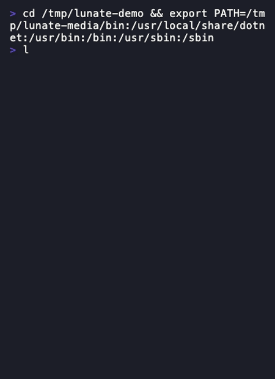

# Set up your terminal

This page answers which terminals and shells Lunate supports and how the layout adapts to them. The
short answer: Windows Terminal, conhost, VS Code, Git Bash, the common macOS and Linux terminals and
tmux/SSH are tier 1, and the `bash` tool resolves the platform's shell at startup.

## Supported terminals

Lunate runs wherever Pi runs: macOS, Linux and Windows, in the terminals people actually use.
Support is defined per environment, tested in CI where possible, and every capability has a
fallback.

| Environment | Tier | Notes |
| --- | --- | --- |
| Windows Terminal | 1 | Full colour, VT, bracketed paste |
| Classic console (conhost, Windows 10 1809+) | 1 | VT enabled at startup; verify paste and resize |
| VS Code integrated terminal (all OSes) | 1 | Common daily environment |
| Git Bash (mintty) | 1 | Works directly under the MSYS2 pseudo console (verified Git for Windows 2.52.0, ADR-0004); without it, a fail-soft diagnostic instead of a crash |
| macOS Terminal.app | 1 | No 24-bit colour, so 256 colours; Option is not Meta by default |
| iTerm2, Ghostty, WezTerm, Kitty, Alacritty | 1 | Full features |
| Linux terminals (GNOME Terminal, Konsole, others) | 1 | Full features |
| tmux, screen, SSH sessions | 1 | Colour from `TERM`/`COLORTERM`; check bracketed paste passthrough |
| JetBrains terminal | 2 | Usually fine; ACP is the better integration there |
| Pipes, CI, `TERM=dumb` | Print mode only | Interactive mode exits with a hint to use `-p` |

## Capability fallbacks

- Colour depth from Spectre's detection and `COLORTERM`; `NO_COLOR` disables colour everywhere.
- No Unicode support detected: ASCII spinner and box characters.
- Character widths (emoji, CJK) via a `wcwidth` table, so the input line never misplaces the cursor.
- Newline: `Alt+Enter`, `Shift+Enter` (where the terminal reports extended keys) and `Ctrl+J`, because
  `Alt` needs "Option as Meta" on macOS Terminal.

## Windows

Windows Terminal and conhost are tier 1. Lunate enables VT processing at startup; without it the
interactive surface reports the terminal it cannot drive instead of writing control sequences into a
console that will not interpret them. Git Bash works directly under the MSYS2 pseudo console
(verified Git for Windows 2.52.0, ADR-0004), with a fail-soft diagnostic when that console is absent.

## tmux and SSH

tmux, screen and SSH sessions are tier 1. Colour comes from `TERM`/`COLORTERM`; check that the
terminal passes bracketed paste through. Clipboard copy over ssh writes the OSC 52 sequence, and
under tmux the notice names `set-clipboard on` when that option is off; [Copy, export and
debug](export-copy-debug.md#copy-the-last-answer) owns the full rule.

## Shell resolution for the `bash` tool

| Platform | Order | Invocation |
| --- | --- | --- |
| macOS, Linux | `bash`, then `/bin/sh` | `bash -c` (no login shell: Lunate already inherits the user's environment, and login profiles are slow or print banners) |
| Windows | Git Bash, then `pwsh` 7, then Windows PowerShell 5.1, then `cmd` | Git Bash via its install path; PowerShell with `-NoProfile -NonInteractive` |

- Models write bash best, so bash wins whenever it exists.
- Never pick `C:\Windows\System32\bash.exe`: that is WSL, which runs the command inside Linux with
  different paths.
- The shell is detected at startup; there is no `shell` setting and no `/shell` command. The system
  prompt and the `bash` tool description name the shell, so the model writes the right dialect.
- Child processes run with UTF-8 output; the process tree is killed with
  `Process.Kill(entireProcessTree: true)` on timeout or cancel.
- Workspace boundary checks are case-insensitive on Windows and on default macOS file systems.

## Fit a narrow terminal

Below 60 columns the layout switches to its compact band: tool headers drop the argument summary
(`✓ read · 13 lines`), the footer shrinks to the model and the context percent, the input box keeps
both rules, and the autocomplete list keeps only the names. The full
layout returns from 100 columns; the guide's
[Narrow terminals](guide.md#terminal-ui-lunatetui) section has the per-band rules.

## Related

- [Use the terminal](usage.md) — turns, approvals and the input box
- [Copy, export and debug](export-copy-debug.md) — the clipboard over ssh and tmux
- [Execution environments](execution-environments.md) — running `bash` in a container instead
