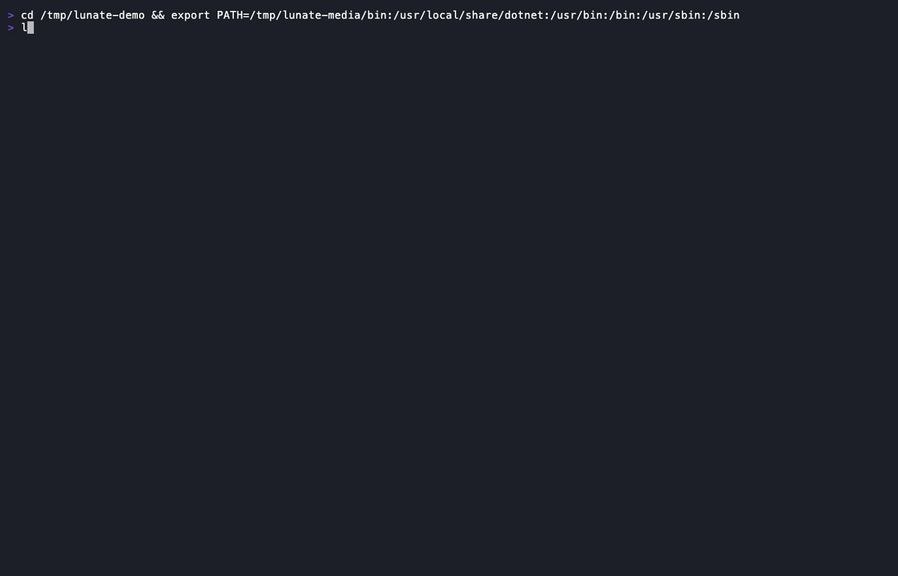
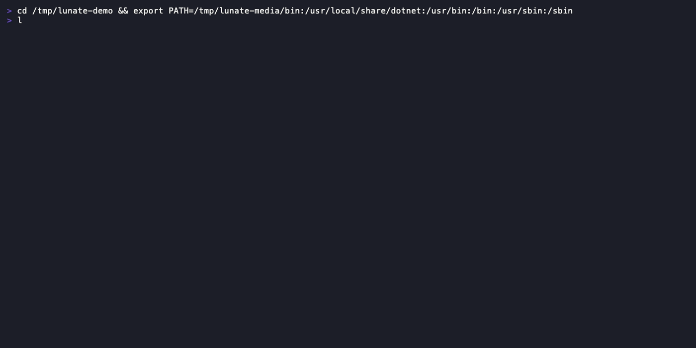
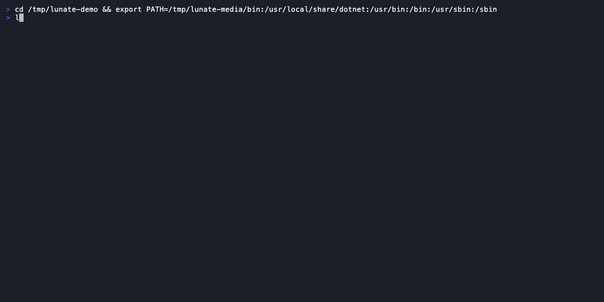
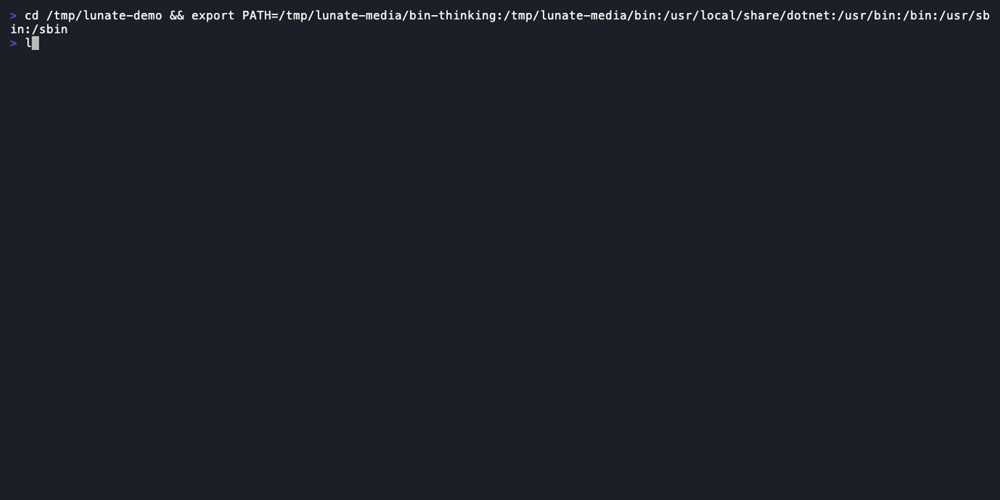

# Usage

This page answers what the interactive session does turn by turn: typing and completing a prompt,
what a turn commits to the scrollback, how tools and approvals appear, sessions and thinking. The
short answer: `lunate` in a repository — you type a task, writes and commands stop at an
approval, and each finished tool call commits one line to the scrollback. Choosing a model, setting
up the terminal, copying or exporting, the decision layer and configuration each have a page of
their own, linked under [Related](#related).

## Type, complete, send

The input is a box: a rule above it at every width, a second rule below from 60 columns, the `>`
marker and the `Ask anything, / for commands` placeholder in the theme's user colour while it is
empty, and a box that grows with the draft to eight lines before it scrolls. Typing `/` opens the
autocomplete list — the built-in commands, `/skill:<name>` and each loaded extension's commands,
with descriptions — and `@` lists matching workspace files from the lazy file index. Both lists
cap at eight rows above the input.

| Key | At the prompt |
| --- | --- |
| `/` | list commands, skills and extension commands |
| `@` | list workspace files |
| `↑` / `↓` | move the autocomplete selection; history when the list is closed |
| `Tab` / `Enter` | accept the selected item; Enter sends when the token is already exact |
| `Esc` | close the list first, otherwise cancel the running turn |
| `Alt+Enter` / `Ctrl+J` | insert a newline |

## Every turn opens with your message

The submitted prompt commits to the scrollback as the first block of its turn — the `>` prompt in
the theme's user colour, wrapped continuation lines indented two spaces, one blank line after — so the
question stays visible above the answer. While the turn runs, the activity line names the work
(`⠹ thinking… 3s`, `⠸ read src/Foo.cs · 4s`, `| working… 7s`), with the run's `↑in ↓out` deltas and
`esc to interrupt` on the wide bands; below 60 columns it keeps the spinner, the label and the
elapsed seconds.

## Edits you approve, with the diff

Writes and commands stop at a panel: a warning headline naming the tool and what it will do, a
bounded detail block with the command or the edit's diff, and
`Allow edit?  [y]es  [n]o  [a]lways this session`. Below 60 columns the detail shortens first and
every choice stays on screen. The result names the match tier it used (`exact`, `normalized` or
`indent`), and an ambiguous edit is refused instead of guessed.

## Tool calls commit as one line

A finished call collapses to one header line — `✓ read  src/Foo.cs (1-13)`,
`✗ bash  dotnet test · exit 1 · 12s`, `✓ edit  src/Foo.cs · +3 −0` (ASCII `+`/`x` without Unicode) —
with a per-tool excerpt and the diff for `edit`/`write` under it. What the excerpt elides is one
`ctrl+o` away: the full-screen transcript viewer shows every block with its complete output and
diff, scrolls with the arrows and PageUp/PageDown, and closes on `q` or `Esc`.

## C# the compiler agrees with

In a C# workspace the model can ask `cs_diagnostics` for compiler errors and warnings — a compile
check after an edit without a full `dotnet build` — and navigate by symbol with `cs_find_symbol`,
`cs_find_references` and `cs_outline`. Roslyn loads on the first C# tool call, and restore, SDK and
partial-load problems come back as messages the model can act on.

## Repository code asks once

A project extension, a project `mcp.json` server and a project skill are code from the repository,
so each asks once per repository — and again when its files change:
`Load project extension 'acme-tools' 0.3.0 from /repo/.lunate/extensions/acme-tools?  [y]es  [n]o`.
Answers are recorded in `~/.lunate/trust.json`; `lunate trust` inspects and records them for
scripted runs.

## You can see what is loaded

`/extensions` lists every discovered extension with its scope, state, load time and what it
registered; `/mcp` lists the MCP servers with their status and source. `lunate extensions --json`
prints the same data for scripts.

## You can watch it think

With a reasoning model, `/thinking low|medium|high` (or `thinking` in `settings.json`) turns
reasoning on: it streams live in the live area in its own colour and collapses to a single
`✦ thought for Ns` line when the model is done. `thinkingFull` commits the full text instead.

## Fork a session without losing the tail

`/fork` writes a new session file that continues the current one under a new id; `/clone` starts a
copy from an earlier turn. A fork carries the session's images and redacts what the source redacted,
so it resumes instead of failing on the first request.

## Long sessions keep their place

When a tool result would flood the window, the text is spilled to a file and the model sees a short
stub it can page back through; observation masking trims old turns without losing the transcript.
`/context` reports what each saved: `saved tokens: spills 0, masking 0, read stubs 0`.

## Run limits

A run can be capped by cost and wall-clock time as well as by its step limit. Both are off by
default, interactively and in print mode. Set them in `settings.json` with `maxCost` (US dollars)
and `maxTime` (seconds), or per invocation with `--max-cost <usd>` and `--max-time <duration>`
(integer seconds or a `s`, `m`, `h` suffix).

- The cost limit is cumulative for the session: a resumed session keeps the spend its recorded
  usages already reached, so restarting does not reset the budget.
- The wall-clock limit is per run and uses one monotonic timer.
- Either limit ends the run when the reached value equals the limit, with a notice that names the
  limit, its value and the spend or time reached. The limit is recorded in the session.
- A cost limit over a model the catalog cannot price refuses to start, because an unknown price is
  not `$0`; pass `--allow-unpriced` only when the limit may cover priced usage alone.

[Print mode](print.md#cap-the-runs-cost-and-time) owns the exit codes a limit produces and the
budget an unattended run should carry.

## Run commands in a container

`bash` normally runs on the host. `--env podman:<image>` or `--env docker:<image>`, or the
user-scoped `environment` setting with `--env` winning, runs the command half in one session
container while `read`/`write`/`edit` stay on the host. The workspace is mounted at the same
absolute path, so file tools, approvals and change tracking keep working; the state root, install
prefix and `auth.json` are not mounted. [Run tool calls in a container](execution-environments.md)
has the full flow, the measurements and the platform limits.

## Where the other two modes live

This page describes the interactive mode (`lunate`), the TUI session with approvals, the live area
and command history ([`openspec/specs/tui/spec.md`](../openspec/specs/tui/spec.md)).
[Print mode](print.md) owns one prompt to completion, the final answer as the only thing on stdout
and the exit codes scripts branch on; [the JSON event stream](json-events.md) owns the `--json`
lines; [ACP](acp.md) owns the editor integration. [Command and option reference](cli.md) lists the
flags the modes share.

## Related

- [Quickstart](quickstart.md) — install, the setup wizard and the first task
- [Run one prompt and exit](print.md) — print mode, its exit codes and its approvals
- [Read the `--json` event stream](json-events.md) — one line per event, for scripts
- [Run Lunate inside an editor over ACP](acp.md) — the editor-driven mode
- [Command and option reference](cli.md) — every command and flag
- [Models and providers](models-and-providers.md) — choosing a provider, credential, model and profile
- [Decisions](decisions.md) — the optional second model for approvals, routing and questions
- [Copy, export and debug](export-copy-debug.md) — taking an answer, the session or a bundle out
- [Set up your terminal](terminal-setup.md) — supported terminals, shells and the narrow layout
- [Configuration](configuration.md) — decision profiles, provider entries and the rest of the file
- [Settings reference](settings.md) — every settings key, generated from the schema
- [Keybindings reference](keybindings.md) — every prompt binding, generated from the catalog
- [AGENTS.md](agents-md.md) — project rules from the root down to the launch directory
- [Skills](skills.md) — `SKILL.md` bundles a project or the user ships
- [MCP servers](mcp-servers.md) — the servers a session starts from configuration
- [Themes and keys](themes-and-keys.md) — the colour depth and the key remaps `/settings` persists
- [Run tool calls in a container](execution-environments.md) — the container mode, its settings and
  what stays on the host
- [Export contract](dev/spec/export.md) — what `/copy` and `/export` guarantee
- [The Roslyn MCP server](mcp-roslyn.md) — the C# tools from another MCP host
- [Security and safety](security.md) — the trust model behind the prompt, and what each layer does
- [Security policy](../SECURITY.md) — how to report a vulnerability
- [Troubleshooting](troubleshooting.md) — what to do when a run or a command refuses
