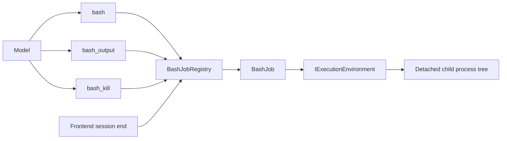

## Context

The foreground `bash` path runs `IExecutionEnvironment.RunAsync`, which owns the shell's detached
spawn, bounded stream capture, timeout, tree kill and exit-code result. Background work needs the
same isolation and timeout but must return before the command ends, expose the unread output while
it runs, and keep the process tree reachable for `bash_kill` and session teardown. The tool registry
is per harness and a session may compose child-workspace tools, so job ownership must be one
per-session object rather than a process-wide singleton. No new package or public contract is
needed; this is an internal extension of the existing bash family.

A lightweight component view (the model sees only tools; the registry owns runtime state):

## Goals / Non-Goals

**Goals:**

- Start a long command without blocking the turn, return a job id, and keep the model able to poll
  output and stop the tree.
- Reuse the foreground shell resolution, guard, environment, UTF-8 decoding, timeout and
  children-first tree kill.
- Bound memory for a job whose output is never read.
- Guarantee every job dies with its session.

**Non-Goals:**

- Persisting jobs across sessions, resuming a job after restart, or attaching to an existing pid.
- Streaming background output into the live area or the transcript without a tool call.
- A new timeout argument; a background job uses the session's existing bash timeout.
- Changing the session file format or the public API.

## Decisions

- **One registry per session, owned by the bash family.** `HarnessFactory` creates a
  `BashJobRegistry` and hands the same instance to `BashTool`, `BashOutputTool` and `BashKillTool`;
  the interactive, print and ACP frontends keep the registry they passed in and call
  `KillAllAsync` on their session-end path. A process-wide singleton was rejected because ACP can
  host more than one session in one process and one session must never kill another's jobs.
- **`bash` gets `background: true` rather than a fourth tool.** The existing command arguments,
  approval, guard, timeout and shell resolution stay in one place; only the wait changes. The
  background path allocates `job-<n>` (culture-invariant) from the registry and returns immediately.
- **A job owns the process and its two pumps.** The job starts the command through a new
  `IExecutionEnvironment.StartBackgroundAsync` hook, reads stdout/stderr concurrently with a decoder
  into two bounded captures, waits for exit, and records the exit code after both pumps reach EOF.
  The foreground `RunAsync` is left unchanged.
- **Bounded tail, not an unbounded transcript.** Each captured stream keeps at most the existing
  1,000,000-byte cap in chunks; appending past it drops the oldest chunks and sets a truncation
  flag, which the next `bash_output` reports once with an explicit marker. Draining a stream clears
  its buffer, so `bash_output` returns only unread output.
- **One state machine for running, exited, timed-out and killed.** The job timer calls the same
  `KillAsync` path `bash_kill` uses; a wait that has already reaped the process makes the timer a
  no-op. `bash_output` reports `running`, `exit code: N`, the foreground timeout wording, or
  `killed; process tree stopped`.
- **The environment seam keeps the container step.** `StartBackgroundAsync` returns the started
  process plus an optional after-kill hook. Local execution starts a normal `ChildProcess`; container
  execution starts the host engine client and records the container process group, so the job kill
  runs the same container-side group kill as a foreground cancel.
- **Session-end cleanup is explicit and awaited.** `KillAllAsync` snapshots the registry, closes it
  to new jobs, kills each job, and waits for its process tree; frontends call it before disposing
  the execution environment or extensions, so a container kill still has its engine.

## Risks / Trade-offs

- **Unread output loses its oldest bytes** -> the next poll carries a clear truncation marker; the
  newest bytes, which usually explain the current state, are kept.
- **A killed job's exit code is not meaningful** -> the result says it was killed rather than
  inventing a signal code; a naturally ended job always reports its exit code.
- **A long-running job can outlive the turn that started it** -> the session-end kill is the
  backstop, and the existing timeout remains the first bound.
- **Child-workspace tools may share the session registry** -> job ids are session-unique and the
  session still owns every tree, which is the desired lifecycle.
- **File changes made after a background start are not published by the start call** -> the start
  call's existing scan baselines the workspace; a later foreground bash call still scans. Extending
  the file-change bus to asynchronous job completions is a follow-up, not part of this card.

## Migration Plan

No migration. The foreground path, session format and public API are unchanged; existing scripts
that never send `background: true` see the same `bash` result.

## Open Questions

None. No external contract, loop behaviour or dependency boundary changes, so no new ADR is needed.
