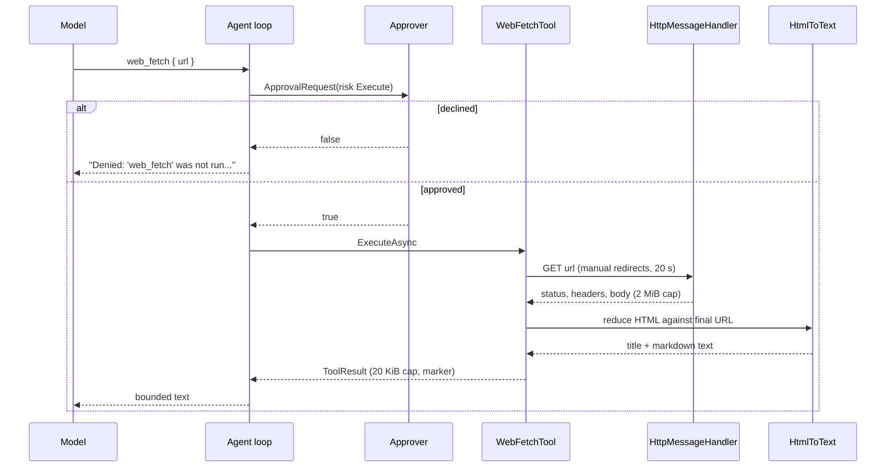

## Context

The core tools are built in `HarnessFactory.CreateTools` and live in `Lunate.Coding`: `read`,
`write`, `edit`, `bash` always, and `grep`, `find`, `ls` when `tools.extra` asks for them. Every
tool implements the `Lunate.Agent` contract (`ITool`, a hand-written JSON schema, `ToolRisk`,
`ToolResult`), and the loop consults the approver before `ExecuteAsync`. `ToolRisk.Execute` is the
`bash` tier: an interactive session asks, ACP asks its client, and print mode declines unless the
run is explicitly `--yolo`.

There is no web access in a plain install. The fallback is `bash` plus `curl`, which the approval
panel sees as a command but the model formats, trusts and reads as free text.

## Goals / Non-Goals

**Goals:**

- `web_search` and `web_fetch` are core tools in the same registry as `read`, `write`, `edit` and
  `bash`, selectable by `--tools` and subject to the same approval path as `bash`.
- Search output is ranked `title`, `url`, `snippet`, capped in count and total bytes.
- Fetch output is readable text with the page title, links preserved as markdown, capped in bytes.
- Every failure names the URL and the reason: non-2xx, redirect loop, timeout, transport, scheme.
- The whole path is testable offline through a stub `HttpMessageHandler`; production uses the
  platform handler.

**Non-Goals:**

- No search API key, no account, no new NuGet package and no MCP server.
- No new settings key. The caps are product constants, not user tuning.
- No caching, retry, cookie jar, robots.txt policy, JavaScript execution or PDF extraction.
- No change to the loop, the approval matrix, the session format or a published contract assembly.

## Decisions

### 1. DuckDuckGo's HTML endpoint is the search backend

The tool sends `GET https://html.duckduckgo.com/html/?q=<query>` and reads the ranked
`result__a` / `result__snippet` anchors. It needs no credential, so a plain install works; the
endpoint is one internal constant named in the tool's description, and tests replace the handler.

Alternatives rejected: a search API (Brave, Bing, Google) needs a key and a settings surface the
card does not ask for; requiring an MCP server is the problem the card exists to remove; scraping a
JavaScript-rendered engine would need a browser.

The parser is deliberately tolerant: it accepts the anchors in either attribute order, decodes HTML
entities, unwraps DuckDuckGo's `uddg` redirect parameter into the real absolute URL, and returns a
readable "no results" result when the shape changes rather than throwing.

### 2. The HTML-to-text step is an in-repo, bounded converter

The card forbids a new NuGet package without asking, so `HtmlToText` scans tags with a small
quote-aware tokenizer instead of adding AngleSharp or HtmlAgilityPack. It skips comments, `script`,
`style`, `noscript`, `svg` and `template` bodies, turns block tags into line breaks, keeps headings
as lines, renders list items with `- `, decodes entities, collapses whitespace, captures `<title>`,
and renders anchors as `[text](absolute-url)`, resolving relative targets against the final response
URL. The converter never throws on malformed markup: an unclosed tag or a truncated document yields
the text read so far.

Alternatives rejected: a regex tag strip loses links and block structure; a full HTML parser is a
new dependency the card makes a maintainer question, and the acceptance only needs readable text
plus markdown links.

### 3. `Execute` risk, manual redirects, one request per call

Both tools declare `ToolRisk.Execute`, exactly like `bash`. That gives the interactive panel one ask
per call, ACP its permission request, and the unattended outcome the card names (declined unless the
run allows everything). The risk tier is the only approval integration point; no new policy value
is added.

`WebFetchTool` follows redirects itself (`AllowAutoRedirect = false`) instead of delegating to the
handler. This makes a redirect loop observable to the tool and testable with a stub handler: it
keeps a set of visited absolute URLs, stops after 10 hops, and returns the loop message the spec
names. A handler that silently followed redirects would hide both facts. The 20 s timeout is a
linked `CancellationTokenSource` spanning all hops, so a slow chain cannot multiply the budget.

### 4. Fixed caps, culture-invariant markers

Search: 5 results by default, at most 10, 8 KiB of rendered output. Fetch: 2 MiB of response body
read, 20 KiB of rendered text, 20 s, 10 redirects. Every cap cut is UTF-8-aware and appends a marker
whose number is formatted with `CultureInfo.InvariantCulture`. These are constants because the
settings schema and its generated docs are a separate surface; a user who needs a different budget
is a follow-up change.

### 5. The transport seam is the constructor, not a service

Both tools take an optional `HttpMessageHandler` in an internal constructor; the public constructor
passes null and the tool creates a platform `HttpClient` per execution with
`User-Agent: lunate/<version>`. Tests pass a stub handler that returns recorded responses, throws,
or never completes. No network call is possible in the test project.

## Diagram

Dynamic view of one fetch:

Boundaries: the loop owns approval and refusal text; the tool owns URL validation, redirects,
timeouts, byte caps and error wording; `HtmlToText` owns markup reduction only; the handler owns
transport. The approval decision happens before any HTTP request, so a declined call never reaches
the network. Assumptions: the search endpoint keeps its HTML shape; a shape change degrades to "no
results", not an exception.

## Risks / Trade-offs

- **DuckDuckGo changes its HTML or blocks the endpoint** -> the tool returns a readable failure or
  "no results" naming the endpoint; the parser is isolated and replaceable, and no API key is at
  risk. A future backend is a follow-up change.
- **A hand-written converter is less complete than a parser library** -> acceptance needs readable
  text, headings, lists and markdown links; malformed input degrades instead of throwing, and the
  converter is covered by fixture tests.
- **`Execute` makes the tools unusable in unattended runs by default** -> this is the card's stated
  behaviour, matching `bash`; `--yolo` is the explicit escape.
- **Fetching arbitrary URLs exposes the machine's IP and requested URL to the site** -> it is an
  approved call with the URL in the approval request, and the tool never attaches credentials.
- **The 2 MiB source cap can truncate a huge page** -> the text cap is far smaller, and the result
  still carries the readable start; the marker makes the cut visible.

## Migration Plan

New tools are additive. A user who does not call them sees no change; a run's tool filter can drop
them. Rollback is a revert of the branch; no stored data, session entry shape or settings file
changes.

## Open Questions

_None._ The backend and the no-new-package HTML approach are recorded above as the two decisions
this change needs; both stay inside the card's scope.
