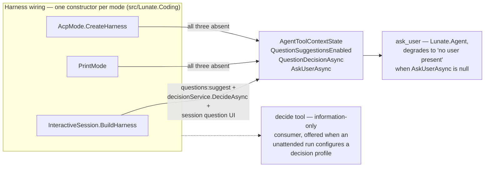

## Context

#439 reviewed the decision layer's wiring and found, recorded as #446: the question-suggestions
consumer has no non-interactive surface. That is confirmed at `origin/main` (`33d3fba3`):

- `AgentHarnessOptions.QuestionSuggestionsEnabled` and `QuestionDecisionAsync` are set in exactly
  one place — `InteractiveSession.BuildHarness` — which wires them only when
  `decisions.questions: suggest` and the `decisions.profile` resolve to a decision service, and
  which also supplies `AskUserAsync`. `AgentHarnessOptions` defaults them off/null
  (`AgentToolContextState` likewise).
- `PrintMode` (harness options at `Lunate.Coding/PrintMode.cs`) sets neither the suggestion pair nor
  `AskUserAsync`.
- `AcpMode.CreateHarness` (`Lunate.Coding/AcpMode.cs`) sets neither either.
- `AskUserTool.ExecuteAsync` returns `unanswered: no user present` before any suggestion consumer
  could attach when `AskUserAsync` is missing, so in print mode and ACP nothing ever displays a
  question — and nothing has a suggestion to show beside it.
- Both degrades are already pinned: `PrintQuestionFallbackTests` (print, reading count 0, exact
  degrade text) and `AcpQuestionTests` (ACP, no permission request, exact degrade text).

The decision-layer spec's fail-closed rule for non-interactive modes names the approval gate only
(question suggestions are outside the approval seam per that same spec), so the deliberate scope of
this consumer exists nowhere in `openspec/specs/` today.

Assumption recorded for the diagram: no user was available to pick format and rigor, so this uses
the repository's convention — a lightweight C4-inspired plain-Mermaid `flowchart`, component level,
the only level that answers the question.

## Goals / Non-Goals

**Goals:**

- Make the reviewed decision the spec's current truth: suggestion scope is deliberate, not an
  unfinished consumer.
- Name the route unattended runs already have to a judgement — the `decide` tool — so the missing
  surface is not mistaken for a missing capability.
- Keep every existing SHALL intact, including the approval seam's rules.
- Pin the scope with tests so a future wiring change is a considered change, not an accident.

**Non-Goals:**

- No ACP protocol surface, no print-mode output change, no consumer wiring change in this change.
- No change to the fail-closed approval-gate rule or to the `ask_user` degrade message.
- No change to the interactive consumer (`#344` behavior, its fallback events and TUI rendering).

## Options considered

Walked as the decision tree; user absent, so each open branch was resolved from repository evidence
or left to the sign-off queue instead of guessed.

- **A — Codify the deliberate scope (chosen).** Spec text + pinning tests. Costs nothing at
  runtime, matches what review already concluded (#439), and closes #446's reader-facing gap.
- **B — Annotate the print-mode no-user degrade with the suggested answer and provenance.**
  Rejected here: it changes a model-facing message pinned word-for-word by tests, and it re-reads
  the agent-config SHALL that question suggestions be "display-only when enabled" — showing a
  decision answer to a model rather than a person is an interpretation of that wording nobody has
  accepted. If wanted, it is a small, separable behaviour change after sign-off (see queue).
- **C — Open an ACP surface: `ask_user` rendered in the editor, suggestions beside it.** Rejected
  here: it is a new request type between adapter and editor — a protocol contract change and a
  feature (ACP has no question display of any kind today), far past this card's scope. Deferred
  with the question raised (see queue).

## Decisions

- **D1 — Suggestions attach only where a person answers.** The interactive session is the only
  recommended-and-rendered path; print mode, queue runs and ACP propose no question decision for
  `ask_user`, keep the no-user degrade, and receive judgements through `decide`. Recorded as the
  ADDED requirement in the delta spec.
- **D2 — The degrade message is unchanged.** "State an assumption and continue." is exactly what an
  unattended run needs; B would only decorate it and is deferred to sign-off.
- **D3 — No ACP design is invented here.** The two questions the ACP surface depends on go to the
  sign-off queue listed below; nothing else waits on them.
- **D4 — The pin lives next to the degrades.** Extend `PrintQuestionFallbackTests` and
  `AcpQuestionTests` with a `decisions.questions: suggest` + decision-profile configuration
  asserting no question decision exchange/event and the unchanged degrade. No new test files, no
  product code.

## Sign-off queue (open questions, nothing else waits on them)

1. **Print-mode annotation (option B):** should the `ask_user` no-user degrade in unattended runs
   carry the decision model's suggested answer, probability and model id when
   `decisions.questions: suggest` is enabled? A yes means a spec amendment (the "display-only"
   wording must be extended to cover the model-visible degrade) and wording changes in two pinned
   tests; a no closes the idea for 0.3.
2. **ACP question surface (option C):** should ACP render `ask_user` at all? A yes is a feature
   (new request type adapter→editor, client-visible UI, then suggestion display as a follow-on);
   it needs its own design and `kind/feature` issue in 0.4 rather than a silent gap. Recording
   either answer in the decision-layer spec makes #446's successor scope explicit.

## Risks / consequences

- If the maintainer answers 1 or 2 with "yes, design it", the follow-up change supersedes D1's
  wording (the spec text is additive and narrow, so re-wording costs little).
- The spec text is the source of truth; the pinning tests are the guard. A later PR that wires
  suggestions into print or ACP must fail these tests first and change the spec with it.
- No code paths change, so no performance or session-format risk.
