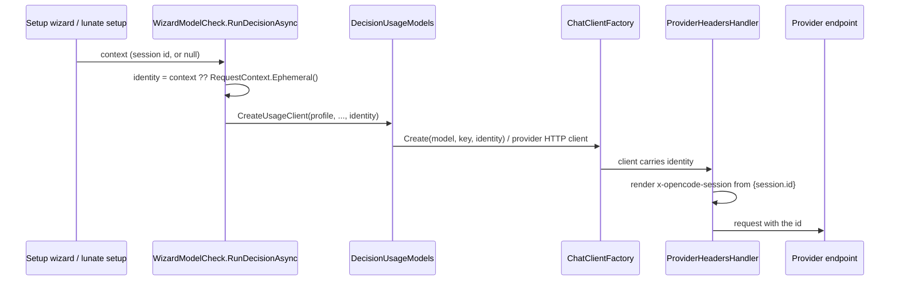

## Context

`WizardModelCheck` runs two setup checks through one shared client path. The model check
(`RunAsync`) already accepts a `RequestContext?`, falls back to `RequestContext.Ephemeral()`,
and passes the result into `DecisionUsageModels.CreateUsageClient`. The decision check
(`RunDecisionAsync`) calls the same client factory with `context: null`, so a provider that
templates `{session.id}` in a header cannot render it and the check fails before the request
leaves the process. This is the released `opencode-go` failure: its preset declares
`x-opencode-session: {session.id}` on every family, including System One.

The in-force architecture keeps request identity in `RequestContext` and resolves header
templates at request time; provider payloads are not patched at call sites. The two setup
entry points already differ only in the identity they own: an interactive session has
`SessionRequestContext()` (a stored session id, or one cached ephemeral id for a fileless
session), while the flag path has no session and should mint a probe identity.

## Goals / Non-Goals

**Goals:**

- Give the decision check the same request identity mechanism as the model check.
- Make the failing `opencode-go` + `jev-1.13` decision check pass through the real provider
  path, with a non-empty session header on the wire.
- Make `/setup` inside a session send that session's id, proven on the wire.
- Leave providers without a `{session.id}` header byte-for-byte unaffected.

**Non-Goals:**

- No change to `ProviderHeadersHandler`, the header template grammar, or the AI-layer rule
  that a template missing its value fails loudly.
- No new provider profile or decision transport.
- No change to `setup --no-test` / `--no-model-check` behaviour.

## Decisions

### One identity mechanism, shared by both checks

`RunDecisionAsync` gains a `RequestContext? context` parameter and resolves
`RequestContext identity = context ?? RequestContext.Ephemeral()` before building its client,
exactly as `RunAsync` does. The identity is passed to
`DecisionUsageModels.CreateUsageClient` for both the native System One transport and the
adapter chat client. Alternatives considered:

- **Patch `x-opencode-session` at the decision-check call site.** Rejected: it would duplicate
  provider-header knowledge outside the provider profile and bypass the shared handler.
- **Always mint an ephemeral id in `RunDecisionAsync`.** Rejected: `/setup` would then send a
  probe id instead of the session it is configuring, breaking the requirement that a session's
  own requests name that session.
- **Reuse a process-wide id for all checks.** Rejected: the existing `Ephemeral()` contract is
  a fresh probe id per call, and neither check resumes a stored session.

### Callers own the identity they already have

The interactive wizard's decision check passes `SessionRequestContext()`, the same value its
model check and session requests pass. The flag path passes `context: null` and therefore gets
a fresh probe id. This is a one-parameter change at each call site; the production path from
staged profile to provider entry to family to client stays untouched.

## Risks / Trade-offs

- **A check sends an ephemeral id that names no stored session** -> This is the documented
  `RequestContext.Ephemeral()` contract for probes; the id is never resumed and only fills a
  header the provider requires.
- **A session without an id accidentally sends a probe id** -> Already true for the model
  check and `/auth`; `SessionRequestContext()` caches one ephemeral id for such a session so
  the value is stable across its requests.
- **Adapter decision profiles could drift from the native path** -> The identity is passed once
  in `CreateUsageClient`, which both paths receive; the tests cover the native `opencode-go`
  path and the existing adapter test keeps its no-header provider behaviour.

## Migration Plan

No data migration. The fix ships in the v0.3.0 release; existing setups need no rewrite. A
user who hit the failure re-runs the decision check in the same setup session.

## Open Questions

None. The problem and the intended identity mechanism are already documented in
`RequestContext.Ephemeral()` and the model-check precedent; no in-force ADR needs revisiting.
