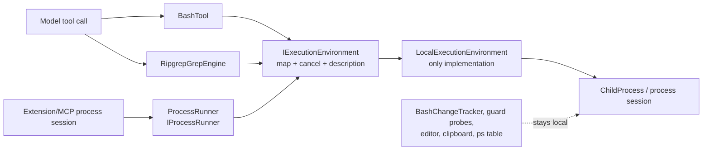

# Design — execution-environment seam

## Context

`BashTool` and `RipgrepGrepEngine` each held a static `ProcessRunner`; `ProcessRunner` also sits
behind `IProcessRunner` for extension/MCP sessions. That makes `ProcessRunner` the de-facto spawn
site, but it also contains local mechanics (process-tree kill, POSIX `ps` walk) that a future
container environment must replace. S-7 measured that the local tree kill does not stop a container
exec client's process group, so cancellation has to be part of the seam rather than a private detail
of the host runner.

The scope is frozen: local execution only, no flag, no setting, no public API, no filesystem
abstraction. `read`, `write`, `edit`, `ls`, `glob` and the file reads behind `grep` stay on host
filesystem access; they spawn nothing. Host support subprocesses (editor, clipboard, guard probes,
the `ps` table, the post-bash change scan) stay local.

## Goals / Non-Goals

**Goals**

- One internal place that maps a tool command and owns how it is run and cancelled.
- The same seam under Bash, ripgrep and the extension/MCP `IProcessRunner` path.
- A one-line environment self-description for #627's header and `/context` work.
- An inventory test that forces every process start to be classified.

**Non-Goals**

- A container, docker/podman selection, a CLI flag or a settings key (#627).
- Moving file tools or the change scan into an environment.
- Changing tool results, approvals, environment building, output caps, timeouts or session format.
- A new package or an ADR.

## C4 component view

Boundaries: the seam is internal to `Lunate.Coding`; the public `IProcessRunner` contract is
unchanged. `ProcessRunner` is the facade the extension path already holds. Host support is a separate
local lane, not a second tool-command implementation.

## Decisions

### 1. The seam owns execution, not only mapping

`IExecutionEnvironment` exposes `Description`, `Map`, `RunAsync`, `StartSessionAsync` and a
`CancelAsync(IExecutionProcess)` hook. A map-only interface would leave the local tree kill hard-coded
in `ProcessRunner` and make #627 reimplement the runner instead of the environment. Owning execution
keeps the mapping four fields and lets a container implementation replace spawn and cancellation
together.

### 2. `ProcessRunner` becomes the facade over the environment

`ProcessRunner` keeps the `IProcessRunner` contract but delegates `RunAsync` and
`StartSessionAsync` to its environment. That is the shortest path that puts the same seam under the
extension/MCP session path: the extension loader keeps resolving `core/process` exactly as today,
and no public type or registration changes.

### 3. Local keeps today's process-tree semantics; the hook is the extension point

`LocalExecutionEnvironment` maps commands unchanged, uses the existing `ChildProcess` batch spawn
and the existing interactive session, and its `CancelAsync` calls the process's existing tree kill.
A future environment can return a handle whose cancellation kills the container's process group
instead. The hook is explicit so #627 does not have to change `ProcessRunner` again.

### 4. Host support is named local, never injected

`BashChangeTracker` and `ClipboardImage` use `ProcessRunner.Local`, which is constructed with the
local environment explicitly. `GuardProbe`, `DraftEditor`, `ClipboardWriter` and the `ps` table read
keep their direct process starts. A future selected environment can therefore be injected into the
tool path without silently moving the host scan or clipboard into a container.

### 5. The inventory is a test, not prose

The inventory test scans `src/` for direct process starts and child spawns and pins the classified
file set. A new spawn site fails the test until it is either moved behind the seam or added to the
host-support list with a reason.

## Risks / Trade-offs

- **More moving parts for no visible change** -> keep the implementation one local class, preserve
  the existing suites, and add only seam/inventory tests.
- **The inventory test is a source scan and can be brittle** -> pin narrow regexes and short
  expected file lists; a legitimate new site is a one-line classification update.
- **A future environment could still be bypassed by a new tool** -> the inventory test fails on a
  new direct process start, which is the enforcement this card can provide without public API.

## Migration Plan

No user migration. One PR: proposal artifacts, seam refactor, tests, docs sync if a document names
the old structure, then the archive commit. Rollback is reverting the PR; there is no stored state or
session-format change.

## Open Questions

None for this card. Container selection, cancellation-by-process-group and the header/`/context`
line belong to #627, behind the same seam.
