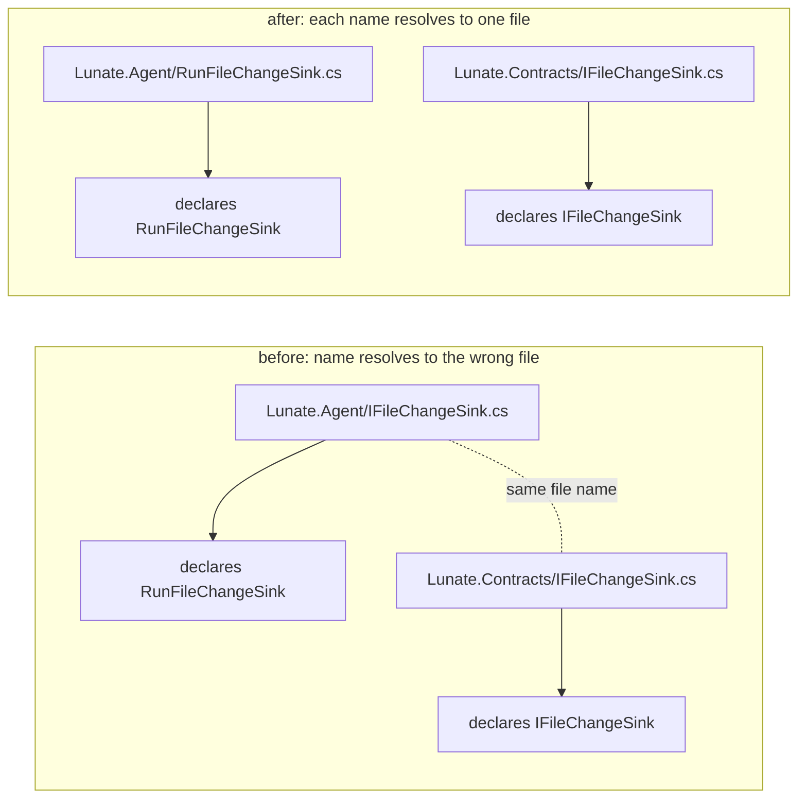

# Design: source file names that match the type they hold

## Context

`src/` holds about 600 C# files across 15 projects, all with file-scoped namespaces, so every
top-level type is declared at column 0. Two conventions already use the name as a signal:

- **partial classes split by concern**: `AgentHarness.Retries.cs` declares `partial class AgentHarness`,
  `InteractiveSession.AuthPicker.cs` declares `partial class InteractiveSession`;
- **aggregate files**: `HookPayloads.cs`, `SubagentLimits.cs` and friends group a family of small
  types that belong together and are too small for a file each.

The review's finding N-3 is the case both conventions exclude: a file whose leading name segment is a
type that lives in a *different* file. Four files do this today:

- `src/Lunate.Agent/IFileChangeSink.cs` holds `RunFileChangeSink`; `IFileChangeSink` is a
  `Lunate.Contracts` type (the Agent project forwards it).
- `src/Lunate.Extensibility.Remote/RemoteExtensionStatus.cs` holds `RemoteExtensionException`;
  `RemoteExtensionStatus` is an `Extensibility.Abstractions` type.
- `src/Lunate.Extensibility.Abstractions/Commands.cs` holds `CommandKind`, `CommandDescriptor`,
  `CommandInvocation`, `CommandResult`, `ICommandSource`; `Commands` is `Lunate.Coding`'s type.
- `src/Lunate.Coding/ChildProcess.Unix.cs` and `ChildProcess.Windows.cs` hold `UnixChildProcess` and
  `WindowsChildProcess`; `ChildProcess` is `Lunate.Coding/ChildProcess.cs`.

Nothing else in the tree violates the rule; the two remaining cross-project name pairs
(`DecisionRequestValidator.cs`, `InputTrace.cs`) declare the same-named type in each project by
design — `Lunate.Tui` may not reference `Lunate.Coding`, and both copies carry a doc comment saying
so — so they are not misnamed and stay.

Constraints: no type is renamed (a rename of an `internal` type would touch call sites in unrelated
areas), no public API change, no new package, no Roslyn reference in the test project.

## Goals / Non-Goals

**Goals**

- Every file under `src/` is named after a type it declares, or after no type at all.
- A focused test fails on the next misnamed file, naming the file and the file that owns the type.
- The test behaves identically on POSIX and Windows.

**Non-Goals**

- No rule about *which* type a multi-type file is named after (aggregate files keep their own names).
- No rule that forbids two projects holding a same-named *type*; that is a separate design question
  for `DecisionRequestValidator` and `InputTrace`, both deliberate.
- No Roslyn analyzer: the repository has a Roslyn backend that loads on first use, and a naming lint
  must not pull it into a unit test.

## Decisions

### The rule: the leading base-name segment must be declared in the file

A file passes when the text before the first `.` of its base name is a top-level type it declares, or
when that text is not a type name anywhere under `src/`. The first `.` segment is what makes the
partial-class convention work without a special case: `SessionFormat.Serialize.ModelUsage.cs` is
judged by `SessionFormat`, which the file declares.

Rejected: **a rule that every file must declare a type matching its whole base name.** It would fail
every partial-class file and every platform variant, and the fix would be to collapse split files —
a much larger change than the finding.

Rejected: **an allow-list of the offending files.** A list that must be edited to add a file hides the
very thing the rule exists to catch, and it rots: the next rename leaves a stale entry nobody notices.

Rejected: **"a file must declare a type named after it" with an allow-list for aggregate files.** The
aggregate set is ~40 files and grows; the "claims no type" test needs no list at all and is the same
strength for the defect the review found.

### Declarations are read with a regex over the source text, not with Roslyn

Top-level declarations are at column 0 in every file in `src/` (file-scoped namespaces, no nested
indentation at the top level), so one anchored regular expression per line finds them. This keeps the
test dependency-free and fast, and matches how `InternalsVisibleToInventoryTests` (the sibling finding
N-2) and `LayeringTests` already inspect the tree.

Trade-off: the regex can miss a declaration written in an unusual shape. It fails *open* (a file it
cannot parse looks like an aggregate file and passes), so a false pass is possible but a false failure
is not — the right bias for a naming lint.

### The test lives in `tests/Lunate.Agent.Tests` and scans all of `src/`

The finding's file is in `Lunate.Agent`, and its sibling finding's test
(`InternalsVisibleToInventoryTests`) already lives there and scans the whole `src/` tree for the same
kind of repository-hygiene invariant. Following it keeps repository-hygiene scans in one place.

The test builds paths with `Path.Combine` and compares file names as strings, never splitting on `/`,
so a Windows run and a POSIX run reach the same verdict from the same host path.

### Paths in the failure message are repository-relative

`Path.GetRelativePath(sourceRoot, path)` plus `/` normalisation for the message only, so the same
violation reads the same on both platforms and a reviewer can paste it into a search.

## Risks / Trade-offs

- **A rename breaks a stale link in documentation or a script** → nothing references these four paths:
  `grep` over `docs/`, `adr/`, `scripts/`, `openspec/` and `.github/` finds no hit; the check is in
  the tasks list.
- **The regex misses a type and a real violation slips through** → the rule fails open by design; the
  four known violations are fixed explicitly, so the test's job is to stop a *new* misnamed file,
  which the common shapes (`class`, `record`, `interface`, `enum`, `record struct`) all match.
- **A future platform split invents `Foo.Linux.cs` for a type named `LinuxFoo`** → the test fails and
  names both files, which is exactly the outcome wanted.

## Migration Plan

None: a source-only rename in one PR, no data, no settings, no public surface. Rollback is
`git revert`.

## Open Questions

None for this change. The deliberate same-named types (`DecisionRequestValidator`, `InputTrace`) are
recorded in the PR as observations, not as work here.
