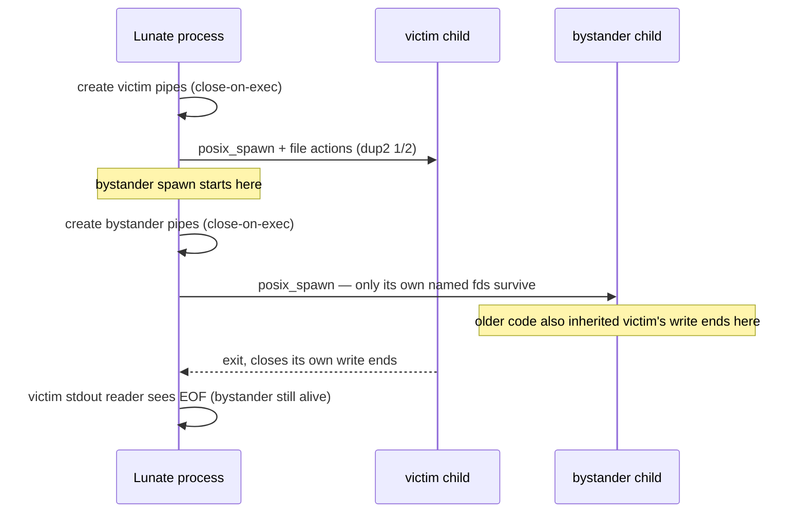

## Context

`UnixChildProcess.Spawn` is the only POSIX spawn path: it creates three anonymous pipes, builds the
`posix_spawn` file actions that place the child ends on 0/1/2, spawns, and only then closes the
parent's copies of the child ends. The pipes ask for `HandleInheritability.Inheritable`, which clears
`FD_CLOEXEC` on the child end. `posix_spawn` copies every non-close-on-exec descriptor into the new
child, so two spawns that overlap between "pipes created" and "`posix_spawn` returned" hand each
other their write ends. The first child exits; the second still holds its stdout/stderr write end;
the reader never reaches EOF and `ProcessRunner` waits forever (`#699`, the product side of `#660`).

The spawn path itself is a two-container dynamic flow — Lunate's process and the child — so the
diagram below is a lightweight dynamic view rather than a new component boundary.

## Goals / Non-Goals

**Goals:**

- A child can inherit only the descriptors its own spawn hands it.
- A completed child's captured stdout/stderr reaches EOF while an unrelated concurrent child is
  alive.
- Keep the existing spawn contract: `POSIX_SPAWN_SETSID`, captured pipes, `/dev/null` or line-pump
  stdin, `addchdir`, explicit `argv`/`envp` pointers, real `posix_spawn` failures.
- Pin the invariant with tests that are red on the current code.

**Non-Goals:**

- No global spawn lock: serialising spawns would trade the hang for a throughput problem and hide the
  defect.
- No timeout change anywhere, and no change to the 60-second test budgets.
- No `ProcessRunner` reordering (it keeps awaiting the readers after `WaitForExitAsync`).
- No Windows change: job objects and redirected handles do not share descriptors this way.

## Decisions

### Close-on-exec pipe ends, plus Darwin's spawn default

Create all three pipes with `HandleInheritability.None`. On Unix that leaves the descriptor's
`FD_CLOEXEC` set from creation (the same effect as `pipe2(..., O_CLOEXEC)` on Linux); asking for
`Inheritable` is what cleared it before. The child still receives its ends because `posix_spawn` file
actions (`adddup2`) run before `exec`, and `dup2` clears `FD_CLOEXEC` on the target 0/1/2. No
inheritable handle is left behind at any point, so there is no window to close.

On Darwin, also add `POSIX_SPAWN_CLOEXEC_DEFAULT` (0x4000, `<sys/spawn.h>`) to the spawn flags. That
makes the child inherit only descriptors named by its own file actions, which is a stronger
guarantee than close-on-exec alone and matches the platform's documented route. Linux has no
equivalent flag, so its guarantee is the close-on-exec handles; glibc and musl both honour
`FD_CLOEXEC` at `exec`.

### Keep the file-action set, and keep the invariant in the code

The existing `adddup2`/`addclose` actions stay as they are. The invariant is stated beside the pipe
creation: **no descriptor another spawn created may be visible to this child.** That sentence is the
thing a future edit must not break.

### Dynamic view: whose write end is open when

## Risks / Trade-offs

- **Darwin flag availability** -> `POSIX_SPAWN_CLOEXEC_DEFAULT` is available on every supported macOS
  (since 10.7); the numeric value is pinned beside `POSIX_SPAWN_SETSID` with the same measured-value
  comment. The close-on-exec pipe ends alone already fix the leak, so the flag is defence in depth.
- **A close-on-exec source descriptor might not reach the file actions** -> false: `posix_spawn` file
  actions run after fork and before `exec`, and `dup2` does not care about `FD_CLOEXEC`; the existing
  spawn/redirect/stdin tests plus the new descriptor-list test measure this rather than assume it.
- **Descriptor test is platform-shaped** -> the test reads the child's own `/dev/fd` (macOS) or
  `/proc/self/fd` (Linux) and ignores the descriptor used for the listing itself; it asserts no
  other descriptor exists.

## Migration Plan

None: internal to `Lunate.Coding`, no public API, no session format, no dependency. Rollback is
reverting the branch.

## Open Questions

None. `ProcessRunner` keeps its post-exit reader wait; the fix is the pipe lifetime, not the wait.
