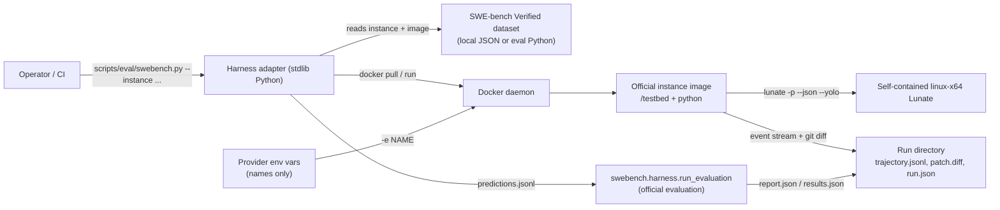

# Design: SWE-bench harness adapter

## Context

Lunate already has a non-interactive contract: `lunate -p --json --yolo` streams every event as one JSON line, exits with a semantic code, and edits the current working directory. The evaluation suite under `eval/` drives that contract for six fixture tasks but has no Docker, no dataset instance and no official scorer. The SWE-bench harness expects a git workspace at `/testbed` in a per-instance image, a text patch per prediction, and `swebench.harness.run_evaluation` for scoring. This change joins those two contracts without adding a second agent loop or a second score.

Constraints carried in from the repository: stdlib-only tooling is preferred, no new package enters the solution, no `src/` or public API change is needed, tests must not use live APIs or Docker, and credentials must come from the environment only.

## Container view



Assumptions: the adapter runs on a host with Docker and Python 3; the instance image is the official x86_64 image named by the dataset; the user has a published self-contained `linux-x64` Lunate binary; the official `swebench` package is installed in the evaluation interpreter the operator names.

## Flow

```mermaid
sequenceDiagram
  participant A as Adapter
  participant D as Docker
  participant I as Instance image
  participant O as Official harness
  A->>A: parse flags, load instance, check docker/binary/env
  A->>D: image inspect; pull when absent
  A->>D: run container with -e NAME and mounted run dir
  D->>I: bash: capture baseline, run Lunate, collect git diff
  I-->>A: trajectory.jsonl, patch.diff, exit code, log
  A->>A: redact forwarded secrets; write run.json
  A->>A: write predictions.jsonl
  A->>O: python -m swebench.harness.run_evaluation
  O-->>A: report.json, results.json
  A->>A: copy report, print official verdict
```

## Decisions

### D1 — A standalone Python adapter, not a `lunate` subcommand

The adapter lives at `scripts/eval/swebench.py` and is invoked directly. A `lunate eval` subcommand would be a public CLI surface and a new spec for behaviour that only benchmark runs use; the harness needs Docker orchestration and an external Python package, both outside the product binary. The script is the single entry point and its `--help` is the documented flag list.

### D2 — The instance image is the official one, pulled when absent

The adapter reads the dataset's `image` field. When the dataset record has no image (older datasets), it derives the official name `swebench/sweb.eval.x86_64.<instance_id with __ replaced by _1776_>`. It uses `docker image inspect`, then `docker pull`; it does not build images itself, because the official harness owns image construction and its Dockerfiles are versioned with the dataset.

### D3 — The binary is a self-contained linux-x64 single file

The instance image has no .NET runtime and may not have network access at run time, so the adapter mounts a published single-file executable and refuses a non-ELF file with the exact publish command in the message. The publish command is documented in `eval/README.md`.

### D4 — Instance metadata comes from a local file or the official dataset

`--dataset-file` accepts the dataset's JSON array or JSONL records and needs no network, which is what the tests and a reproducible re-run use. `--dataset-name` (default `princeton-nlp/SWE-bench_Verified`) plus `--split` (default `test`) loads the same records through the evaluation interpreter's `datasets` package, so the adapter always pins the official dataset definition instead of copying problem statements into the repository.

### D5 — Patch collection is baseline-aware git diff

The in-container script records the image's pre-existing untracked files, runs Lunate, then marks only newly untracked files intent-to-add and writes `git diff HEAD --binary`. This keeps an image's own setup files out of the model patch while still carrying new files the agent created. The run leaves `/testbed` as it was; the container is removed with `--rm`.

### D6 — Artifact paths are stable and relative

`<output-dir>/<run-id>/` is the run root. Each instance has its own directory with `prompt.md`, `trajectory.jsonl`, `lunate.log`, `exit-code`, `patch.diff`, `baseline-untracked.txt`, and `official-report.json` after evaluation. `run.json` at the root records relative paths, the model, image, timings, forwarded environment variable *names* and the redaction count. A moved run directory stays self-describing.

### D7 — Credentials are names, never values

`--env NAME` is repeatable. Without it the adapter forwards the provider variables that are set from a fixed list (`ANTHROPIC_API_KEY`, `OPENAI_API_KEY`, `OPENROUTER_API_KEY`, `GOOGLE_API_KEY`, `GEMINI_API_KEY`, `DEEPSEEK_API_KEY`, `MISTRAL_API_KEY`, `GROQ_API_KEY`, `XAI_API_KEY`, `AZURE_OPENAI_API_KEY`). Docker receives `-e NAME`, so the host's Docker client copies the value; the adapter never handles it as an argument. After the run, every text artifact and the patch are scanned for each forwarded value and occurrences are replaced with `[REDACTED:<NAME>]`; `run.json` records how many files changed.

### D8 — Evaluation is an invocation, not a calculation

The adapter writes `predictions.jsonl` in the official schema and runs `python -m swebench.harness.run_evaluation` with the dataset, split, run id, instance ids and predictions path. It captures the combined output as `evaluation.log` and copies the official `report.json`/`results.json` into the run directory when found. It never counts resolved instances itself; the printed verdict is the official report's content.

`--evaluate auto` (the default outside `--dry-run`) evaluates when at least one non-empty patch exists and fails honestly when the official package is missing. `--evaluate always` evaluates even with an empty patch. `--evaluate never` is the dry-run default and is allowed only for debugging, never for a published number.

### D9 — Preflight before container work

Docker presence and a reachable daemon, the ELF executable, dataset instance, model id, forwarded credential and (when evaluation will run) the `swebench` import are checked before any container starts. Failures are one line each on stderr and exit 1; a usage error (missing selection flag, unknown option) exits 2 and writes no run directory.

### D10 — ProgramBench is a separate adapter, documented as such

ProgramBench's inference image contains a compiled binary and documentation, not a git `/testbed`; its submission is a `submission.tar.gz` of the whole codebase and its official scorer is `programbench eval`. Running Lunate's patch through the SWE-bench path would not produce a valid submission, and a second adapter is a separate change. `eval/README.md` states this boundary and names the official entry point.

## Risks

- The official `swebench` CLI changes between releases; the adapter invokes only the stable flags that have existed on `run_evaluation` (`--dataset_name`, `--split`, `--instance_ids`, `--predictions_path`, `--max_workers`, `--run_id`, `--timeout`) and treats report discovery as a search under the run directory rather than a hard-coded version-specific path.
- The instance image may need more than one provider variable for a routed model; `--env` is repeatable and the default list is only a convenience.
- A dry run needs a real provider key and a published binary; without either it stops at preflight with the missing prerequisite named, which is the honest outcome the card allows.

## Open questions

None that block implementation. #624 owns the first published run and its model choice; the adapter takes both as flags.
