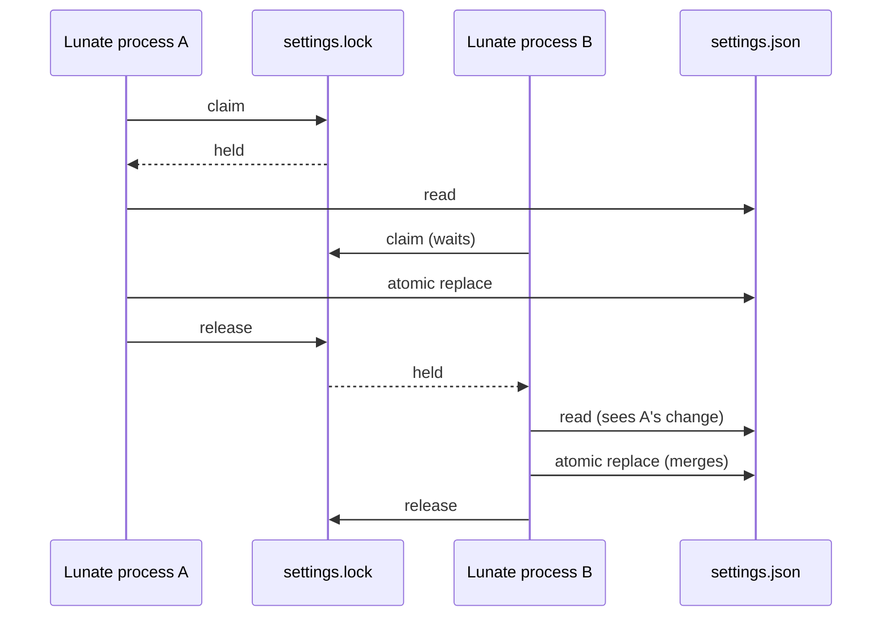

## Context

`SettingsStore` and `ProviderStore` own two user-scoped files under `~/.lunate`: `settings.json`
and `providers.json`. Every mutation is read-modify-write — read the whole JSON document, apply one
change, validate through the same parser that reads it, then replace the file atomically. A
process-local `Lock Gate` serializes threads, but nothing serializes two processes. A TUI and a
child run, two terminals, or the setup wizard and a running session can each read the same document
and each replace it; the later replace silently drops the earlier change. The provider store's
migration path has the same shape: `Load` reads, discovers auth keys that need an entry, and writes
the whole file.

The repository already has the mechanism this needs: `Lunate.Ai.FileLock` takes an exclusive
handle (`FileShare.None`) on a lock file beside the data. The extension trust store and the session
writer claim use it for exactly this reason, and `FileReplacement` already retries a transiently
locked destination.

## Goals / Non-Goals

**Goals:**

- Serialize every settings and provider-store read-modify-write across processes, including the
  setup wizard's commit, which replaces both files.
- Keep a refused claim honest: bound the wait, name the file and the lock, change nothing.
- Leave reads unchanged: no claim, no lock file created, and a complete document every time.
- Prove it with a real second process, not a share-mode constant.

**Non-Goals:**

- A multi-file transaction spanning `auth.json`, `providers.json` and `settings.json`; the setup
  wizard's staging already gives that commit its own all-or-nothing shape.
- Excluding readers; the lock file exists so readers never touch the claim.
- The auth store's own writes: it replaces a whole in-memory document and has no read-modify-write
  path of its own, so the wizard commit is serialized by the settings claim but `auth login` in
  another process is not (follow-up issue).
- User-owned workspace files; the edit and write tools keep their mutation queue.

## Decisions

1. **Reuse `FileLock` and a `<file>.lock` sidecar.** Alternatives: a named `Mutex` (Windows
   semantics without a POSIX equivalent), claiming the data file itself (refuses readers, and
   Windows denies the rename while the claim is held), or optimistic retry without a lock (still
   loses an update when both processes read before either writes, and needs a version field the
   files do not carry). The lock-file pattern is already the repository's answer and both stores
   live in `Lunate.Coding`, which may use `Lunate.Ai` internals.
2. **Take the claim inside the existing in-process gate.** The gate already serializes this
   process's reads and writes, and taking one claim per process avoids `FileLock` refusing a second
   handle from this process. The claim is held for the whole read-modify-write and released when
   the atomic replace returns.
3. **Every settings writer takes the claim.** `WriteFavorites`, `WriteProvider`, `WriteProfile`,
   `WriteUsage`, `WriteDecisionsKey`, `WriteTui` and `WriteProfileReasoningLevel` are the complete
   set of read-modify-write writers today; the helper sits in `SettingsStore` beside the gate so a
   new writer cannot forget the in-process half without also seeing the cross-process half.
4. **The provider store claims on write only, and re-reads under the claim.** A read-only `Load`
   must not create a lock file or fail on a read-only store, so `Load` detects migration from the
   first atomic read; only then does it take the claim, re-read, recompute and write. `Save` always
   claims because it is always a write.
5. **A ten-second bound, matching the extension trust store, then an actionable refusal.** A
   write that cannot claim says which file and which lock, and that nothing changed. Contention is
   a different failure from invalid data, so it surfaces as `InvalidOperationException` rather than
   the store's `InvalidDataException`.
6. **The wizard's commit claims its targets before it seeds.** The walk is answered before
   `SetupWizardCommit.Commit`, so the commit itself is one short, non-interactive pass: claim the
   settings file and the provider store, then seed the staged bodies from the targets, build them
   with the same writers, and replace the targets while the claims are still held. The claims are
   never held across a person answering a step, so another process waits for one pass, not for a
   walk. A claim that cannot be taken refuses with the store's own error before any target is
   touched, and the transaction's all-or-nothing restore is unchanged.
7. **The wizard's provider entry merges into the staged copy, not into a pre-walk reading.** The
   staged provider store is seeded from the target under the claim, so it is the document the
   commit merges into; an entry another process saved while the walk was answered survives. The
   commit therefore takes no entries argument: a caller cannot hand it a reading older than its
   own claim.

## Risks / Trade-offs

- **`auth.json` still has no claim of its own** -> The wizard's commit replaces all three files
  under the settings and provider-store claims, so two wizard commits are serialized, but a
  concurrent `auth login` in another process holds no claim on `auth.json` and can still lose one
  side's key. Recorded as follow-up issue #791 in the same milestone; the auth store's own
  read-modify-write needs the claim and a re-read, which is a separate change.
- **An in-process direct writer and a commit can wait on each other's order** -> A store writer
  takes the in-process gate and then the claim; the commit takes the claim and then reaches the
  gate through the staged writers (on different paths). The window is one non-interactive pass and
  the writer's bounded wait turns a collision into a refusal, never a lost update.
- **A stale lock file looks like contention** -> `FileLock` claims an open handle, not the file's
  existence, so a leftover sidecar after a crash is harmless; the next writer claims it.
- **A writer on a read-only store** -> Settings and provider writes already need a writable
  directory; only the read path was made claim-free, so a read-only store still loads.
- **Extra syscall per write** -> One open/handle-close per read-modify-write, on a path that
  already reads, serializes and renames the whole file.

## Migration Plan

No data migration. The first write creates the owner-only `<store>.lock` sidecar beside the file;
an older build ignores it. Rolling back leaves the sidecar behind, which is harmless.

## Open Questions

None. No in-force ADR is revisited; ADR-0017's addendum records the lock-file claim this change
reuses.
