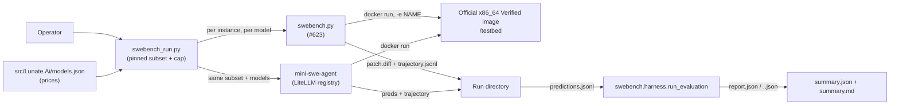
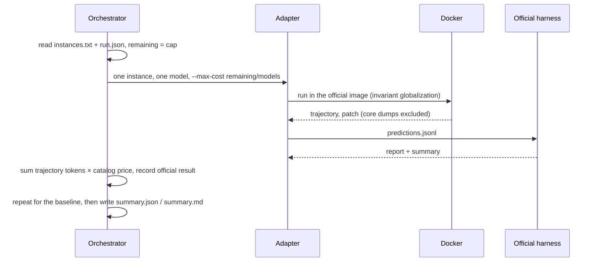

# Design: the first published SWE-bench run

## Context

#623 delivered the SWE-bench adapter at `scripts/eval/swebench.py`, but its tests use a fake Docker
client and a fake official evaluator. The first real Verified instance exposed five defects that
the fakes could not: the official images ship no ICU, the adapter defaulted to the stale
`princeton-nlp` dataset without `image` and `eval_script`, the local dataset omitted the resolved
image, `swebench` 5.0.2 writes its summary as `<model>.<run_id>.json`, and a crash core dump became
the prediction patch. The same run also showed that the only Docker host available here is arm64,
so the x86_64 official images run under QEMU; .NET needs `DOTNET_EnableWriteXorExecute=0` there.

The repository's six-task eval suite is saturated (all five tools pass 6/6), so the README's C#
claim cannot rest on it. This change fixes the adapter on real data, pins a reproducible run, and
publishes the numbers that the claim will cite.

## Goals / Non-Goals

**Goals:**

- One committed run definition: instance ids, selection rule, two models, one cost cap, timeout.
- The Lunate arm and the mini-swe-agent arm on the same subset and models.
- Every score from the official SWE-bench evaluation; every dollar from token lanes and the
  catalog price (or the agent's own limit event).
- A committed summary and write-up with the numbers, spend, failures and honest scope.
- A README claim that cites the write-up and nothing it does not show.

**Non-Goals:**

- A full 50-instance Verified number. The first run is a five-instance pilot; a larger run is a
  follow-up if the pilot justifies it.
- A new product CLI, a new package, or any change to `src/`.
- ProgramBench (still out of scope for the adapter, with the reason recorded in #623).

## Container view

## Flow

## Decisions

### D1 — A deterministic five-instance stride, not a cherry-picked set

The subset is every 100th instance id in lexicographic order of the 500-instance Verified test
split (indices 0, 100, 200, 300, 400). It spans four repositories and can be regenerated from the
official dataset. Five is a pilot chosen for the wall clock and the arm64 host's disk budget, and
the write-up says so; it is not a claim about full Verified.

### D2 — One run cap, remaining budget per invocation

`run.json` records one `maxCostUsd` for the whole run. The orchestrator passes
`remaining / models` to each concurrent invocation as `--max-cost`, so no single instance can
spend past the remaining run budget, and it stops starting instances when the cap is reached. A
limit stop is reported as a limit stop (exit 3, the limit event's spend), not an agent failure.

### D3 — Official scoring, reconciled spend

The official harness is the only scorer. The adapter already hands it the patch; this change
teaches it the current dataset shape and the summary filename that `swebench` 5.0.2 writes. The
orchestrator prices each trajectory from the pinned model's catalog entry (the same lane rules as
`ModelPricing.ComputeCost`) because the per-event `costUsd` may be absent when a wire id is shared
by several providers; the agent's own `--max-cost` still uses its resolved model price.

### D4 — Adapter hardening is part of this run

A run that cannot start is not a run. The five fixes are the minimum to make the first real
instance produce artifacts and an official verdict:

- setting `DOTNET_SYSTEM_GLOBALIZATION_INVARIANT=1` in the container;
- defaulting to `SWE-bench/SWE-bench_Verified` (the dataset with `image` and `eval_script`);
- adding the resolved image to the local `dataset.json`;
- finding `<model>.<run_id>.json` as the official summary;
- excluding core dumps from `patch.diff` and `predictions.jsonl`.

Each has a test that fails on the old behaviour.

### D5 — Baseline parity and pricing

mini-swe-agent runs the same subset and the same two models. Its default `step_limit` is 250;
Lunate's harness default is 50, so the baseline is capped at 50 for parity, and both settings are
recorded. LiteLLM does not know these new ids and refuses to track cost, so
`eval/swebench/litellm-models.json` registers the catalog prices; that keeps the baseline's cost
limit enforceable and its spend reportable.

### D6 — The arm64/QEMU host is an environment fact, not a product change

The official images are `linux/amd64`; this host is arm64. The adapter already pins the platform.
The run sets `DOTNET_EnableWriteXorExecute=0` for .NET under QEMU (without it the runtime
segfaults) and records the host architecture in the summary. A native x86_64 host needs neither
workaround.

## Risks / Trade-offs

- [Five instances cannot support a reliability claim] -> The write-up states the size, every
  unresolved instance and the scope limit; the README cites the measured number only.
- [A QEMU crash is reported as an agent failure] -> A crashed instance is recorded with its exit
  code and excluded from the resolved count; the core dump is never a patch.
- [A model is unpriced and the cap cannot be enforced] -> The run refuses an unpriced model with a
  cap; the LiteLLM registry prices the baseline models.
- [The baseline is slower than the Lunate arm] -> Both use the same 50-step limit and the same
  official evaluation; wall clock is reported, not hidden.

## Migration Plan

No product migration. The run definition and the summary are new repository data; the adapter
flags are additive. If the run is aborted, the committed summary records the incomplete subset and
the PR stays blocked rather than claiming a number.

## Open Questions

None blocking. A larger subset (the 50-instance target) is the obvious follow-up if the pilot's
failure modes are informative; the cost cap amount is a repository constant for this run, not a
product default.
