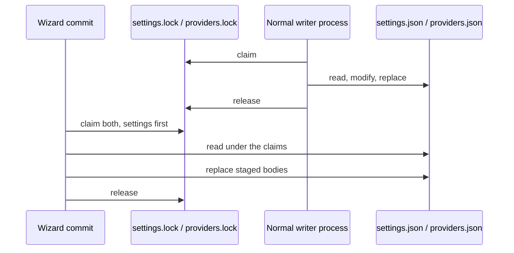

## Context

`SetupWizardCommit.Commit` is the wizard's one short, non-interactive final pass.
On this branch's base (#665, `wt/issue-584`) it already claims `settings.lock`
then `providers.lock` before it seeds, merges the walk's provider entry into the
store read under the claim, and releases the claims only after the last replace.
The store writers on the same base take those claims, so a normal writer and the
commit now serialize in both directions.

The remaining gaps are coverage and the capability spec: `setup-wizard` does not
state the guarantee, no test makes the ordinary `ProviderStore.Save` the other
process, and no test drills the bounded refusal. The commit's claim wait is fixed
at the stores' ten-second default, which makes a refusal test unnecessarily slow.

## Goals / Non-Goals

**Goals:**

- Record the commit's cross-process guarantee in the `setup-wizard` capability.
- Cover the merge with the ordinary provider-store writer and the unclaimable
  refusal with real child processes.
- Keep the refusal test fast without changing the production default wait.

**Non-Goals:**

- Reimplementing the claim pass; it lives in #665 and this branch is stacked on it.
- A claim on `auth.json` (follow-up #791).
- Changing store formats, the default ten-second bound or any public API.

## Decisions

- **Stack on #665 instead of copying its store-lock change.** The review requires
  the ordinary writers on the merge base to take the same claims. Depending on
  #665 makes that true without duplicating its diff in this pull request.
- **Forward an optional claim timeout through `SetupWizardCommit` and
  `SetupWizardTransaction.ClaimTargets`.** The production call passes null and
  keeps the stores' default; the refusal test passes `WaitBudgets.StoreClaimRefusal`.
  Both store claim helpers already have timeout overloads, so no new locking
  primitive is introduced.
- **Use the normal writer in the merge-child test.** The child calls
  `ProviderStore.Save`, the same writer `/settings` and `auth login` use, so the
  test proves the interaction the review asked for rather than only raw lock
  compatibility.

## Risks / Trade-offs

- [A stacked pull request can merge only after #665] -> The PR body says so and its
  base is `wt/issue-584`; once #665 lands the branch retargets to `main`.
- [A test-only timeout parameter widens an internal signature] -> It defaults to
  null and is internal; production still waits the stores' bounded ten seconds.
- [The spec now duplicates part of the store specs] -> It states the wizard
  capability's own guarantee, which is the contract a wizard change is checked
  against; the store specs keep the writer-level guarantee.

## Migration Plan

No migration. The lock files and commit order already exist in #665; this change
adds no new file, format or default behaviour.

## Open Questions

None. No in-force ADR is revisited: ADR-0027's provider store and ADR-0029's
provider API families are unchanged, and the lock convention is the store
implementation detail recorded by #665.
