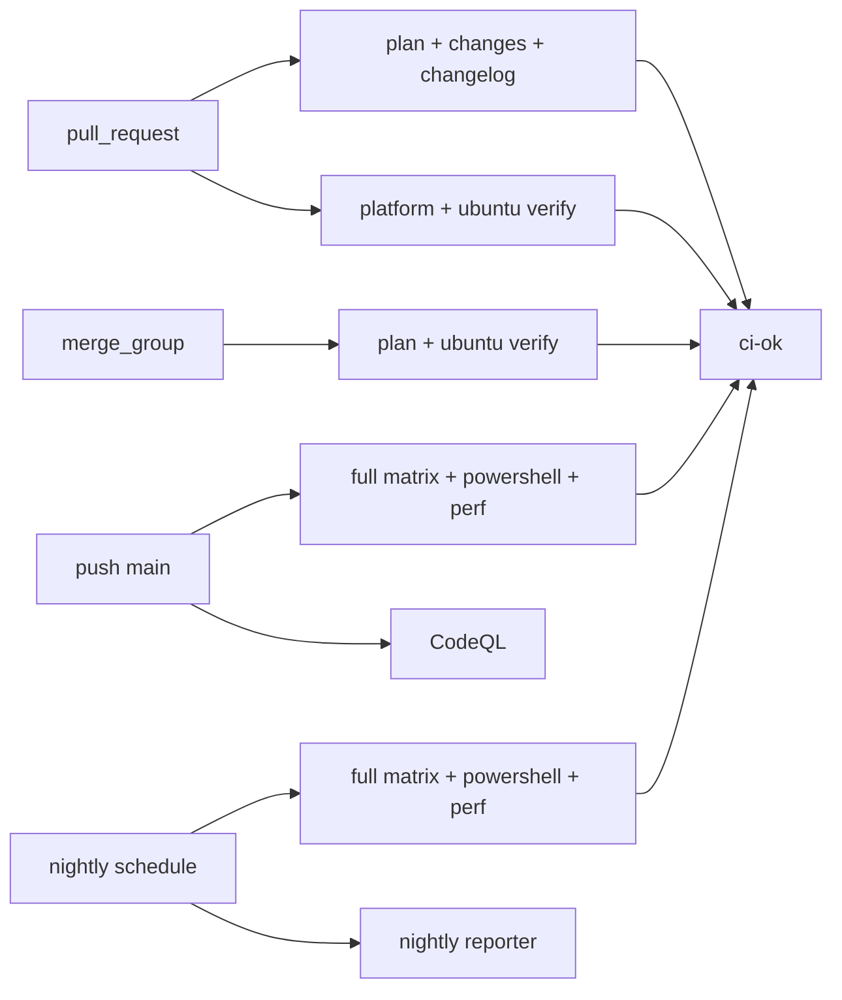

## Context

Today a pull request runs the full three-OS verify matrix (four shards each on Ubuntu and Windows, two on macOS),
the platform/docs checks, the Windows PowerShell twin and the changelog guard; its `merge_group` run repeats the
matrix on the queue head. The same diff therefore runs ten verify shards twice, and macOS and Windows — the two
shared-runner classes with the flakiest timings and the tightest capacity — are the expensive part of both runs.

Three constraints shape the fix. `ci-ok` is the only required check, so every event's job set has to be named
there or a leg can disappear silently. The three-OS gate is still the only way to catch an OS-specific
regression, so it cannot be dropped. And a merge group is built from pull requests that already passed their own
gate; the queue's job is to prove the combined tree still builds and tests, not to re-run prose checks whose
inputs did not change.

## Goals / Non-Goals

**Goals:**

- A pull request proves the change once, on Ubuntu, with the cheap always-useful checks around it.
- A merge group runs the Ubuntu test gate and nothing the pull request already proved.
- The full three-OS matrix, the PowerShell twin, the dedicated perf measurement and CodeQL run on the events
  that own them: a push to `main` and the nightly schedule.
- A red nightly files its own deduplicated `kind/bug` card naming the failing job.
- `ci-ok` requires exactly the event's job set and its self-test fails when the two drift.

**Non-Goals:**

- Changing the release gate, `release.yml`, the shard engine in `scripts/verify.sh` or any budget.
- Making the full matrix cheaper: this change moves it, it does not shrink it.
- Reworking the docs profile's allow-list or the changelog guard's rules.

## Decisions

### The plan emits the matrix for the event

`plan` already decides the profile from the changed paths; it also emits the verify matrix. The matrix now keeps
Windows and macOS legs only when the event is not `pull_request` and not `merge_group`:

| Event | Verify matrix | `changes` | `changelog` | `platform` | `verify-docs` | `verify-powershell` | `perf` |
| --- | --- | --- | --- | --- | --- | --- | --- |
| `pull_request` (full) | Ubuntu, 4 shards | runs | runs | runs | skipped | skipped | skipped |
| `pull_request` (docs) | none | runs | runs | skipped | runs | skipped | skipped |
| `merge_group` (full) | Ubuntu, 4 shards | skipped | skipped | skipped | skipped | skipped | skipped |
| `merge_group` (docs) | none | skipped | skipped | skipped | skipped | skipped | skipped |
| `push` to `main` | Ubuntu 4, Windows 4, macOS 2 | runs | skipped | runs | skipped | runs | runs (advisory) |
| `schedule` | Ubuntu 4, Windows 4, macOS 2 | runs | skipped | runs | skipped | runs | required |
| `workflow_dispatch` | Ubuntu 4, Windows 4, macOS 2 | runs | skipped | runs | skipped | runs | skipped |

Mermaid sketch of the event-to-job flow (lightweight C4 container view of the CI system):

The assumption is that a prose-only merge group needs no test run: its pull request already proved the prose,
and a merged prose batch cannot break the build. So the docs profile stays a plan-only run in the queue. The
alternative — forcing the full profile in a merge group — would spend the Ubuntu gate on prose.

Keeping the four-shard Ubuntu default (rather than one shard) is deliberate: the shard engine already exists,
Ubuntu is the cheap runner, and the queue wall time is the point of the change.

### The job conditions name the events, not the profile alone

Each conditional job gets an explicit event predicate, so a reader can check the table above against the
workflow:

- `changes`: not a `merge_group`.
- `platform` and `verify-docs`: not a `merge_group`.
- `verify-powershell`: not a `pull_request` and not a `merge_group`.
- `perf`: `push` or `schedule` (the nightly is its verdict; a push's timing does not gate).
- `changelog`: unchanged, `pull_request` only.

`changes` still runs on a pull request even though the PowerShell leg does not, because the card names it and
because the path decision remains the honest record of what the change would need. `ci-ok` ignores the
PowerShell decision on a pull request rather than pretending the paths did not require it.

### `ci-ok` carries the per-event table, and takes `changes` as an input

`ci-ok` now receives `needs.changes.result` so it can require the decision on a pull request and a push, and
require its absence in a merge group. The decision grows one branch per event:

- **pull request**: `plan`, `changes` and `changelog` succeed; the profile's own legs succeed (`platform` and the
  Ubuntu verify for full, `verify-docs` for docs); `verify-powershell` and `perf` are skipped. macOS is not
  required. Extra macOS legs on the live head stay permitted, because a manual dispatch on the same head would
  otherwise redden a green pull request; the plan's own pull-request matrix is pinned by the self-test instead.
- **merge group**: `plan` and the Ubuntu verify succeed (or, for docs, only `plan`); every job the pull request
  proved must be skipped, and a run of one of them is red with its name.
- **push / schedule / dispatch**: `plan`, `changes` and `platform` succeed, the full matrix ran (macOS and the
  macOS budget leg are present), the PowerShell twin follows its path decision, and the nightly requires `perf`.
  A push's `perf` result does not feed the verdict, as before.

The live pull-request path reads check runs, not payloads; `ci-ok-state` now requires only Ubuntu legs, and the
self-test ties that list to the plan's `leg` lines so a leg added to the pull-request matrix cannot escape it.

### The nightly reporter reads the run's jobs, not `needs`

`needs.<job>.result` collapses a matrix to one result, so it cannot name `verify (windows-latest, 2/4)`. The
reporter calls the jobs API with the run id, takes every job whose conclusion is red, and for each one searches
open issues by title (`Nightly CI failed: <job>`), commenting when one exists and creating a `kind/bug` issue in
milestone `0.4.0` otherwise. The decision and the filing live in `scripts/nightly-issue.sh`, whose self-test
stubs `gh` and asserts create/comment/no-op for synthetic job lists; the workflow keeps only the token and the
milestone constants.

Alternatives considered: a single card per red night (loses the per-job dedupe the card asks for), and
`needs`-based reporting (cannot name the matrix leg). The jobs API call needs `actions: read`; the filing needs
`issues: write` on the reporter job only.

### CodeQL leaves the pull request

The card puts CodeQL in the push/nightly column. Removing the `pull_request` trigger saves one full-solution
build per pull request and leaves the push to `main` and the weekly schedule — which already analyze the same
commit — as the events that produce code-scanning results.

## Risks / Trade-offs

- **[A Windows- or macOS-only regression reaches `main` before any gate catches it]** → the full matrix runs on
  every push to `main` and the nightly, and the nightly files its own card per failing job. The PowerShell twin
  and the perf leg still gate the nightly.
- **[A merge group loses the platform/docs checks, so a batch that combines two individually green prose edits
  could break a generated region]** → the push to `main` re-runs the platform checks and `tree-checks.yml` runs
  the docs checks on `main`; a merge conflict still stops the batch before that.
- **[Milestone `0.4.0` or the `kind/bug` label is missing, so the reporter cannot file]** → the reporter's job
  fails loudly on the nightly instead of silently dropping the report; the milestone is the card's own.
- **[A manual dispatch on a pull-request head adds Windows and macOS check runs]** → the live pull-request
  decision permits them; only the plan's own matrix is pinned.
- **[`ci-ok` becomes a larger decision table that can drift from the workflow]** → the self-test covers all
  events per event, asserts the job wiring in the workflow, and ties the plan's pull-request legs to
  `ci-ok-state`.

## Migration Plan

Merge the workflow and script change. The next pull request runs the fast gate; the first merge-group run after
the merge is the `after` measurement (the repository has no merge queue on a worktree branch). Rollback is
reverting `.github/workflows/ci.yml`, `.github/workflows/codeql.yml`, `scripts/ci-ok.sh`, `scripts/ci-ok-state`
and `scripts/nightly-issue.sh` together; no persisted state is involved.

## Open Questions

None. The measured wall time before is recorded in the pull request; the after value needs the first real
`merge_group` run, which only the queue can produce after the merge.
