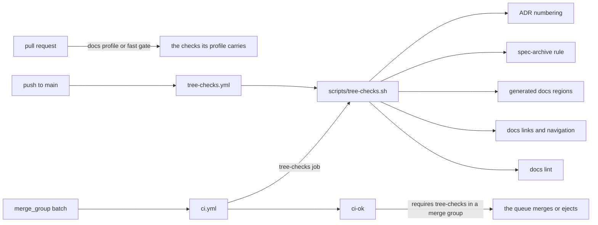

## Context

The repository-wide rule set that needs no build — ADR numbering (`scripts/check-adr-numbers.py`), the
spec-archive rule (`scripts/check-spec-archive.py`), the generated documentation regions
(`scripts/docs-sync --check`), the documentation link, anchor, redirect and navigation check
(`scripts/docs-check --check`) and markdownlint — lives in `.github/workflows/tree-checks.yml` and runs
on a push to `main`. A pull request meets it through its profile: the documentation profile runs the
whole set, and the full profile's `platform` job runs most of it, with ADR numbering the one member the
full profile does not run.

That leaves a gap in the merge queue. Two pull requests can each be green on their own tree — #840 took
a free ADR-0036 while #843's full-profile gate never asked about ADR numbers — and the batch that the
queue builds then carries a duplicate ADR number. `ci-ok` is the one required check in the queue, and
it requires a fixed job set that does not include the tree checks, so the batch landed.

The event-sized gate itself is ADR-0036's: a pull request proves itself on Ubuntu, the queue re-runs the
Ubuntu test gate, and `main` and the nightly own the full matrix. ADR-0036 also states the maintenance
contract this change follows: a new job is added to both `ci.yml` and the `ci-ok` event table, and the
self-test is what keeps them the same.

The pull request box is the unchanged path; the two arrows into `scripts/tree-checks.sh` are the wiring
this change adds and keeps in one place.

## Goals / Non-Goals

**Goals:**

- A `merge_group` run judges the batch's tree with the same five checks a push to `main` runs.
- `ci-ok` requires that judgement, so a batch with a duplicate ADR number is red and the queue ejects
  it instead of merging it.
- One command list, called by both triggers, so the push to `main` and the queue cannot drift.

**Non-Goals:**

- No change to what a pull request runs. Its fast gate stays as it is (#831/#843).
- No new check, no change to the checks themselves, and no change to their exit codes or messages.
- No change to the push to `main` or to `tree-checks.yml`'s trigger.
- No product code, public API, package or release-workflow change.

## Decisions

**The job lives in `ci.yml`, not in `tree-checks.yml`.** `ci-ok` can only require jobs of its own
workflow: `needs` does not cross workflows, and reading another workflow's check run would mean teaching
the aggregate a second evidence path for a merge group. A job in `ci.yml`, added to `needs` and to the
event table, is the mechanism the repository already uses for every other leg.

Alternative considered: add `merge_group` to `tree-checks.yml` and have `ci-ok` read its check run
through the API. Rejected — it changes the merge-group aggregate from a payload decision to a live-read
decision, which the spec deliberately keeps apart, and it makes a merge-group verdict depend on a second
workflow's scheduling.

**One script holds the command list.** `scripts/tree-checks.sh` runs the five checks in order, prints
the name of each before it runs, and stops at the first failure (`set -euo pipefail`). `tree-checks.yml`
and the new `ci.yml` job both call it with `--base <rev>`.

Alternatives considered: copy the five `run:` steps into `ci.yml` (two command lists that drift, which is
the defect class this card is about), or move the push-to-main job into `ci.yml` (a docs-only push skips
`ci.yml` through `paths-ignore`, so the checks would stop running on exactly the push that needs them).

**The merge-group job runs on every batch, whatever the profile.** A prose-only batch is the case that
produces a duplicate ADR number, so gating the job on `profile == full` would miss it. The job therefore
sits outside the profile switch and carries no path filter.

**The batch is judged against `github.event.merge_group.base_sha`.** That is the commit the batch would
land on, so `base_sha...HEAD` is the batch's own diff. It is what the spec-archive check wants, and the
ADR numbering check reads the whole tree instead of a diff, so it sees the duplicate whichever of the two
pull requests introduced it.

**Full history and the release tags are fetched.** `check-spec-archive.py` runs `git diff`, which a
shallow clone cannot answer, and the version region in `README.md` is derived from the release tags.

**`ci-ok` requires success only in a merge group.** On a pull request, a push, the nightly and a manual
dispatch the job is skipped and the skip is a pass — the work is either the pull request's own profile or
`tree-checks.yml`'s push job. The merge-group branch fails on a skip as well as on a failure, because
the job has no path filter: a skip there means the wiring broke, not that the paths did not match.

**The live pull-request decision learns to ignore the job.** `scripts/ci-ok-state` gains `tree-checks`
as a single job whose default is `skipped`, so the live-head path keeps deriving a pull request's verdict
from that head's check runs, and a stray tree-checks run on a pull request head fails the pull-request
branch (it ran although no pull request requires it).

**No new ADR.** The change adds a job to the event-sized gate ADR-0036 accepted, following that ADR's own
contract (add the job to `ci.yml` and to the `ci-ok` event table, and pin both in the self-test); it does
not replace the gate's topology. A numbered addendum would also collide with the in-flight #848, which
renumbers the duplicate ADR-0036 and frees 0037 — writing 0037 here would reintroduce exactly the defect
this card fixes.

## Risks / Trade-offs

- **The queue gets slower by a few seconds.** Negligible against the Ubuntu verify shards; the checks
  need no .NET, no build and no test. The job is one runner step and reuses the same commands the push
  already pays for.
- **A batch with a pre-existing defect on `main` is ejected.** Today `main` carries the duplicate
  ADR-0036, so every batch is red until #848 lands. That is the intended behaviour: the check is doing
  its job, and the fix belongs to #848, not to a weaker queue gate. -> The pull request report names #848
  as the prerequisite for a green queue.
- **The command list could still drift between the script and what each check expects.** -> The script
  is the only place the commands appear; the wiring test reads the script and both workflows, and each
  check keeps its own unit tests.
- **ADR numbering is not in the pull request's full profile**, so a code pull request can still add a
  duplicate ADR number and only learn about it in the queue. -> Deliberate: this card is about the queue
  rejecting it, and widening the pull request's fast gate is the follow-up the report names if the
  maintainers want earlier feedback.

## Migration Plan

No migration. The job is additive; the push-to-main behaviour is unchanged. Rollback is reverting the
commit: the queue then stops requiring the tree checks again.

## Open Questions

- Whether the tree checks should also join the pull request's full profile (ADR numbering is the missing
  member today). Out of scope here: the card's acceptance is the queue, and widening the fast gate is a
  separate decision.
