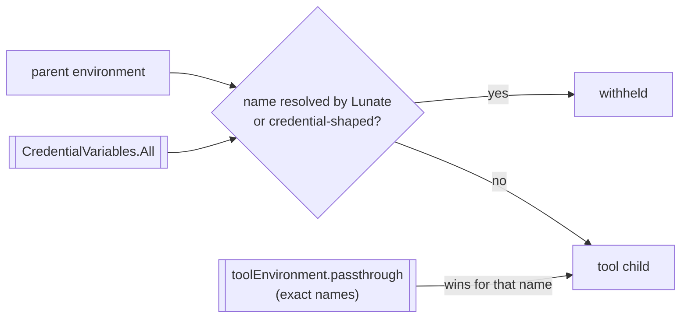

## Context

The tool child (`bash`) runs under the `Inherited` environment policy. One builder,
`EnvironmentScrubber.Build`, holds both policies; `ChildProcess.BuildEnvironment` is the one place the
tool child's policy is named, and it passes `strip: CredentialVariables.All` (every preset key
variable and alias, plus each configured custom provider's `env:` reference) and
`passthrough: ToolEnvironmentPassthrough.Names` (the user-scope exact-name list from #642/#659).
Every tool spawn reaches that method; the extension hosts' `Scrubbed` policy never inherits.

So the deny covers exactly the credentials Lunate resolved. A `GITHUB_TOKEN`, `NPM_TOKEN`,
`AWS_SECRET_ACCESS_KEY` or `SSH_ASKPASS` on the developer's machine is inherited by every command the
model chooses and the user approves — a skim, not a read, and `--yolo` exists. The strip's own
purpose (#621) is that a model-chosen command cannot read the user's credentials; today it protects
only Lunate's keys. `toolEnvironment.passthrough` is the exact-name opt-in that makes a wider default
deny usable, and Codex CLI's shell environment policy is the prior art (#741).

```
InteractiveSession / PrintMode / AcpMode
        │  settings resolve; provider store registers custom env: names
        ▼
ToolEnvironmentPassthrough.Configure(names)       ← process-wide exact-name list
        │
        ▼
ChildProcess.BuildEnvironment(request)            ← the one policy-build site
        │  EnvironmentScrubber.Build(Inherited, passthrough: Names, strip: CredentialVariables.All)
        ▼
EnvironmentScrubber  inherit → capture pass-through values → withhold (resolved names ∪ credential-shaped)
                     → re-admit pass-through → apply declared values (withheld names skipped)
        ▼
ChildProcess.Windows / ChildProcess.Unix → tool child
```



## Goals / Non-Goals

**Goals:**

- A credential Lunate never resolved is withheld from the tool child by default, by the shape of its
  name, with the exact-name pass-through list as the only way back in.
- The matching rule is stated precisely enough to predict: word match on `_` and `-`, a fixed word
  list, case-insensitive.
- The false positives the issue names (`MONKEY`, `KEYBOARD_LAYOUT`, `HOCKEY_POOL`,
  `GITLAB_TOKENIZE_TIMEOUT`) survive.
- One builder, no public API change, no new setting, no new package.

**Non-Goals:**

- No substring/glob/regex matching, no user-configurable strip patterns, no per-tool or per-project
  deny list.
- No change to the `Scrubbed` policy or its base set, and no change to the resolved-name strip.
- No per-spawn report of what was withheld (see Decisions).
- No attempt to catch credentials whose *name* gives nothing away (`DATABASE_URL`, `PGPASSWORD`,
  `DOCKER_AUTH_CONFIG`); that is what the container boundary and approvals are for.

## Decisions

- **The rule lives in `EnvironmentScrubber`, not in `CredentialVariables`.** The builder is the one
  place that decides a child's environment, and the shape rule is a policy fact like the `Scrubbed`
  base set. Putting it in `Lunate.Coding` would need a new parameter (a public API change the card
  does not authorize) or a second filtering pass in `ChildProcess`, which would be a second place
  that decides the environment. Alternative rejected: a `Func<string, bool>` strip matcher on
  `Build` — public API churn for a rule with one caller.
- **Word match, not substring.** The name is split on `_` and `-` and each part is compared
  case-insensitively against the word list. Substring matching (Codex's default) catches the four
  false positives the issue names; word matching keeps the gain that matters (a credential word is
  almost always its own part in `SCREAMING_SNAKE_CASE`) and drops the cheapest way to break a build
  invisibly. Alternative rejected: substring matching, because a variable named after a keyboard
  layout is not a credential and a build that silently loses it is worse than the leak it prevents.
- **The word list is `KEY`, `KEYS`, `TOKEN`, `TOKENS`, `SECRET`, `SECRETS`, `PASSWORD`,
  `PASSWORDS`, `PASSWD`, `PASS`, `CREDENTIAL`, `CREDENTIALS`, `CREDS`.** `AUTH`, `PWD`, `URL`, `URI`
  and `DSN` are deliberately absent: `SSH_AUTH_SOCK`, `PWD`, `OPENAI_BASE_URL` and
  `NEXT_PUBLIC_*_URL` are ambient variables toolchains read, and a URL's name says nothing about
  whether it carries a password.
- **The pass-through list is unchanged and is the only opt-in.** Exact name, platform comparison
  (case-insensitive on Windows), user scope only, read in `ChildProcess.BuildEnvironment`. It is
  applied after both denies, so a listed name comes back with its inherited value; the resolved-name
  collision warning stays as it is, and the startup admission notice keeps naming every listed name.
- **The shape deny also refuses declared values under `Inherited`.** The existing rule that
  `ExtraEnvironment` cannot re-introduce a stripped name is extended to a withheld one, so a spawn
  site cannot bypass the policy. The bash tool's own `LUNATE_SESSION` marker does not match.
- **Nothing reports per-spawn what was withheld.** The bash tool result is the wrong place for it
  (noise on every call, and the model reads it), and a startup line cannot know which names the
  parent holds at spawn time. The rule is documented with its word list in the ADR, the guide and the
  settings reference so a user can predict it, and one passthrough entry admits the variable that
  broke. Alternative rejected: a `--debug`-style note in the log — not worth the plumbing for this
  card; a follow-up can add it if a user asks.

## Risks / Trade-offs

- [A real credential-shaped variable that a build needs disappears] -> it is one exact name in
  `toolEnvironment.passthrough` to restore, and the startup notice then names it every session. This
  is the failure mode the decision prefers: a missing variable is visible and recoverable, an
  exfiltrated token is neither.
- [False positive that is not a credential] -> `GOOGLE_APPLICATION_CREDENTIALS` (a path),
  `SECRET_SANTA_EXCHANGE`, `GIT_CONFIG_KEY_0`. Accepted, named in the ADR, restorable by listing the
  name.
- [False negative] -> `DATABASE_URL` with a password, `PGPASSWORD`, `DOCKER_AUTH_CONFIG`,
  `SLACK_WEBHOOK_URL` stay inherited. Accepted and stated: the rule is a shape heuristic, not a
  guarantee, and the docs must not claim otherwise.
- [Case] -> matching folds case on every platform. On POSIX that withholds `github_token` too, which
  is the safe side; the pass-through list keeps the platform's own comparison.
- [Tests depend on the parent's real environment] -> the spawn tests hand the parent set in through
  `ProcessRunRequest.Environment`; nothing mutates the test process's environment.

## Migration Plan

No settings, state or session-format migration. The behaviour change is the point: an existing
user's credential-shaped ambient variable stops reaching tool children until it is listed. Rollback
is reverting the commit.

## Open Questions

None. ADR-0035 left a future pattern feature to a new decision; this change is that decision and
ADR-0036 records it, amending ADR-0035's strip while keeping its pass-through contract.
