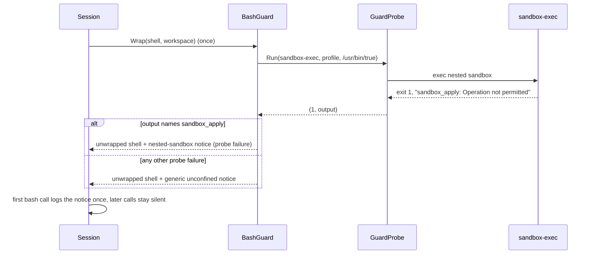

## Context

`BashGuard.ResolveMacOs` decides once per session whether the shell is wrapped in
`sandbox-exec`. It probes `sandbox-exec -p <profile> /usr/bin/true`; a non-zero exit today produces
the generic notice "the bash guard could not start: sandbox-exec probe failed (…); this command runs
unconfined". When the process is itself started by `sandbox-exec` (a worker harness applying its own
Seatbelt profile), macOS refuses to apply a second, nested profile and the probe fails with
`sandbox-exec: sandbox_apply: Operation not permitted`. The command is not unconfined — the outer
profile still applies — but the message says it is, and never mentions that the guard's own rules
were not added.

The guard already has the right shape for the fix: `GuardProbe` is the injectable platform seam, and
`BashTool.NoticeOnce` emits a `GuardCommand.Notice` once per tool instance (one instance per
session) through the host log, leaving the command's stdout bytes untouched. ADR-0024 requires that
a mechanism that cannot start is reported, never assumed away; this change keeps that rule and
corrects only the nested case's report.

## Goals / Non-Goals

**Goals:**

- Recognise the macOS nested-sandbox probe failure and report it accurately: the process already
  runs inside a sandbox, the guard's own rules are not applied, the outer sandbox still applies.
- Never say "runs unconfined" for that case, and emit the notice once per session.
- Keep the existing probe seam and single-probe-per-session behaviour; make the branch testable on
  every OS through the fake probe.

**Non-Goals:**

- Detecting an already-confined Linux process (containers/user namespaces). The card is the macOS
  nested `sandbox-exec` case; Linux has no equivalent positive signal in this codebase and its
  existing unavailable report stays as it is.
- Adding a private macOS API (`sandbox_check`, `csops`) to ask the OS whether the process is
  sandboxed. That would be a new native dependency and a larger architectural decision.
- Changing the probe state vocabulary, the header/`/context` text, the `bash` result text, or the
  wrapping/refusal/hint behaviour.
- Emitting a second notice from session composition. The existing once-per-tool notice path already
  gives "once per session, not per command".

## Decisions

### 1. Classify the probe failure by its `sandbox_apply` signature

`ResolveMacOs` checks the probe output for `sandbox_apply` (the Seatbelt function that applies a
profile) and, when present, returns the dedicated nested-sandbox notice instead of the generic one.
Rationale: the exact output is the card's evidence and the documented meaning of that failure — a
process that is already sandboxed cannot apply another profile. The check is deliberately narrow:
only a failure that names profile application counts, so an invalid profile or a missing binary
keeps the existing report. Alternative considered and rejected: probing with a second, minimal
profile — it distinguishes nothing, since the nested refusal happens before any profile is parsed.

### 2. Reuse `Unwrapped` with mechanism `none` and probe state `failure`

The shell still runs unwrapped (there is no way to add the profile), so `Wrapped` stays false,
`Mechanism` stays `none`, and `ProbeState` stays `failure`. No new status field or vocabulary: the
spec fixes the mechanism and probe-state values, and header/`/context` continue to report the fact
they already report. Alternative considered and rejected: a new `nested` probe state — it would
ripple into the header, `/context` and their tests for no user-visible gain over the notice.

### 3. One notice per session through `BashTool.NoticeOnce`

The new text is the existing `Notice` channel: the first bash call writes it to the host log, later
calls in the same session do not. Alternative considered and rejected: `Notify` at session
composition — it would duplicate the message (the tool log already emits it) and would have to be
special-cased to the nested branch, adding session state for no acceptance gain.

### Notice text

`the bash guard is not applied: this process already runs inside a sandbox (sandbox-exec probe
failed: <probe output>); the outer sandbox still applies, but Lunate's own state-root,
install-prefix and auth.json rules are not`

It carries the probe's output (ADR-0024's "detected and reported" rule), names the outer sandbox,
names the missing rules, and never uses "unconfined".

## Risks / Trade-offs

- **A non-nested failure that also prints `sandbox_apply` is mislabelled as nested.** -> The
  function only fails that way when applying a profile is refused; the message states the failing
  probe output, so a reviewer sees the evidence next to the inference.
- **The message no longer says "unconfined", so a genuinely broken `sandbox-exec` gets a less
  absolute warning.** -> Only the `sandbox_apply` branch changes; every other failure keeps the
  existing text.
- **No test can run a real nested `sandbox-exec` on CI.** -> The branch is covered through the fake
  probe, which is how every other platform branch is tested; the field evidence is the card's
  probe output.

## Migration Plan

No migration. The guard is resolved per process at start, so the corrected report takes effect on
the next session. Rollback is a code revert; no stored state or session format changes.

## Open Questions

None. This change does not revisit an in-force ADR; ADR-0024's "detected and reported, never
assumed" rule is the one it applies.
