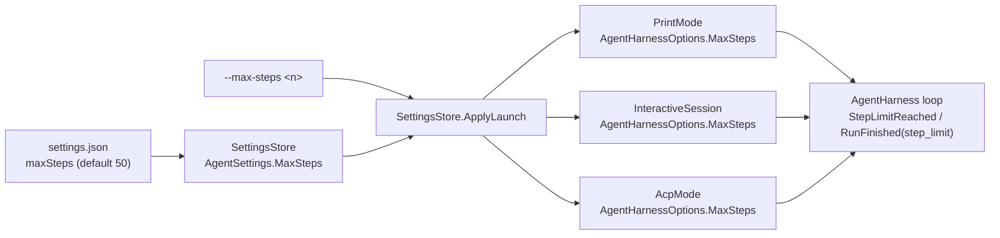

## Context

The loop already has a step ceiling: `AgentHarnessOptions.MaxSteps`, default 50, validated at
construction (`>= 1`) and checked after every model call. `StepLimitReached(maxSteps)` and
`RunFinished(step_limit)` are the existing events, and print mode already maps the stop reason to
exit code 2. What is missing is a way to resolve that ceiling from the user: the settings store has
no `maxSteps` key, the launch parser has no `--max-steps`, and the three frontends that compose a
harness pass no `MaxSteps`, so every run takes the harness default.

The sibling run limits already show the shape: `maxCost` and `maxTime` are top-level settings keys,
`--max-cost` and `--max-time` are launch flags, `SettingsStore.ApplyLaunch` merges the flag over the
setting, and each frontend passes the resolved value into its `AgentHarnessOptions`. The step ceiling
is the same kind of per-run limit, so it takes the same path. The subagent runner already treats the
parent harness's `MaxSteps` as its ceiling and clamps a child's request down to it, so resolving the
parent's value also resolves the ceiling for child runs without further wiring.

## Goals / Non-Goals

**Goals:**

- One settings key (`maxSteps`, a positive integer, default 50) and one launch flag
  (`--max-steps <n>`) that override the harness default in print mode, interactively and over ACP.
- A value that is not a positive integer is a launch usage error (exit 2), validated before any
  model request, and an invalid settings value is a settings-validation error naming the key.
- The existing `step_limit` event and exit-code contract stay exactly as they are; only the ceiling
  they report becomes configurable.
- Docs name the default, the flag and the setting in `docs/usage.md`, `docs/cli.md` and
  `docs/print.md`, and the generated settings reference carries `maxSteps`.

**Non-Goals:**

- No "unlimited" value. The loop needs a finite ceiling to terminate a runaway provider, and the
  card asks for a higher configurable ceiling, not for none. A very large positive integer already
  expresses "effectively unlimited".
- No project-scoped step limit. The sibling `maxCost` and `maxTime` keys are user-scoped and a
  project lowering or raising them is a different decision; this card follows them.
- No new public API in `Lunate.Agent`: `AgentHarnessOptions.MaxSteps` already exists with its
  validation and public API entry.
- No change to the session format, the event vocabulary or the subagent depth/token limits.

## Decisions

### 1. A top-level `maxSteps` setting, not a `limits` section

`AgentSettings.MaxSteps` is an `int` with the default 50, beside `MaxCostUsd` and `MaxTime`. The
schema entry is `maxSteps`, type `integer`, default `50`, scope `user`. A real value must be a
positive integer; a non-number, zero or negative value is collected as a settings problem like
`maxCost` and `maxTime`. Alternative considered and rejected: a nested `limits.steps` section — it
would be the only limit not at the top level and would break the settings file's established shape.

### 2. `--max-steps` parses through `RunLimits` and overrides settings in `ApplyLaunch`

`LaunchOptions.MaxSteps` is an `int?`; `RunLimits.TryParseSteps` accepts an invariant-culture
integer `>= 1`, and the existing `TryValue` gives the missing-value case its usage error. A
non-positive or non-integer value names the flag and the expected `positive integer`, then
`LaunchOptions.TryParse` returns false, which the CLI already turns into exit 2 before composing a
session. `ApplyLaunch` merges it with `launch.MaxSteps ?? settings.MaxSteps`, the same way cost and
time merge. Alternative considered and rejected: parsing the flag in each frontend — three copies
that can disagree, and the launch parser is the one place flag meaning is owned (design D1).

### 3. The frontends always pass the resolved value

`PrintMode`, `InteractiveSession` and `AcpMode` set `MaxSteps = settings.MaxSteps` on their
`AgentHarnessOptions`, after `ApplyLaunch` has run. The default lives in `AgentSettings`, so the
harness keeps its own default for direct callers and tests but no frontend silently drops the
setting. ACP shares the launch parser and the settings merge, so `--max-steps` works there too
without a second code path; the existing ACP usage-error rules for print/selection flags are
unchanged.

### 4. The print-mode acceptance test drives the real ceiling past 50

The existing `LoopingChatClient` emits one failing `read` call per model call. A new print-mode test
sets `--max-steps 55` (through `LaunchOptions`) and asserts the run makes 55 tool calls, then emits
`step_limit_reached` with `maxSteps: 55`, `run_finished` with `stopReason: step_limit`, and exit 2.
That is the only shape that proves "would pass 50 steps with a higher limit and stop at the
configured one" without depending on wall-clock timing. A settings-resolution test covers the file
path, an interactive test covers the settings-driven harness, and flag-parse tests cover the usage
error.

## Risks / Trade-offs

- **A very large `--max-steps` lets an unattended run spend for a long time.** -> The existing cost
  and wall-clock limits remain the budget controls, and the docs keep recommending them for print
  mode; the step ceiling is a loop guard, not a time budget.
- **The setting and the flag could drift.** -> Both land in `AgentSettings.MaxSteps` before any
  frontend reads it, and one print-mode test exercises the merged value through the real harness.
- **An invalid settings value could be silently dropped like other limits have been.** -> The
  settings-schema probe test asserts the resolved value, and an invalid-value test asserts the
  actionable message names `maxSteps`.

## Migration Plan

No migration. A settings file without `maxSteps` resolves to 50, which is today's behaviour. A user
who relied on the fixed ceiling gets it unchanged; one who needs more sets the key or passes the
flag. Rollback is a code revert with no stored state or session-format change.

## Open Questions

None. This change does not revisit an in-force ADR: it reuses the loop's existing step ceiling
(ADR-0003), the settings/launch precedence already used by the sibling run limits, and the
`Lunate.Coding` frontend boundary. No new durable ADR is needed.
