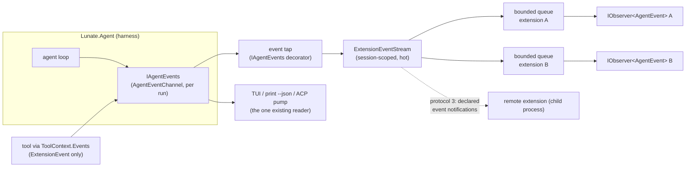

# Design — hook-based extensibility on observables

## Context

Lunate has one extension mechanism with two holes in it.

The intercepting half is built. `Lunate.Extensibility.Abstractions` declares one handler interface per
catalogue point (`IHookHandler` with `Priority`, `Hooks/HookHandlers.cs`) and typed payload/result
DTOs (`Hooks/HookPayloads.cs`). `HookRunner` dispatches by priority descending with load order on
ties, runs every handler async with a per-handler timeout (5 s; `ProviderStreamEvent` 100 ms), applies
each hook's declared failure policy, and never lets a handler exception reach the run
(`src/Lunate.Extensibility/HookRunner.cs`). The agent loop stays extension-agnostic: it calls no-op
seam points (`IAgentHookPoints`) that `AgentHookAdapter` maps into hook DTOs. Out-of-process
extensions get the same catalogue through `Lunate.Extensibility.Remote`: interceptor hooks are
`hook/<Name>` requests, observer hooks are notifications, both declared in the manifest
(`docs/extensions-remote.md`).

The observing half is partial. An extension can observe at the hook points that happen to be
observers — `ProviderStreamEvent`, `SessionStarted`/`SessionEnding`, `RunSettled`, `ModelChanged`,
`ToolsChanged` — and through `SubscribeFileChanged`. It cannot watch the run. It cannot see a text
fragment, a tool's arguments, an approval request, a usage update or a retry unless a hook exists for
that point, and the set of points is not the set of events.

The stream exists already. `AgentEvent` (`src/Lunate.Contracts/AgentEvent.cs`) is a closed hierarchy of
sealed records with `RunId`, `SessionId`, `ParentRunId` and `Source` stamped on it; the harness emits
them through `IAgentEvents` into an unbounded `AgentEventChannel` with a single reader
(`AgentHarness.cs:202`); `--json` renders each as one documented JSON line (`PrintEventJson`) and ACP
maps the same records (`AcpEventMapper`). Tools get an `IAgentEvents` that only accepts
`ExtensionEvent`. `Lunate.Tui` converts the async stream into Rx observables inside its live area only
(ADR-0007).

Two reference models are in scope. Pi exposes ~40 typed events through `pi.on()` in an in-process
TypeScript extension; handlers are awaited in load order, some notify and some transform or block
(`tool_call` can mutate input in place or return `{block, reason}`), and a handler error is reported,
with `tool_call` failing safe. Claude Code exposes a settings-driven hook catalogue (30+ events,
`PreToolUse`/`PostToolUse`/`UserPromptSubmit`/`Stop`/`SessionStart`/…): each handler is an external
command, HTTP endpoint, MCP tool, prompt or agent, matched by a regex-ish pattern, given the event as
JSON on stdin, and answers through exit codes (2 blocks) or a JSON object
(`permissionDecision`, precedence `deny > defer > ask > allow`); matched handlers run in parallel with
per-hook timeouts (600 s default, 30 s on `UserPromptSubmit`, 10 s on `MessageDisplay`).

Constraints in force: no new NuGet package; `Lunate.Agent` references only `Lunate.Ai`,
`Microsoft.Extensions.AI` abstractions, `Lunate.Contracts` and the BCL; the contract assembly is
semver'd and PublicAPI-tracked; everything that crosses the extension boundary is JSON-serializable;
in-process extensions are fully trusted and the process boundary is runtime isolation, not a
permission boundary (ADR-0017); Rx stays at the `Lunate.Tui` boundary (ADR-0007); the harness is
never dependent on the extension system.

## Goals / Non-Goals

**Goals:**

- One decision record that answers #897: are the two kinds one contract or two, BCL or Rx, what
  out-of-process extensions get, and how this relates to `--json` and the existing extension contract.
- A design a follow-up card can implement without re-deciding: the exact observable surface, its
  delivery and failure semantics, its declaration in the manifest, and the wire extension point.
- A comparison against Pi and Claude Code that a reader can check against the upstream docs.

**Non-Goals:**

- No code, no spec delta, no new hook, no new event type, no wire method, no manifest field in this
  card. Those are the implementation card's tasks and its tests.
- No change to the intercepting catalogue, its ordering, its failure policies or its timeouts.
- No change to the `--json` line shapes or to `AgentEvent` itself.
- No permission model for observers; in-process trust is unchanged and out-of-process extensions stay
  runtime-isolated, not sandboxed.

## Where the stream runs

Component view of one session (lightweight C4; boxes are components, not deployables):

The tap sits on the emit path inside the harness, after the channel write, so every consumer mode and
every child harness inherits it without per-mode wiring. `Lunate.Agent` gains one generic
`IAgentEvents?` seam on `AgentHarnessOptions` — the same shape as the existing `ExtensionOnlyEventSink`,
and no extension type. The `ExtensionEventStream` that the tap feeds lives in `Lunate.Extensibility`;
the harness never learns what a subscription is.

## Decisions

### D1 — Two kinds, one contract assembly, two mechanisms

Observing and intercepting stay separate mechanisms in `Lunate.Extensibility.Abstractions`:

| | Intercepting | Observing |
| --- | --- | --- |
| Surface | `IHookHandler` per catalogue point | `IObservable<AgentEvent>` per extension |
| Result | observe / transform / replace / block | none; the value cannot change |
| Order | priority descending, load order on ties | emission order per subscriber; no priority |
| Failure | catalogue policy (report / skip / keep / block / deny) | subscription dropped, logged, run unaffected |
| On the run's path | yes, awaited before approval/execution | never |
| Declaration | manifest `hooks` | manifest `events` (new) |

Rejected: expressing observation as hooks (a payload DTO and a wire round-trip per `AgentEvent`, i.e.
27+ entries today and one more per event type, plus a conformance entry each, to model something that
has no result and no ordering) and expressing interception as observable side effects (a subscriber
cannot veto, and ordered mutation needs a return value).

### D2 — BCL `IObservable<T>` only; Rx is the extension's own choice

`IExtensionContext.Events` is `IObservable<AgentEvent>`. `System.IObservable<T>`/`IObserver<T>` are BCL
types, so the contract gains no package and its API version does not pin a reactive library. An
extension that wants operators adds `System.Reactive` itself; any Rx observable is already an
`IObservable<T>`, so the contract does not have to name it. `Lunate.Tui` keeps its Rx dependency where
ADR-0007 put it — the live-area boundary — and the agent contract stays `IAsyncEnumerable<AgentEvent>`.

Rejected: `System.Reactive` in the contract (forces every extension author to pin it, drags Rx into the
apphost and startup budget, and contradicts ADR-0007's confinement), and a hand-rolled
`IEventStream` abstraction (a second vocabulary for the BCL interface, for no operator).

A pull-shaped `IAsyncEnumerable<AgentEvent>` was rejected for the extension surface: the harness has
one reader by design (`AgentEventChannel` is single-reader; a second reader would steal or split the
stream), and a puller would either block the loop or buffer it without a bound. The push interface with
a bounded queue is the shape that cannot stall the run.

### D3 — One hot, session-scoped stream

`Events` is a property on `IExtensionContext`, one per extension, hot (a subscriber sees events emitted
after it subscribes), and live for the session: every run, every child run (`ParentRunId` set, ids
intact), and every `ExtensionEvent` a tool or the host emitted, stamped with `SessionId` the same way
`--json` is. Subscribing is registration-only: it must not start a process, socket or timer, matching
every other `IExtensionContext` registration. Disposing the returned `IDisposable` unsubscribes; the
extension's context disposal on unload unsubscribes everything it registered.

Per-run or per-session was decided by the consumers: logging, metrics and a UI want to see session
lifecycle and run boundaries in one subscription. Per-run would make each of them re-subscribe and race
`RunStarted`.

### D4 — Delivered off the run's hot path, with a bound

The tap hands each event to the fan-out, which appends it to each subscriber's bounded queue and
returns. Each subscription has its own pump that calls `OnNext` on the observer, so a slow subscriber
delays only itself. The queue is bounded (1024 events, fixed); on overflow the oldest event is dropped
and counted per subscription. Drops are reported once per extension with a warning naming the
extension, the count and the recommendation (a background service or an interceptor hook for work that
needs to finish), and `/extensions` carries `events dropped <n>` when it is non-zero.

`OnNext` must return quickly. Work that must not be lost goes into an `IBackgroundService`, and work
that must decide something goes into an interceptor hook. This is the honest difference from Pi
(handlers are awaited in stream order, so a slow handler delays stream consumption) and from Claude
Code (a process per hook, parallel, with a per-hook timeout): the observer is not on the path that
produces the event.

Rejected: awaiting observers (`ProviderStreamEvent` already exists for a short, budgeted, awaited
observation at the raw-provider level), and an unbounded queue (a logging extension that stops reading
would grow the session's memory without limit).

### D5 — Error isolation is per subscription, and completion is explicit

- A throw from `OnNext` or `OnCompleted` — the only callbacks the host calls — is caught at the pump,
  logged once as an error naming the extension and the event type, and that subscription is disposed.
  Other subscribers and the run are unaffected.
- `OnError` is never used for a failed run. A failed run is a `RunError` event and the stream continues;
  that is the same rule `--json` follows.
- `OnCompleted` fires once: at session end, or when the extension unloads. A remote extension whose
  process dies completes its subscription after the host drains what it had (the bounded grace the
  remote host already applies at shutdown).
- There is no priority and no reordering. If two extensions' reactions must be ordered relative to each
  other, they are intercepting hooks, where ordering is defined.

### D6 — The manifest declares what an extension watches

The manifest gains `events`: a list of event kind names — the `--json` `type` vocabulary
(`tool_call_start`, `tool_call_end`, `approval_requested`, `usage_updated`, …) — or `["*"]` for all.
The same list is shown by `/extensions`, carried into the trust prompt as an informational line (no new
permission), and is the filter a remote extension's subscription will use. A subscription to a kind the
manifest does not declare is ignored with one warning naming the extension and the kind; the
declaration is the source of truth, exactly as `hooks` already is.

Rejected: a C# type-name vocabulary (it would make the declaration UI- and wire-hostile and diverge from
the names `--json` already documents) and no declaration at all (a remote extension would then have
nothing to declare, and `/extensions` could not show what an extension watches).

### D7 — Out-of-process parity: the catalogue now, the stream as a declared projection next

The parity question has two honest answers.

1. **Hooks: already at parity.** A remote extension declares `hooks` and gets the same catalogue with
   the same semantics: interceptor hooks as requests (its result is the hook's result, its timeout and
   failure policy are the catalogue's), observer hooks as notifications (never awaited, failures
   dropped with a warning). There is no second implementation; the proxies register through the same
   `IExtensionContext` path (`RemoteExtension.RegisterProxies`).
2. **The raw event stream: parity by projection, in protocol version 3.** A remote extension declares
   `events` in its manifest, answers a capability in `initialize` (mirroring `commands: true`), and the
   host sends the declared events as `event/` notifications carrying the *same* JSON line object
   `--json` writes — one serializer (`PrintEventJson`), no second event model and no per-type payload
   DTO. Notifications are never awaited, are subject to the same bounded drop, and a `events`
   declaration against a host that only speaks protocol 2 is refused at the handshake, naming both
   versions, rather than silently ignored.

The v3 wire is designed here and implemented in the follow-up card, together with its conformance entry
and the `node-remote` sample. Host-only observables were rejected: the manifest would promise parity the
wire cannot deliver. An event-per-hook wire was rejected for the reason in D1.

### D8 — `--json` and ACP stay projections of the same stream

The observable and `--json` share one source and one record type; they are not two models and neither
wraps the other.

- `--json` keeps its documented line shape (`docs/json-events.md`), its camelCase/stamped envelope and
  its reflection-pinned event set (`PrintEventJson.HandledEventTypes`). The observable carries the
  `AgentEvent` instances *before* that projection.
- The observable is not a superset of `--json`: the stream has no `hookTimings` or `startMs` (those are
  the `/extensions` inspect payload, not events), and it does not add cost fields the projection
  computed.
- Observers never write to stdout. In print/`--json` mode stdout is the line stream; in ACP only the
  protocol is written. An observer that wants to surface something uses `IUserInteraction` (which
  degrades by mode) or its own log.
- Adding a subscriber changes nothing a mode sees; adding an `AgentEvent` type makes both projections
  grow, and the existing reflection test fails until the `--json` mapping covers it.

### D9 — Nothing about edits is new

The card names "before/after tool calls, prompts and edits". In Lunate, edits are tool calls: the
`write` and `edit` tools are intercepted by `ToolCalling` (rewrite arguments before the user approves,
or block with a reason) and by `ToolResultReady` (transform or redact the result), and successful
tool-path mutations are observed on the file-change bus (`FileChanged`). `bash`-made changes are not
interceptable and stay behind the approval/bash guard. Prompts are intercepted by `InputReceived`,
`RunStarting` and `ContextBuilding`. So the design adds no file-edit hook and no prompt hook; it only
completes the observing surface.

### D10 — Contract and wire versioning

`IExtensionContext.Events` and the manifest `events` field are a semver-minor addition to
`Lunate.Extensibility.Abstractions` (`ExtensionApi` moves), with the PublicAPI entries and the parity
test the repository already runs. The wire protocol stays version 2 until the v3 card lands; a v2 host
refuses an `events` declaration at the handshake instead of ignoring it. An extension that never
subscribes is unaffected: no queue, no thread, no cost.

### Comparison

| | Pi `pi.on()` | Claude Code hooks | Lunate today | Lunate with this design |
| --- | --- | --- | --- | --- |
| Handler | TypeScript function, in-process | command, HTTP, MCP tool, prompt, agent | .NET `IHookHandler`, in-process or remote | same, plus `IObservable<AgentEvent>` |
| Declaration | code, registration order | settings JSON, matcher groups | `extension.json` `hooks` | `hooks` + `events` |
| Intercept | return value; `tool_call` mutates input in place or `{block, reason}` | exit 2 or JSON `permissionDecision` (`deny > defer > ask > allow`) | typed result (`Proceed(args)`/`Block(reason)`), first block wins | unchanged |
| Order | load/registration order, awaited | parallel; decision precedence, not order | priority descending, load order on ties, awaited | unchanged; observers unordered |
| Failure | reported; `tool_call` blocks fail-safe | non-zero exit non-blocking; `onFailure: block` opts in | per-hook policy; `ToolCalling` fail-safe, `ProjectTrust` denies | subscription dropped, logged |
| Timeout | no documented fixed timeout; `ctx.signal` | 600 s (30 s prompt, 10 s display), command/HTTP/MCP | 5 s handler, 100 ms provider stream | observers have no timeout; a slow one drops |
| Observe a run | any of ~40 typed events | any of 30+ events, JSON on stdin | a handful of observer hooks + file bus | the whole `AgentEvent` stream |
| Out of process | no; the extension is in-process | yes by construction (external process) | declared hooks over JSON-RPC | declared hooks + declared event notifications (protocol 3) |
| Cost of a slow handler | delays stream consumption | a process per hook, per event | delays that hook's dispatch | delays only that subscriber |

## Risks / Trade-offs

- **Event volume** (a fragment per token) × observers → the tap is a no-op when nothing subscribes,
  each subscriber has a bounded queue and a drop-oldest policy, and drops are counted. Mitigation kept
  for the follow-up: a burst test (10 000 events) and a per-subscription budget next to the existing
  slow-hook warning.
- **A subscriber that blocks in `OnNext`** → its own pump blocks, not the loop; the queue then drops.
  The warning names the extension, so the fix is visible.
- **A memory leak through an undisposed subscription** → the context disposes every subscription on
  unload, and the pump stops with it; `/extensions` shows the live subscription count.
- **Secret-bearing payloads in the stream** → the events already reach in-process hooks and `--json`
  (tool arguments, outputs); nothing new is exposed in-process. Remote event notifications must apply
  the same argument/output caps `--json` applies, and the v3 card must test that.
- **`--json` and the stream drifting** → one record type and one `--json` mapping, pinned by the
  existing reflection test; the design forbids a second mapping.
- **A second subscription vocabulary** (`SubscribeFileChanged` takes a handler, not `IObservable`) →
  accepted for now; the file bus predates this design and changing it is not in scope. The design
  records the inconsistency rather than hiding it.
- **Protocol v3 without an implementation** → the design deliberately separates the decision (now) from
  the wire (follow-up), so the v2 host's refusal path is specified here and implemented there.

## Migration Plan

No migration: the surface is opt-in and additive. An existing extension registers no subscription and
behaves exactly as before. The contract version moves a semver minor, so an extension built against the
new contract on an older host is refused by `ExtensionApiGate` as it is today. Rollback is deleting the
tap wiring; no stored format, session file or golden fixture changes.

## Open Questions

- **Queue capacity and whether it is a setting.** Recommended: a fixed 1024 events in v1, no settings
  key until a consumer needs one; a settings key would be a new behaviour and belongs to a card that
  measures it.
- **`event/subscribe` versus a manifest-only filter.** Recommended: manifest-declared `events` plus an
  `initialize` capability answer, mirroring `commands: true`; no separate subscribe request, so the
  filter cannot drift from the declaration. The v3 card may revisit if a consumer needs to change its
  filter mid-session.
- **`ProviderStreamEvent` after the stream exists.** Recommended: keep it. It is the awaited, 100 ms
  fast path at the raw provider update, which is earlier and lower-level than the typed event stream;
  the stream does not supersede it, and ADR-0040 does not.
- **Whether an extension-sourced `ExtensionEvent` may be re-emitted by an observer.** Recommended: no.
  An observer cannot emit; the emit path stays `ToolContext.Events` (extension events only) and the
  host's own emitters.
