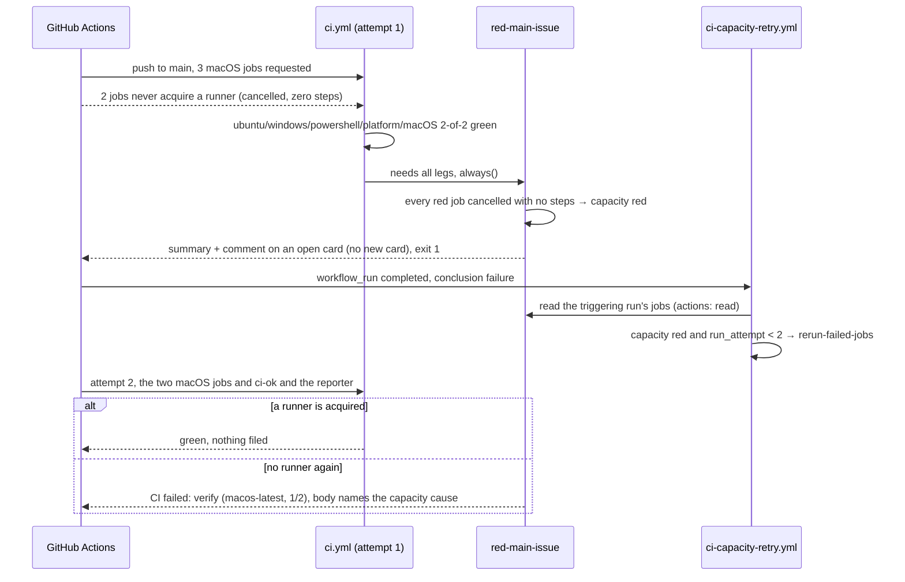

## Context

Run 43904858046 (push to `main`, commit `9dc051d7`) is red for one reason, and it is not the code. Two of
the run's three macOS jobs — `verify (macos-latest, 1/2)` and `perf (macos-latest)` — were cancelled after
fifteen minutes with `runner_id: 0`, `steps: []` and GitHub's own annotation on their check runs:

```text
The job was not acquired by Runner of type hosted even after multiple attempts
Due to capacity constraints, jobs targeting macOS arm64 runners may experience longer queue times.
```

Every job that held a runner succeeded: the four Ubuntu shards, the four Windows shards, the PowerShell
twin, the platform job and `verify (macos-latest, 2/2)`. `ci-ok` then did what the spec asks — a cancelled
leg is not a pass — so it reported `verify=abandoned` and the `red-main-issue` reporter filed a `kind/bug`
card, this one.

The two facts that shape the change:

- **A run cannot rerun itself.** GitHub accepts a rerun only for a completed run, and the reporter runs
  inside the run it would have to rerun. Whatever retries the run has to be a workflow the completion of
  CI triggers.
- **`rerun-failed-jobs` only reruns failed jobs.** That keeps the green Ubuntu and Windows work from being
  paid for twice, but it also means a job that succeeded on attempt one is not present on attempt two —
  the reporter has to be a failed job of attempt one to observe the retry.

## Goals / Non-Goals

**Goals:**

- A leg GitHub never gave a runner is retried once, automatically, and is not turned into a card while the
  retry budget is unspent.
- The retry can never hide a failure that executed: any red job with a step disqualifies the run.
- A runner shortage that survives the retry still produces the card, and the card says why.
- The decision is pure, lives beside the red-job and area decisions, and fails before the change.

**Non-Goals:**

- Retrying a test that failed, a build that broke or a perf budget that was breached: those ran, and the
  existing flake budget (`scripts/verify.sh`'s single retry with its ledger) already owns in-job flakes.
- Retrying a pull request or merge-group run: neither runs macOS, both are re-triggered by a push, and the
  reporter does not report them.
- Raising or hard-coding a macOS budget or shard count: the capacity constraint is GitHub's, not the
  gate's, and `#831` already sized the matrix.
- Turning a missing leg green: `ci-ok` still fails closed on an abandoned leg in every attempt.

## The flow

The dynamic view of one capacity red, as Mermaid `sequenceDiagram` (plain syntax, no C4 specifics):



Boundaries and responsibilities, in prose:

- `scripts/ci-issue-triage` owns the decision (which jobs are red, is the red a capacity red, which
  milestone and area a card takes). It is pure Python over documents the shell hands it, so its self-test
  needs no network — the same split `scripts/ci-ok-state` and `scripts/ci-ok.sh` already use.
- `scripts/nightly-issue.sh` owns the `gh` calls and the run's own attempt number
  (`GITHUB_RUN_ATTEMPT`), so it decides "defer and fail" versus "file".
- `.github/workflows/ci-capacity-retry.yml` owns the one side effect a run cannot perform on itself:
  requesting the rerun, gated on the same decision. It needs `actions: write`, which no other CI job holds.
- `ci-ok` stays unchanged: it keeps requiring every leg of the plan's matrix, in whichever attempt it runs.

## The capacity predicate

A job is *never acquired* when `conclusion == cancelled`, `runner_id == 0` and `steps` is empty. A run is a
*capacity red* when it has at least one red job and every red job is never acquired. The three conditions
are checked together because each alone is ambiguous: a job cancelled by a `cancel-in-progress` run also has
no steps, and a started-then-cancelled job has steps but may still report `runner_id: 0` in a paginated
payload. All three together are only satisfied by a job that never reached a machine.

Red is the reporter's existing set — `failure`, `timed_out`, `cancelled`, `action_required`,
`startup_failure`. `skipped` is not red.

## Alternatives considered

- **Retry the whole run (`rerun`, not `rerun-failed-jobs`).** It would rerun the reporter unconditionally and
  remove the need for the reporter to fail on the deferral path, at the cost of repeating ~20 minutes of
  green Ubuntu and Windows work for a macOS queue problem. Rejected: `rerun-failed-jobs` keeps the retry
  proportional to what actually failed.
- **Do the retry from inside `ci-ok`.** It runs at the end of the same run, so its own run is still in
  progress and the API refuses the rerun. Rejected as impossible, not as undesirable.
- **Suppress the card without retrying.** `main` would then be red with nothing filed and nothing retried,
  which is the failure mode the "red run reports itself" rule exists to prevent. Rejected.
- **Reduce the macOS legs on a push (fewer shards, drop the perf leg).** `#831` already cut macOS to two
  shards and the perf leg is the quiet measurement the shared runner needs; cutting again trades coverage
  for a queue that was still short with three jobs. Rejected inside this card; a genuine capacity policy
  change would be its own card.
- **Poll the run from the retry workflow until it completes.** Unnecessary: `workflow_run: completed` is the
  completion event.

## Risks

- The retry workflow only runs once the file exists on the default branch, so the change cannot be exercised
  before the merge. Its decision is unit-tested and its wiring is pinned by the workflow invariants in
  `tests/scripts/`; the first real capacity event is the only end-to-end evidence, and it is a maintainer
  observation after the merge.
- A capacity red costs one extra run attempt. The budget of one retry bounds that.
- If GitHub ever reruns a run in place of creating an attempt, `run_attempt` would not advance and the
  budget would not bind. The workflow reads the attempt from the triggering run payload, which GitHub
  documents as the attempt number, and files no card of its own — so the worst case is a second rerun, not
  a loop that reruns before `red-main-issue` can report.
