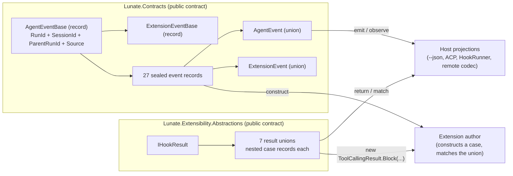

## Context

Nine public types head a closed set on the extension-facing contract:

- `Lunate.Agent.AgentEvent` (`src/Lunate.Contracts/AgentEvent.cs`) — 27 sealed event records that
  derive from `AgentEventBase`, which carries the state the event channel stamps (`SessionId`,
  `ParentRunId`, `Source`). `ExtensionEvent` is the extension half: 14 of those records, derived from
  `ExtensionEventBase`.
- Seven hook-result families (`src/Lunate.Extensibility.Abstractions/Hooks/HookResults.cs`), each a
  union over two or three nested case records implementing `IHookResult`.

Both sets are specified as closed. [`openspec/specs/agent-events/spec.md`](../../../openspec/specs/agent-events/spec.md)
says `AgentEvent` is "a closed, sealed set of records" and requires consumers to ignore a kind they
do not know; the hook catalogue fixes the result of every interceptor. Before this change neither set
was closed in the compiler: any assembly could derive from either, so a consumer's `switch` could not
be exhaustive and a kind outside the contract could reach it.

The retarget ([ADR-0041](../../../adr/0041-net11-target-frameworks.md)) made `union` and `closed`
available on this surface. #192 deferred the choice to this card; the card's decision is `union`, and
[ADR-0043](../../../adr/0043-contract-unions.md) records it, superseding
[ADR-0042](../../../adr/0042-contract-closed-sets.md).

## Goals / Non-Goals

**Goals:**

- The closed sets are unions over their cases: no type outside the contract can add a case, and a
  `switch` over the set that the compiler checks for exhaustiveness.
- The wire is byte-identical: the `--json` event stream and the remote-extension protocol keep their
  discriminator and field names, and the existing golden/session fixtures pass unchanged.
- The public API files are updated and the public-API analyzer is green.
- The decision, the measurements and the shape are recorded (ADR-0043) and the live docs and the
  extension version note say what the code now does.

**Non-Goals:**

- No change to `ContextBuildingResult` or `ToolResultReadyResult` (single-shape records).
- No change to the internal `Lunate.Tui` / `Mermaid.Terminal` union refactor slices of #192.
- No JSON type classifier: no wire serializes a union as a union.

## Decisions

### 1. `AgentEvent` and `ExtensionEvent` are unions over the event records

Every event record keeps its name, constructor and properties, and derives from `AgentEventBase` (or
`ExtensionEventBase`), which holds the stamped state — a union declaration may not carry instance
fields or auto-properties (CS9373). The union declares the records as its cases, exposes `RunId`,
`SessionId`, `ParentRunId`, `Source` and `Kind` as computed properties, restores record value equality
with `Equals`/`GetHashCode`/`==`, delegates `ToString` to the case, and converts from `AgentEventBase`
so the one place that stamps a session (`AgentEventChannel`, `SubagentRunner`) does `with` on the
record and converts once.

### 2. The seven hook-result families are unions over their nested cases

The case names are the authoring surface, so they stay nested (`ProjectTrustResult.Deny`); each case
implements `IHookResult` and so does the union, which keeps handler signatures and the conformance
inventory's marker walk working. The families' private constructors and no-case default are gone —
that is the shape the card chose — and a handler's return of a case converts implicitly.

### 3. The consumer idiom survives the union

A union's `Value` is `object`, so `Enumerable.OfType<T>` over it never matches and `GetType()` reports
the wrapper. The contract therefore ships `AgentEventExtensions.OfType<T>` (which projects to the
record line first) and a `Kind` property, and the repository's `GetType()` call sites moved to it.
`OfType<T>` is a public helper and documented for extension authors.

### 4. The wire stays a projection of the case

`PrintEventJson` builds the `--json` line from the matched case, and `HookResultCodec` writes the
`outcome` object from the matched case; neither hands a union to `System.Text.Json`, so no classifier
is required and the bytes do not move. The hook conformance inventory gains one union-typed sample
per family so `MissingCoverage()` stays empty.

### 5. What stays the same

The namespaces stay (`Lunate.Agent`, `Lunate.Extensibility.Abstractions`), the case names and
constructor shapes stay, the `IHookResult` / `IHookPayload` markers stay, the `--json` and ACP
projections stay, and `ExtensionApi.Current` stays `1.16.0`: that minor is unpublished and this
change rides it. The spec's consumer rule — ignore a kind you do not handle — is now the `_` arm the
compiler asks for.

## Diagram

The contract surface, the record line and the two projections:

- The contract assemblies are the only place a case can be declared; both unions are declared over
  the whole set, so a downstream assembly cannot add one.
- The host matches over the union; the compiler proves its switch complete.
- The wire is a projection of the case, not of the wrapper, so it does not move.
- Assumption: a future family that needs a state-carrying base keeps one, as these do.

## Risks / Trade-offs

- **A source break for reference identity and `GetType()`.** The version note states it; the
  repository's own call sites moved to value equality and `Kind`.
- **A future case is a contract change.** Adding one changes the compiled set, so it carries a
  version note and an API-version decision.
- **A union is a struct.** It cannot be a type constraint (`where T : AgentEvent` becomes
  `where T : AgentEventBase`) and `default` is a no-case value; nothing in the contract produces one,
  and the `OfType<T>` helper tolerates it.

## Migration Plan

Nothing to migrate for construction and matching: every type name, case name, constructor and marker
is unchanged. Code that derived from a set replaces the subclass with a declared case; code that used
`GetType()` reads `Kind`, and code that compared events by reference compares by value.

## Open Questions

_None._ The union question is answered for both families by ADR-0043; the internal `Lunate.Tui` and
`Mermaid.Terminal` slices keep their own decisions.
