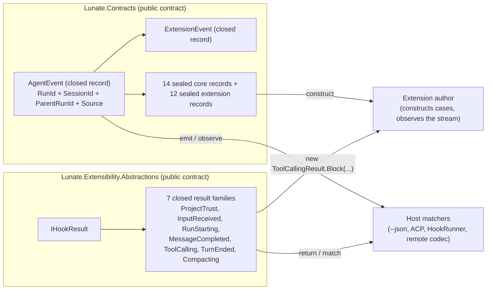

## Context

Nine public types head a closed set on the extension-facing contract:

- `Lunate.Agent.AgentEvent` (in `src/Lunate.Contracts/AgentEvent.cs`) is an `abstract record` with a
  positional `RunId`, three init properties stamped on the base (`SessionId`, `ParentRunId`,
  `Source`), fourteen sealed record cases and one intermediate base, `ExtensionEvent`, with twelve
  sealed cases of its own.
- Seven hook-result families (in `src/Lunate.Extensibility.Abstractions/Hooks/HookResults.cs`) are
  `abstract record`s implementing the `IHookResult` marker, each with a `private` constructor and
  two or three nested sealed records: `ProjectTrustResult`, `InputReceivedResult`,
  `RunStartingResult`, `MessageCompletedResult`, `ToolCallingResult`, `TurnEndedResult`,
  `CompactingResult`.

Both sets are specified as closed. [`openspec/specs/agent-events/spec.md`](../../../openspec/specs/agent-events/spec.md)
says `AgentEvent` is "a closed, sealed set of records" and requires consumers to ignore a kind they
do not know; the hook catalogue fixes the result of every interceptor. Neither set is closed in the
compiler: any assembly can derive from either, so a consumer's `switch` cannot be exhaustive and a
kind outside the contract can reach it.

The retarget ([ADR-0041](../../../adr/0041-net11-target-frameworks.md)) made `union` and `closed`
available on this surface, and #192 deferred the choice to this card. The inventory
([`docs/dev/csharp-15.md`](../../../docs/dev/csharp-15.md)) named `AgentEvent` the motivating case for
`union` before the shape was measured.

## Goals / Non-Goals

**Goals:**

- The closed sets are closed in the compiler: no derived type outside the contract assembly, and a
  `switch` over the set that the compiler checks for exhaustiveness.
- No public member moves beyond that guarantee; no change to the event JSON, the hook wire, the
  loop, or the `ExtensionApi` version.
- The decision, the evidence and the shape rule are recorded (ADR-0042) and the live docs say what
  the code now does.

**Non-Goals:**

- No `union` type on the contract: the two families that would use one are not union-shaped
  (Decisions 1 and 2).
- No change to `ContextBuildingResult` or `ToolResultReadyResult` (single-shape records).
- No change to the internal `Lunate.Tui` / `Mermaid.Terminal` refactor slices of #192.

## Decisions

### 1. `AgentEvent` and `ExtensionEvent` become `closed` records

A union wrapper cannot carry this family. Measured on SDK 11.0.100: a union declaration over the
case types produces a struct whose `Value` is `object`, plus one constructor per case; it has no
base. The three stamped properties and the `ExtensionEvent` classification live on the base, so a
union would move `SessionId`, `ParentRunId` and `Source` into all 26 cases and delete the
`is ExtensionEvent` filter that the mappers and `ExtensionOnlyEventSink` use — and every emit,
projection and switch would pay a box and a cast for a value the host already holds.

`closed` gives the compiler-checked case set in the shape the contract already has: it is implicitly
abstract, the sealed cases stay real records with value equality, the base keeps its state, and a
non-exhaustive `switch` is CS8509 instead of a silent fall-through. It also matches the spec
sentence "a closed, sealed set of records" that nothing enforced before.

### 2. The seven hook-result families become `closed` records, not unions

The same rule, with one more measured fact that decides it: the extensions spec requires every hook
payload and result DTO to round-trip through `System.Text.Json`, and a `union` cannot be
deserialized without a custom type classifier —

```
JSON value type 'Object' is ambiguous for union type 'Res' because multiple case types
can use this value type. Specify a custom type classifier to support deserialization.
```

Serialization works (the case serializes as itself); deserialization does not, so a union result
would need a classifier per family on the wire that already has a hand-written, conformance-tested
codec. The families also carry the `IHookResult` marker on the base, a private constructor that
makes an invalid variant unrepresentable, and nested case names (`ToolCallingResult.Block`) that are
the authoring surface; a union wrapper would replace the base with `object? Value`, whose `default`
is a no-case value, and drop the families' `==`, `Equals` and `GetHashCode` from the API.

`closed` keeps all of that and adds the guarantee: the family cannot grow a variant outside the
contract, and the host's dispatch switch is exhaustive.

### 3. The shape rule, for the next family

A contract type is union-shaped when its cases are otherwise unrelated types with no shared base and
no state on the base. A contract type is `closed`-shaped when a base record carries the family's
marker, its state or its case names. Nothing on the contract surface is union-shaped today, and a
future family that is gets a `union` with the case types in the declaration body — a shape that keeps
`new Family.Case(...)` compiling — plus a JSON classifier.

### 4. What stays the same

The namespaces stay (`Lunate.Agent` for the events behind the type forwards, `Lunate.Extensibility.Abstractions`
for the hooks), the case names and constructor shapes stay, the `IHookResult` / `IHookPayload` markers
stay, the `--json` and ACP projections stay, and `ExtensionApi.Current` stays `1.16.0`: that minor is
unpublished and this change rides it. The public API file does not move either — `closed` is
implicitly abstract, so PublicApiAnalyzers reports the same entries as for the `abstract` record.

### 5. The consumer rule survives the closed set

`agent-events` requires a consumer to ignore a kind it does not handle. With a closed set the
compiler asks for that arm instead of leaving it to convention: a `switch` that does not cover the
set and has no `_` arm is CS8509, which is an error in this repository. The test that proved the rule
with a locally declared `ExtensionEvent` subclass is re-expressed on a declared kind plus a `_` arm,
because a kind outside the contract is exactly what the change removes.

## Diagram

The contract surface and its two matchers (component view, `closed` marked):



- The contract assemblies are the only place a case can be declared; both closed roots are marked
  `closed`, so a downstream assembly cannot add one.
- The host matches over the sets; the compiler now proves its switch complete.
- The author's construction surface is unchanged: the cases are the same nested and top-level
  records.
- The hook wire and the JSON stream are projections of the same records and do not change.
- Assumption: the next family that is genuinely "one of unrelated types" takes the `union` shape
  (Decision 3) with its own classifier; nothing today qualifies.

## Risks / Trade-offs

- **A breaking source change for a downstream subclass.** Nothing in `src/`, `extensions/`,
  `samples/` or the template derives from these types; the one place that did was a test. The version
  note states it for extension authors.
- **A future case is a contract change.** Adding a case now changes the compiled set, so it carries a
  version note and an API-version decision; that is the cost of exhaustive matching and it is the
  point of the change.
- **The inventory said `union`.** The measurement says otherwise for these families; the inventory is
  corrected rather than the code shaped to match an unmeasured assumption.

## Migration Plan

Nothing to migrate: the surface keeps every member and every type name. An extension that derived
from a closed type replaces it with a declared case (or, for a custom notification, uses the
extension event stream once ADR-0040's observer surface lands).

## Open Questions

_None._ The union question is answered for both families by ADR-0042; the internal `Lunate.Tui` and
`Mermaid.Terminal` slices keep their own decisions.
