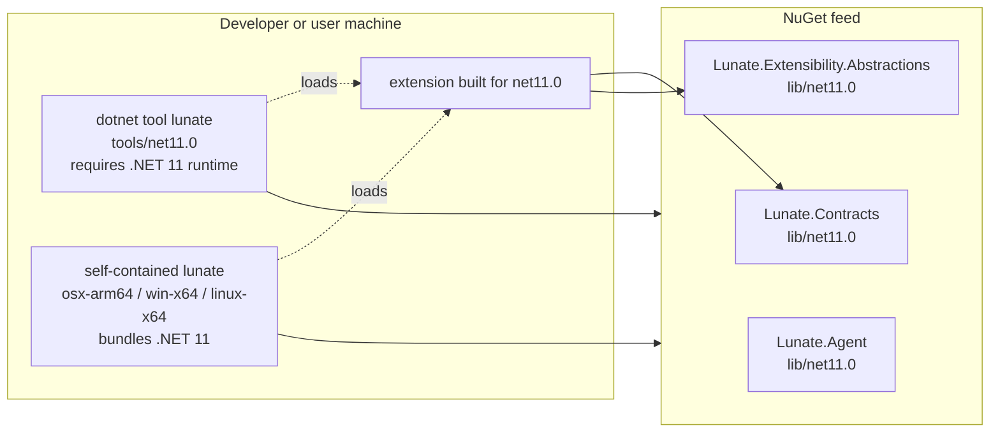

## Context

The repository already pins the .NET SDK 11 (`global.json`) and until now built the product for `net10.0` with it. The C# 15 / .NET 11 inventory ([`docs/dev/csharp-15.md`](../../../docs/dev/csharp-15.md), #899) records the probes: union types and closed hierarchies need the `net11.0` BCL (`IUnion`, `UnionAttribute`, `IsClosedTypeAttribute`); collection-expression arguments and labeled jumps need only the C# 15 compiler.

State before this change:

- `Directory.Build.props` sets `TargetFramework=net10.0` for every project.
- Five projects override it with `TargetFrameworks=net10.0;net11.0` (the superseded compatibility floor): `Lunate.Contracts`, `Lunate.Extensibility.Abstractions`, `Lunate.Agent`, `Lunate.Ai` and `Lunate.Ai.Decisions`.
- `Lunate.Coding` packs as a framework-dependent `dotnet tool`, so its asset is `tools/net10.0`.
- The extension template's extension project targets `net10.0`, and the fixture solutions under `tests/fixtures/` do too.
- Extension compilation already derives its target from the host runtime (`SingleFileTarget.Current()`); only test fixtures and script paths hard-coded `net10.0`.
- `scripts/perf.sh` (local default 150 ms) and `scripts/memory.sh` (150 MB gate) hold the startup and memory budgets calibrated in ADR-0005 / ADR-0009 on .NET 10.

## Goals / Non-Goals

**Goals:**

- Every project in the repository builds for `net11.0` with C# 15, and no project multi-targets.
- The published packages carry one `lib/net11.0` asset; the `dotnet tool` package carries one `tools/net11.0` asset and its release note states the .NET 11 runtime requirement.
- The gate stays green after the retarget: fixtures restore offline, template copies build, and the packed assets are asserted.

**Non-Goals:**

- No C# 15 refactor (union/closed types) in this change; that is step (c).
- No change to `ExtensionApi`, to the extension lock format, or to the public API.
- No budget re-calibration: the card makes the startup and memory re-measurement a maintainer step after the merge (ADR-0005, ADR-0009).
- No new package and no change to the extension loader.

## Decisions

### 1. One target framework, no override

`Directory.Build.props` sets `TargetFramework=net11.0` and stays the only place that names it. The five projects drop their `TargetFrameworks` override, so there is no second asset anywhere: the contract packages, the harness package, the preview test kit, the tool and the app all build once. `Lunate.Agent` and `Lunate.Extensibility.Testing` keep packing their carried assemblies at `lib/$(TargetFramework)`, which now resolves to the one asset.

Alternative rejected: keep the `net10.0;net11.0` split for the published packages. It doubles five builds, keeps the contract surface `net10.0`-compatible — the opposite of what the retarget is for — and protects a consumer that does not exist.

### 2. The tool package requires .NET 11

`Lunate.Coding` packs one `tools/net11.0` asset. The changelog fragment, `README.md`, `docs/quickstart.md` and `docs/dev/distribution.md` say that `dotnet tool install -g lunate` needs the .NET 11 runtime; the self-contained installers are unchanged and still need no runtime. Alternative rejected: carry both `tools/net10.0` and `tools/net11.0`, which forces the whole tool graph onto `net10.0`.

### 3. The extension template and the fixture solutions follow

The template is a copy that builds outside this repository: its extension project and its test project are both `net11.0`, so it shows what an extension for this host looks like and the copy target reads one output path. The fixture solutions (`tests/fixtures/solutions/*`, `tests/fixtures/verified-edits/*`) move to `net11.0` because the gate restores them offline against the machine's global packages folder, which the repository's own build fills with the packs it needs — after the retarget, `net11.0` packs only. The `multi-target` fixture keeps two frameworks, at `net11.0`, because modeling a user's multi-target project is its subject.

### 4. Extension compile target follows the host

No product change: `SingleFileTarget.Current()` already produces `net{runtime.Major}.{runtime.Minor}` from `Environment.Version`. The tests and fixtures that hard-code `ref/net10.0` when locating the machine's reference pack use the current TFM instead; package-asset strings that describe a dependency package (for example `lib/net10.0/Octokit.dll`) stay as they are, because they model a real package layout, not the host.

### 5. Live instructions change, records do not

Instructions name `net11.0` and the tool's runtime requirement: `AGENTS.md`, `openspec/config.yaml`, `CONTRIBUTING.md`, `README.md`, the quickstart, `docs/dev/guide.md`, `docs/dev/csharp-15.md`, `docs/dev/distribution.md`, `docs/extensions/README.md`, the template README and ADR-0041. Records keep what was true when they were written: `docs/dev/spikes/**`, `openspec/changes/archive/**`, `CHANGELOG.md` and the earlier `changes/*.md` fragments. `eval/tasks/**` holds an eval subject — somebody else's repository — and keeps its own framework.

### 6. The budgets stay where they are in this change

The card makes the .NET 11 startup and memory re-measurement the maintainer's step after the merge, and says it is not pull-request evidence. This change therefore neither moves `scripts/memory.sh`'s gate nor `scripts/perf.sh`'s budget nor the tests that assert them, and ADR-0041 hands the re-measurement to ADR-0005 / ADR-0009. Measuring the shipped single-file ReadyToRun subject on a developer machine and recalibrating the shared gate from it would be a change to a budget's evidence base that the card explicitly keeps out of the pull request.

## Diagram

Deployment view of a release after this change:

Boundaries: the self-contained binary and the tool are both the `net11.0` host; the extension packages carry the one `net11.0` asset that host and extension bind to. The compatibility boundary the previous decision drew — two assets per package, an extension built against the older one — is gone.

## Risks / Trade-offs

- **An extension built against `net10.0` stops loading** → there are no external extension authors and one user; the template, the reference extensions and the samples move with the repository. ADR-0041 records that multi-targeting returns as a deliberate, breaking decision before the first external release.
- **A fixture asks for a targeting pack the pinned SDK does not bundle** → the fixture solutions move to `net11.0`, so an offline restore resolves against the SDK's own packs; the offline fallback folder stays as the mechanism for a fixture that ever needs another framework.
- **The gate's hard-coded output paths fall behind** → every live script that addresses build output is part of this change, and a new test asserts that no project targets or multi-targets anything but `net11.0`.
- **The tool's local roundtrip needs a .NET 11 runtime** → the pinned SDK and the CI runners already install .NET 11; the changelog and distribution docs state the requirement.
- **A budget regresses on the new runtime** → re-measured by the maintainer after the merge (ADR-0005, ADR-0009); the pull request does not move a budget on local numbers.

## Migration Plan

1. Set the five projects back to the single inherited target framework; keep the pack paths at `lib/$(TargetFramework)`.
2. Move the extension template and the fixture solutions to `net11.0`; update the inline fixture projects and the template copy test.
3. Update the live scripts and docs; write ADR-0041 and the changelog fragment.
4. Build Release, run the focused tests and `openspec validate --all --strict`.
5. Roll back by reverting the branch; no data migration is involved.

## Open Questions

_None._ The target frameworks are the maintainer's decision on #192; the budget evidence belongs to the post-merge maintainer step, and the multi-target question is recorded to return before the first external release.
