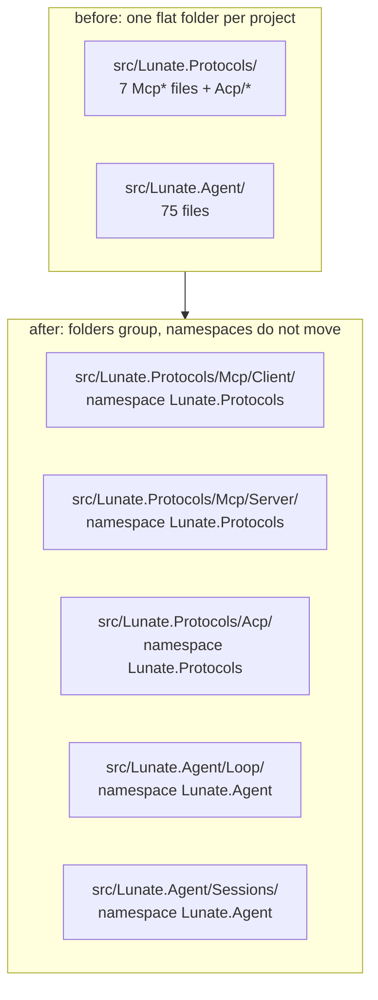
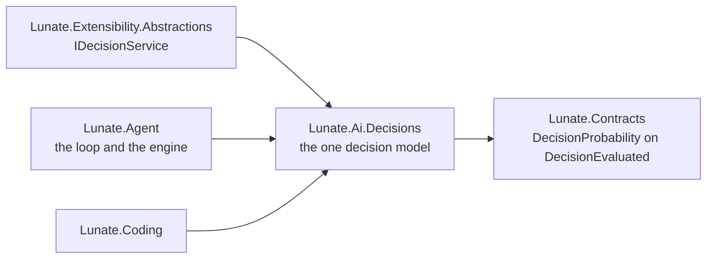

# Design: feature folders that never change the public surface

## Context

`src/` holds 15 projects and about 800 C# files; `tests/` mirrors that flatness with about 950 files.
The 0.3 review asked for feature folders, and thirteen issues (#539–#551) each named one project. The
files are already named after the type family they hold (`AgentHarness.Retries.cs`,
`SettingsStore.Project.cs`, `Mcp*`), so the missing layer is the directory: a reader has to read file
names to find a feature, and a reviewer cannot see from a path whether two files belong together.

The question the change has to settle first is what a move is allowed to change. The code answers it:
`src/Lunate.Contracts` declares `Lunate.Agent`, `Lunate.Ai` and `Lunate.Extensibility.Abstractions`
types and `src/Lunate.Agent` / `src/Lunate.Ai` / `src/Lunate.Extensibility.Abstractions` forward them
with `TypeForwardedTo`, so a compiled consumer keeps binding after the assemblies were split. The
namespace is the compatibility identity; the assembly and the folder are not. Extensions are compiled
by their authors against `Lunate.Extensibility.Abstractions`, so a namespace rename would break a
third-party extension for a directory tidy-up.

## Goals / Non-Goals

**Goals**

- One written rule and one test that fails when a folder tries to become a namespace.
- Every project under `src/` split into feature folders; every test project mirrors them.
- One decision model in `Lunate.Ai.Decisions`, and the contract free of it.
- No behaviour change: same tests, same golden fixtures, same wire shapes, same decision outcomes.

**Non-Goals**

- No project moves, no csproj change, no assembly rename, no package change.
- No type rename beyond folding the two folder-derived namespaces back and the decision model's own
  merge (below).
- No new published package and no release-pipeline change.

## Decisions

### The rule: a folder groups, a namespace identifies

A file's namespace is the assembly's established namespace. A folder never adds, removes or changes a
segment. This is the rule the tree already follows everywhere except two folders, and it is the only
rule that can hold in `Lunate.Contracts`, which must keep declaring `Lunate.Agent` and `Lunate.Ai`
types for its type forwarders.

Rejected: **namespace = project namespace + relative folder**. It would rewrite every `using` in the
solution, break the type-forwarder scheme in `Lunate.Contracts` (the forwarded types would have to
change namespace, and the whole point of forwarding is that they do not), and break third-party
extensions compiled against `Lunate.Extensibility.Abstractions`. It would also make the layout rule
unmergeable with "organize `Lunate.Contracts` without changing its public API".

Rejected: **address-based namespaces with an allow-list for the forwarded types**. The allow-list is
the exception that makes the rule unauditable, and the next split would add a row.

### The two folder-derived namespaces fold back

`Lunate.Protocols/Acp/*.cs` declares `Lunate.Protocols.Acp` and `Lunate.Tui/Platform/*.cs` declares
`Lunate.Tui.Platform`. Both are exceptions the rule cannot tolerate. `IAcpServer`,
`AcpSessionContext` and the rest sit in `PublicAPI.Unshipped.txt` — no shipped assembly declares them
— so folding them into `Lunate.Protocols` changes an unreleased surface only; the `Lunate.Tui.Platform`
types are internal. The `PublicAPI.Unshipped.txt` entries are rewritten in the same commit, and every
`using Lunate.Protocols.Acp` in `src/`, `tests/` and `samples/` follows.

Trade-off: a host that already composes `IAcpServer` re-compiles. Nothing published depends on it,
and the 0.4 release is the only consumer.

### Feature folders are named after the capability, not the type suffix

Folders use the capability vocabulary the specs already use (`Decisions`, `Sessions`, `Tools`,
`Extensions`, `Packages`, `Skills`, `Trust`, `Acp`, `Mcp`) and stay singular PascalCase, matching the
folders the tree already has (`Acp`, `Platform`, `Transcript`, `ToolBlocks`). A project's own
sub-projects keep their own folder sets; `Lunate.Extensibility.Compile` is one file pair and gets no
folder.

### Files stay put where a path is part of a contract

Embedded assets (`settings-schema.json`, `system-prompt.md`, `keys.json`, `models.json`,
`providers.json`) keep their location next to the csproj, because the csproj names the path
(`EmbeddedResource Include="system-prompt.md"`) and a script or test reads the file. Only `.cs` files
move. `tests/fixtures/**` and `tests/Lunate.Coding.Tests/fixtures/**` keep their paths, because golden
sessions and fixtures are compared by path.

### Tests mirror their subject's folder

Each test file goes to the folder of the src feature it exercises, chosen from the types it names: the
test project's file list is walked against a type→src-file index, and the folder of the src file that
declares most of the types the test mentions wins. A test that names no src type (a support double, a
collection definition, an `AssemblyInfo.cs`) stays at the test project root, which is the substrate
every folder shares. `tests/Lunate.TestSupport`, `tests/tools` and `tests/TestExtensions` are support
projects with no single subject and get no folders.

Trade-off: a test that drives a cross-feature flow is filed under its subject type, which is the one
rule that is stable enough to review. The mirrored path is checked in the same source scan: a test
project has a folder only when the src project has it.

### The layout rule is enforced by a source-scanning test

`LayoutRuleTests` (in `tests/Lunate.Coding.Tests`, beside `LayeringTests`, `TargetFrameworkTests` and
the other repository-hygiene scans) walks `src/` and `tests/` and asserts that no declared namespace
repeats a folder segment of its own path, that every feature folder of a source project is mirrored by
the same folder under its test project, and that no test folder exists without one. The scan lives in
`LayoutRule` so the regression cases can feed it a synthetic repository. It reads text, not Roslyn,
like its siblings, so it adds no dependency and stays fast.

### The decision layer: one model, one home

`Lunate.Ai.Decisions.DecisionRequestValidator.Validate` re-checked what `Lunate.Agent`'s
`DecisionRequestValidator.Prepare` and `DecisionEngine` already checked on every request (a state, at
least one question, non-empty instructions, unique answer sets), and every production call reached it
through `DecisionEngine`; it is a second pass over the same object. This change deletes the second
validator, keeps the single validation at the boundary, and renames the internal kind `Noul` to
`YesNo`.

The two DTO sets are merged, which is the boundary work the card's "unify the decision type model"
asked for and the maintainer signed off (ADR-0044). The decision model — `DecisionRequest`,
`DecisionQuestion`, `DecisionQuestionKind`, `DecisionAnswer`, `DecisionBox`, `DecisionResult`, its
usage records and the two seams `INativeDecisionClient` and `IAgentDecisionService` — lives in
`Lunate.Ai.Decisions`, public, and is the type the engine, the chat adapter, the System One transport,
the parser, the validator, the `decide` tool, the ask-user suggestions, the wizard check and
`IDecisionService` all use. `Lunate.Contracts/Decisions/DecisionRequest.cs` is deleted.

The edge runs `Lunate.Ai.Decisions` → `Lunate.Contracts` and never back. The one record that stays in
the contract is `DecisionProbability`, because `AgentEvent.DecisionEvaluated.Distribution` publishes
it to every event consumer; the decision loop reads it from the contract instead of defining a second
copy. Everything else moved down to the loop.

`IDecisionService` stays where the decision-layer spec puts it — `Lunate.Extensibility.Abstractions`,
so an extension resolves it from the extension contract — and that assembly now references
`Lunate.Ai.Decisions` for the model its signature names. The assembly is not published on its own, so
the contract package carries it in `lib/` beside the contract (`Private` to the package, the shape
`Lunate.Agent` and the test kit already use), the host-owned list and the embedded compile contract
gain it, and the extension host-assembly rule allows an extension to reference it. The contract's API
version does not move: the decision types were never shipped, so no published consumer changes.

Rejected: **keep both models and map between them.** Two DTOs with the same meaning is the technical
debt the card exists to kill, and every new field needs a mapping on both sides.

Rejected: **move `IDecisionService` into the decision assembly.** It would take the extension-facing
service out of the extension contract, which is the one assembly an extension compiles against, and
the decision-layer spec places it in Abstractions.

Rejected: **publish `Lunate.Ai.Decisions` as its own package.** Correct eventually, and out of scope
here: the release pipeline names the packages it publishes one by one, and no consumer needs the
assembly on its own.

### The mirror rule is checked in both directions

The test-project scan only walked `tests/` and asked whether each folder had a source folder, so a
feature folder could arrive without a place for its tests and nothing noticed — three had
(`Lunate.Extensibility.Testing/Remote`, `Mermaid.Terminal/Flowchart`, `Mermaid.Terminal/Graph`). The
scan now walks both ways and both halves carry a regression case on a synthetic repository, so a scan
that stopped detecting a violation fails instead of passing on a clean tree. The namespace half got
the same treatment: a folder segment that reappears anywhere in the declared namespace fails, not
only one at its end.

## Risks / Trade-offs

- **A path-sensitive test breaks on a moved file** → the source scans walk the tree generically; the
  only literal `src/` paths are the csproj references, which do not move, and the embedded-asset
  includes, whose files do not move. The focused suites in `tasks.md` include every scan.
- **A test lands in the wrong feature folder** → the folder is reviewable from the path; the rule that
  a test sits with its subject is a convention, and a misplacement costs a later move, not a build.
- **The two namespace folds touch a public surface** → `Acp` types are unshipped and the `Tui.Platform`
  types are internal; the API-analyzer files are updated in the same commit and the focused suites
  include `PublicApiTests` and the ACP tests.
- **The diff is large** → it is moves: `git status` shows renames, and no file's content changes
  except the namespace fold and the decision-layer merge, which carry their own tests.
- **The decision model is public in an unpacked assembly** → the contract package carries it in
  `lib/`, the host owns it at load, and the embedded compile contract offers it to a compiled
  extension; the API version does not move because nothing was shipped.

## Migration Plan

One change, one pull request, one commit per slice. Rollback is `git revert` of the moves. No data,
settings, wire format or session fixture is affected, so no migration is needed.

## Open Questions

None. The one project edge the earlier draft left open (`Lunate.Ai.Decisions` → `Lunate.Contracts`) is
taken with the maintainer's sign-off and recorded in ADR-0044.
