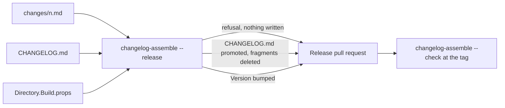

# Design — changelog-assemble --release

## Context

`scripts/changelog-assemble` already owns the changelog's shape: `--write` folds `changes/<n>.md`
fragments into marker regions under `## [Unreleased]`, and `--check` compares the file to that result.
The rest of the release pull request's edit is done by hand from `docs/dev/distribution.md` step 1 —
promote the heading, strip the markers, add a fresh `## [Unreleased]`, delete the fragments, bump
`<Version>` in `Directory.Build.props`. lunate-lane#21 will open that pull request itself, so the
manual page becomes a script or it becomes a source of drift.

The pieces the command reads already exist and are already authoritative: the fragments, the
unreleased section, and `Directory.Build.props`'s `<Version>`, which `release.yml` compares the tag
against. Nothing about the version scheme changes: `ContractApiVersion`, `PreviewVersion` and the
contract suffix derive from `<Version>` already (ADR-0002 addendum), so bumping `<Version>` is the
whole edit.

In-force ADRs reviewed: 0011 (CSharpier, markdownlint, documentation map) — the promoted section has
to stay valid Markdown and the runbook stays the one place that describes it; 0037 (the gate sized by
event) — `--check` at the tag is unchanged; 0041 (net11.0) — untouched, no C# is involved. No ADR
needs revisiting: this is a release-process script, not an architectural commitment.

## Goals / Non-Goals

**Goals**

- One command that performs the whole release pull request edit and is a pure function of the tree.
- Refusals that name the reason and leave the tree byte-identical, so a failed run is safe to inspect.
- The same semver vocabulary the tag uses, so `0.5.0-rc.1` orders before `0.5.0`.
- `--check` passing afterwards, which is what makes the tag-time gate meaningful.

**Non-Goals**

- No new release step: tagging, channel manifests and the sha placeholders stay in steps 2–8.
- No automatic fragment creation, no branch or pull-request handling, no git operations.
- No bump of `ContractApiVersion`: it follows its own scheme and only a maintainer decides it.
- No change to `--check`, `--write` or the fragment grammar.

## Decisions

### A third mode on the existing script, not a second script

The promotion has to know what `--write` produced: the marker regions, the heading order and the
fragment set. A separate script would either import the assembler's private functions or re-implement
the grammar and drift from it. `--release <version>` therefore runs the same in-memory assembly the
other two modes use and then promotes its result.

`--release` is mutually exclusive with `--check` and `--write`, and `--date` only parses together with
`--release` — passing it alone is a usage error, not a silently ignored option.

### The promotion is a rebuild of the unreleased section

Given the assembled text, `release()` finds `## [Unreleased]`, takes its body up to the next `## `
heading, strips the marker comments (the existing `strip_markers` helper), trims it, and rebuilds:

```markdown
## [Unreleased]

## [0.5.0] - 2026-12-01

### Added

- **An entry.** … (#962).

## [0.4.0] - 2026-11-14
```

The fresh `## [Unreleased]` is emitted first and empty, the promoted section follows with one blank
line between them, and everything after the old section is copied byte-for-byte. That is deliberately
the shape `assemble()` treats as a fixpoint for an empty fragment set, so `--check` passes afterwards
without a special case in `--check`.

### The version gate is semver precedence against `Directory.Build.props`

Two runs would otherwise promote twice. The guard is the existing version, read from
`<Version>…</Version>` in `Directory.Build.props`: the run is refused unless the requested version has
*a higher* semantic-version precedence. That one rule also covers the second-run case (`0.5.0` is not
newer than `0.5.0`), refuses a downgrade (`0.3.9`), and refuses a prerelease of the version already
released (`0.5.0` → `0.5.0-rc.1`) while allowing the prerelease → release step the project actually
takes (`0.5.0-rc.1` → `0.5.0`). A version string that is not `MAJOR.MINOR.PATCH[-pre][+build]` is
refused by name rather than compared as text.

The existing heading check is kept beside it: an already-promoted `## [<version>]` is named on its own,
because "this section exists" and "the version is not newer" are different diagnoses and a reader who
reset the version would otherwise see the wrong one.

### Validate everything, then write

The mode collects every refusal — fragment errors from the assembler, the version comparison, the
existing heading, a missing `## [Unreleased]`, a missing `<Version>` element — prints all of them with
the `changelog-assemble:` prefix, and returns 1 before any write. Then it writes `CHANGELOG.md`, writes
`Directory.Build.props`, and deletes the consumed fragments, in that order. Every failure the run can
report is discovered before the first byte changes, which is what makes "refused … with nothing
written" true rather than approximately true.

`--date` is checked against an exact `YYYY-MM-DD` pattern and then parsed with
`datetime.date.fromisoformat` for calendar validity, so a bad date — including a form the parser
also accepts, such as `20261201` or `2026-W49-1` — fails as a usage error instead of appearing in a
heading.

### Tests drive the tree through `--root`

The suite already builds a temporary tree per test (`make_tree`, `run(root, …)`). It gains a
`Directory.Build.props` at the tree's root and a `version=` argument, so a release test is one
`--release` call plus assertions on the three files. The scenarios are the acceptance list: a normal
release, a prerelease, the UTC date default, a date spelled another way, each refusal (not newer,
heading exists, invalid fragment), a second run and a fragment-less release.

The repository's own fragments are still proved by `test_the_repository_tree_assembles`; it stays on
`--write`/`--check`, because running `--release` there would need a version nobody has decided yet.

### Docs follow the command

`docs/dev/distribution.md` step 1 names `scripts/changelog-assemble --release <version>` and keeps the
explanation of what it edits, `changes/README.md` and `CONTRIBUTING.md` name it where they named
`--write` for the release pull request, and the changelog guard's failure message names it too, so a
contributor who reads the refusal is pointed at the command that consumes fragments.



Boundaries: the assembler is the only component; the release pull request is the actor; the tree is
its store. There is no service, queue or database in play, so a system-context diagram would add
nothing beyond the flow above.

## Risks / Trade-offs

- **A release prompt asks for a version the tag also has to spell** → the runbook's step 2 keeps
  `release.yml` comparing the tag with `<Version>`, so a mismatch fails the tag by name.
- **A fragment merges between the release pull request and the tag** → unchanged: `--check` at the tag
  fails, naming the fragment. `--release` does not weaken it.
- **The promoted section keeps a person's hand-written text** → it is promoted with the section, which
  is what step 1 already asked for; nothing is dropped and nothing is reordered.
- **A release with no user-visible change produces an empty released section** → deliberate: the
  version bump is the release's own record, and an empty section is honest where a fabricated entry
  is not. The alternative — refusing — would leave no command for such a release.
- **Deleting fragments is the one destructive step** → it happens last, after `CHANGELOG.md` and
  `Directory.Build.props` are written, and the entries they carried are already in the changelog;
  `git status` names every deletion, which is the review the pull request gives them.
- **A Windows checkout writes `\r\n`** → `CHANGELOG.md` is opened with `newline="\n"`, and
  `Directory.Build.props` is written the same way, so the bytes do not depend on the platform.

## Migration Plan

1. Land the mode, its tests, the docs and this change's own fragment.
2. The next release pull request runs `scripts/changelog-assemble --release <version>` instead of the
   manual list; nothing else in steps 2–8 changes.
3. Rollback is a revert of this change: `--check` and `--write` are untouched, and a tree released by
   the revert keeps its already-promoted section.

## Open Questions

None inside this repository. The lane's use of the command (lunate-lane#21) is outside it; the command
line the lane calls is the one `docs/dev/distribution.md` step 1 names.
