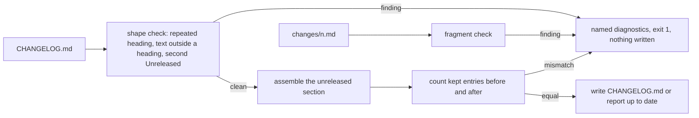

# Design — the changelog's own shape is checked before it is assembled

## Context

`scripts/changelog-assemble` reads `CHANGELOG.md`'s unreleased section as a preamble plus one block
per `###` heading (`split_blocks`), and writes the section back as the preamble, then the headings
Added, Changed, Fixed with the fragments' entries in a marker region and the hand-written bullets
after them. Fragments are validated (`parse_fragment`: heading, bullets, reference). The changelog is
trusted, and three shapes it does not handle are silent:

- **A repeated heading.** `legacy[heading] = kept` keeps the last block of a heading, so a second
  `### Added` replaces the first block's body. Reproduced on a temporary tree: a `### Added` block with
  `- First hand-written entry (#1).` followed by another `### Added` block loses the first bullet on
  `--write`, and `--check` then says "up to date".
- **Text outside a heading in the unreleased section.** The preamble is kept verbatim, so a bullet
  above the first `###` stays above every heading; `promote` carries it into the released section,
  where it sits outside any heading. Nothing is lost, but the entry lands where no heading owns it,
  and `--check` passes.
- **A second `## [Unreleased]`.** The assembler's section ends at the next `## ` line, which is the
  second unreleased heading. A bullet under the second section is tail text: `--write` never touches
  it, `--check` passes, and `--release` promotes the first section and leaves the second behind, so the
  entry is never released.

The mechanisms the check needs are already in the script: `UNRELEASED`, the `## ` section boundary,
`split_blocks`' `### ` prefix, and the `errors` list every mode already collects before it writes.

In-force ADRs reviewed: 0011 (CSharpier, markdownlint, documentation map) — the touched Markdown is
the change's own artifacts and the spec delta; 0037 (the gate sized by event) — no job, leg or profile
changes, the same scripts run; 0041 (net11.0) — untouched, no C# is involved. No in-force ADR is
revisited: this is one release-process script and its spec.

## Goals / Non-Goals

**Goals**

- A `CHANGELOG.md` the assembler cannot read reliably is refused by every assembling mode, with one
  diagnostic per finding naming the file, the line and what was found.
- `--write` cannot carry fewer entries than it read.
- Tests cover each diagnosis and a clean changelog.

**Non-Goals**

- No change to the fragment grammar, to what a successful `--write` produces, to `--release`'s
  promotion, to `--check --tag`, or to the changelog's Markdown style.
- No check on released sections' prose: `## [0.3.0] - 2026-11-09` opens with two prose paragraphs
  before `### Added` and that is the released history's shape. Only the unreleased section's text
  outside a heading is a finding.
- No new script, option or mode: `scripts/changelog-guard` stays the CI-side guard for which pull
  request may edit the changelog, and this stays the assembler's reading of the file.

## Decisions

### The check lives in `assemble`, so every mode refuses the same file

`--check`, `--write` and `--release` all reach `assemble()`; `--release` calls it through `release()`.
The shape check and the entry count go there, before the section is rebuilt, so the three modes cannot
disagree and `--release` cannot publish notes assembled from a file the other two modes refuse. The
card names `--check` and `--write`; `--check --tag` and `--release` inherit the check by sharing the
path, which is the behaviour a release wants.

### One section walk: level-2 headings open versions, level-3 headings open blocks

A single pass over the file's lines:

- A `## ` line opens a version section and resets the section's level-3 headings. Its text is looked up
  in a file-wide table of level-2 headings; a repeat is a finding at the later line, naming the
  earlier one. `## [Unreleased]` gets its own message, because the assembler reads only the first
  unreleased section and everything after the second is invisible to it. The generic level-2 message
  covers any other repeat — two `## [0.4.0] - 2026-11-14` sections are the same defect one level up,
  and `promote` already refuses a second release heading for its own reason.
- A `### ` line is recorded per section; a repeat is a finding at the later line, naming the earlier
  one and the section.
- Any other non-blank line is a finding only while the current section is `## [Unreleased]` and no
  `### ` heading has opened there. Inside an open block it is a bullet or its continuation, which is
  what `parse_fragment` accepts in a fragment; in a released section it is prose the history keeps.

Line numbers are 1-based and counted from the file's first line, and the message names the text found
(the heading, or the trimmed line), so a reader can go straight to it.

### The entry count is a post-condition on the bytes, not a second parser

The entries the write must not lose are the unreleased section's top-level bullets outside the
generated marker region — the ones a person wrote. Bullets inside the region belong to the fragments
and are legitimately replaced when a fragment is consumed (the existing
`test_a_consumed_fragment_disappears_from_the_section` case). `assemble` counts that set in the input,
rebuilds the text, parses the rebuilt text the same way and counts again; a difference refuses the
write and names both counts. Counting the rebuilt text rather than the intermediate lists is
deliberate: the guard is about what would be written, not about what the assembler believes it built.

The refusal is defence in depth: with the shape check in front of it, a count mismatch is a bug in the
assembler rather than something a changelog can cause, so it is exercised directly in the tests on the
count and refusal functions, and end-to-end by the ordinary `--write` cases that keep every
hand-written entry.

### Diagnostics read like the script's existing ones

Every message is `CHANGELOG.md:<line>: <what was found>; <what the assembler expects>`, printed on
stderr after the existing `changelog-assemble: ` prefix, collected with the fragment errors so one run
lists all of them and exits 1 having written nothing. The mode lines ("up to date", "wrote
CHANGELOG.md") are unchanged, so a green run's output does not move.

Boundaries: one script, two files it reads (the changelog and the fragments) and one it writes. There
is no service, queue or store, so a container or system-context diagram would repeat the flow above.

## Risks / Trade-offs

- **A person writes prose in the unreleased section** → it is refused, though `--write` used to keep
  it. That is the card: text outside a heading in the unreleased section is a shape the assembler
  cannot place, and the message says to move it under Added, Changed or Fixed. Released sections keep
  their prose, so nothing in the history changes.
- **A `### CI`-style heading in the unreleased section** → allowed, as it is in the released sections;
  the card asks about repeated headings, not about a closed set of heading names.
- **The check reads headings by prefix, not by Markdown parsing** → a `### ` line inside a fenced code
  block in the unreleased section would be read as a heading. The changelog has no fenced blocks, and
  a real Markdown parser would be a dependency the gate's Python does not have.
- **The count guard cannot be reached from a file once the shape check passes** → the guard is tested
  directly on its own functions, and the end-to-end cases pin that no hand-written entry is lost.
- **`--check` now fails on a file `--write` would have produced** — no: `--write`'s output has an empty
  preamble and one block per heading, which is exactly the shape the check accepts, and the repository
  tree's own `--write`/`--check` round trip stays green.

## Migration Plan

1. Land the shape check, the count guard, their tests and this change's fragment; no changelog edit is
   needed, because the current `CHANGELOG.md` already passes the check.
2. Release pull requests and ordinary `--check` runs pick the check up with the same commands.
3. Rollback is a revert of this change: it adds refusals and touches no output of a successful run.

## Open Questions

None inside this repository. No in-force ADR needs revisiting.
