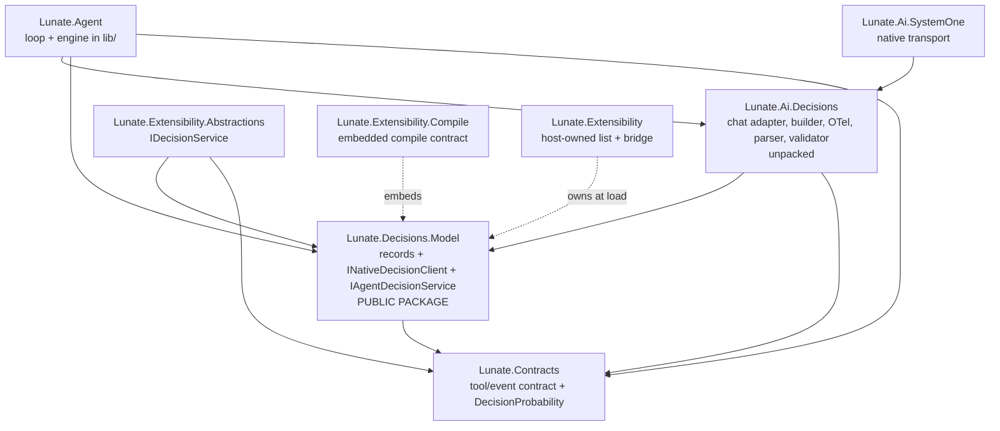

## Context

ADR-0044 made `Lunate.Ai.Decisions` the one home of the decision model, but that project also holds
the engine. `Lunate.Extensibility.Abstractions` references it only because `IDecisionService` is typed
with the model, and packs the whole assembly in `lib/`. The engine therefore has two problems at once:
it is extension contract without a `PublicAPI` file pinning it, and it travels in two packages
(`Lunate.Agent` and `Lunate.Extensibility.Abstractions`), so a test project that references both sees
the same engine assembly twice over.

The constraint that shapes the design is the repository's own compatibility rule: a move never
renames a type or a namespace (`docs/dev/architecture.md`, `repo-quality` spec). The shipped
namespace, `Lunate.Ai.Decisions`, stays; only the assembly that holds the model types changes. The
`IDecisionService` signature in `PublicAPI.Unshipped.txt` therefore does not move.

## Goals / Non-Goals

**Goals**

- `Lunate.Decisions.Model` is a published package holding only the records and the two seams, with
  `PublicAPI` files and no engine types.
- `Lunate.Ai.Decisions` keeps the engine and stays unpacked; the engine types are internal except
  where `Lunate.Agent`, `Lunate.Ai.SystemOne` and the composition reach them through
  `InternalsVisibleTo`.
- Only `Lunate.Agent` ships `Lunate.Ai.Decisions.dll`, because only it needs the engine; every other
  package reaches the model as a package dependency.
- The release, pack dry run and verify roundtrip pack the model package.
- A new ADR amends ADR-0044.

**Non-Goals**

- No namespace change and no type rename.
- No change to the decision wire, results, confidence or `IDecisionService` signature.
- No engine API made public for extensions.
- No change to `Lunate.Contracts`; `DecisionProbability` stays where it is.

## Decisions

### 1. The model types keep their namespace

The package is named `Lunate.Decisions.Model` because a package id is a shipping identity; the
namespace stays `Lunate.Ai.Decisions` because a namespace is a compiled compatibility identity. This
keeps `Lunate.Extensibility.Abstractions`' `PublicAPI` entry, every consumer's `using` and the
summary/`cref` references unchanged, and the project sets `<RootNamespace>Lunate.Ai.Decisions</RootNamespace>`
to say so explicitly. The alternative — rename to `Lunate.Decisions.Model` — would rewrite an
unshipped-but-declared surface for no functional gain.

### 2. `DecisionOptions` and engine bookkeeping stay in the engine

`DecisionOptions` is the per-call transport option (`ModelId`, timeout, session/run ids) and appears
only in `IDecisionClient`, which is internal. `DecisionUsageAttempt` and
`DecisionUsageAttemptsException` are engine bookkeeping. Moving them to the model package would make
engine internals extension contract again. They move into the engine project; the model file keeps
the public records exactly as the acceptance lists them.

### 3. The model package references `Lunate.Contracts`; the engine references both

`DecisionAnswer` carries `IReadOnlyList<DecisionProbability>`, so the model package needs
`Lunate.Contracts`. `Lunate.Contracts` still does not reference any decision project. The engine
references both and remains the only place the parser, validator, adapters and transport-aware
exceptions live. The model package also needs `Microsoft.Extensions.AI.Abstractions` for
`DecisionResult.ChatUsageAttempts`; that dependency rides `Lunate.Contracts` in practice and does not
add a package the contract pair does not already bring.

### 4. Abstractions depends on the package, not on the packed file

`Lunate.Extensibility.Abstractions` gets a normal `ProjectReference` (a NuGet dependency when packed)
to `Lunate.Decisions.Model`, and its `PackOwnAssemblies` target is deleted. Nothing outside
`Lunate.Agent` references `Lunate.Ai.Decisions` for runtime, so `Lunate.Extensibility` references the
model for `IAgentDecisionService`, and `Lunate.Extensibility.Compile` embeds the model assembly and
offers it to the compiler. `HostOwnedAssemblies` names the model, so a copy of it is ignored at load
exactly like a copy of the contracts.

### 5. The seams are public in the model package

`INativeDecisionClient` was already public. `IAgentDecisionService` was internal but crossed two
assemblies through `InternalsVisibleTo`; the card names it as a model-package seam with `PublicAPI`
files, so it becomes public in the package. Its documentation states it is the host-composition seam,
not an extension entry point. `AgentDecisionService` stays internal.

### 6. The model package versions with the contract pair

The package is compiled by extensions through `Lunate.Extensibility.Abstractions`, so it moves with
`ExtensionApi`, not with the preview package pair. It carries `$(ContractVersion)`, and the pack dry
run, release and verify roundtrip expect it under the `CONTRACTS` derivation.

## Diagram

Assumption: extensions still compile against exactly three Lunate assemblies plus MEAI; the model
package replaces the engine in that set and adds no fourth name.

## Risks / Trade-offs

- **A new package a release can forget.** Mitigation: the pack list, the release workflow, the verify
  roundtrip and a test that reads the list all name it.
- **An extension compiled against `Lunate.Ai.Decisions.dll`.** The model types were unshipped in
  `PublicAPI.Unshipped.txt` and the contract package carrying them is still unreleased, so there is no
  published consumer; ADR-0044's stated future move is exactly this one.
- **A public `IAgentDecisionService`.** It exposes a host-composition seam to extension authors.
  Mitigation: the README and XML doc say what it is for; no extension-facing service points at it.
- **Two `Lunate.Ai.Decisions`-namespace assemblies.** Readers may wonder which holds what. The model
  project comment, the package README and the architecture page say model vs engine in one sentence.

## Migration Plan

Project references move in one commit set; no runtime data migrates. A package consumer of
`Lunate.Extensibility.Abstractions` gets `Lunate.Decisions.Model` through its nuspec dependency and can
drop any hand-copied `Lunate.Ai.Decisions.dll`. Rollback is the reverse reference move; no bytes on
disk or on the wire change.

## Open Questions

_None._ ADR-0044 anticipated this exact package move in its Consequences; the new ADR records the
amendment.
