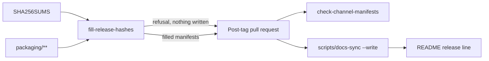

# Design — fill-release-hashes

## Context

`docs/dev/distribution.md` step 4 is the one post-tag edit still done by hand: read three archive
hashes out of the release's `SHA256SUMS` and paste them into the Homebrew formula, the Scoop
manifest and the winget installer manifest, and bump `PackageVersion` in all three winget manifests.
#868 did that for 0.4.0 and #880 fixed the locale manifest it had missed. The lane will open that
pull request itself (lunate-lane#21), so the step needs a deterministic command.

The inputs and the guard already exist and are authoritative:

- `scripts/published_release.py` owns `parse_sums`, the stable-tag spelling and the version, and
  `scripts/check-channel-manifests.py` already validates the result against a release's sums.
- `scripts/docs-sync` already owns the README release line and derives it from the newest published
  stable release, so the fill command must not touch `README.md` itself.
- The manifests are small, fixed-shape files whose values are the only release-dependent part.

In-force ADRs reviewed: 0011 (documentation map and generated docs regions) — the runbook stays the
place a person reads, and `docs-sync` keeps owning the README; 0037 (gate sized by event) — the new
test joins the platform checks, which already run the channel guard; 0041 (net11.0) — untouched, no
C# is involved. No ADR needs revisiting: this is a release-process script, not an architectural
commitment.

## Goals / Non-Goals

**Goals**

- One command that turns a release's `SHA256SUMS` into the committed channel manifests, as a pure
  function of that one file and the tree.
- The 0.4.0 result is reproducible byte-for-byte from 0.4.0's real sums and the 0.3.0 manifests.
- Refusals that name the asset or the manifest whose shape moved and leave every byte untouched.
- A second run with the same input changes nothing.
- The result passes the existing channel guard, and `scripts/docs-sync --write` still owns the
  README line afterwards.

**Non-Goals**

- No network or release lookups: the command reads only `--sums`.
- No README edit, no git operation, no pull-request creation, no tag or release verification.
- No handling of a prerelease tag: the channel guard and the README line are stable-only.
- No new manifest channel and no change to the guard or to the release workflow.

## Decisions

### A standalone script, not a mode on the channel guard

The guard's job is to measure the manifests against the newest published release and it must keep
working when the release host is unreachable. The fill command's contract is the opposite: it has the
checksum file in hand and must never reach the host. Keeping them separate means the guard keeps its
network seam and the fill command stays testable with one local file. `scripts/published_release.py`
is imported for `parse_sums`, `STABLE_TAG` and `tag_version`, so the version vocabulary and the
checksum grammar are not reimplemented.

### The tag is the release identity; the checksum file is the only input

`v<major>.<minor>.<patch>` is required, matching the guard's stable-tag rule. `--sums` is required
and is read once. The three archive names are fixed by the asset contract, and each must appear
exactly once in the file. A missing name is reported by name and no manifest is read for writing.

### Shape-anchored edits, not a parser rewrite

Homebrew and winget are edited with anchored patterns that contain the asset name and the line being
rewritten, so the command fails rather than guessing when the formula or a manifest changes shape:

- Homebrew: one pattern per archive, matching `url "…/<asset>"` immediately followed by
  `sha256 "<64 hex>"`. The match must occur exactly once; the whole URL is replaced with the canonical
  release URL, and the digest with the sums value.
- winget: exactly one `PackageVersion:` line in each of the three manifests, plus exactly one
  `InstallerUrl:` and one `InstallerSha256:` in the installer manifest. The URL must name
  `lunate-win-x64.zip`; the written hash is uppercase.

Only the matched value is rewritten, so comments, ordering and the `$schema` lines survive.

Scoop is JSON, so the command parses it, validates that `architecture.64bit` carries a version, a
`lunate-win-x64.zip` URL and a 64-hex `hash`, then serialises it with the same four-space indentation
the file already uses. The decoder refuses a duplicated object member name before validation, so a
manifest with two `hash` members is named and rejected rather than silently collapsed to one. The
current file round-trips byte-for-byte through `json.dumps(..., indent=4) + "\n"`, which the test
pins; a future formatting change would make the command refuse only if the shape (not the
whitespace) changed.

### Validate everything, then write only what changed

Every manifest is read and rewritten in memory first; all errors are collected and printed with the
`fill-release-hashes:` prefix before anything is written. A refused run therefore leaves the tree
byte-identical. On success, a file whose text is unchanged is not rewritten at all, which is what
makes the second run a no-op and gives the run something honest to say (`unchanged`).

### Tests use the real 0.4.0 release as the golden case

`tests/fixtures/releases/v0.4.0/SHA256SUMS` is the real asset from the 0.4.0 release, committed so a
test never touches the network. `before/` holds the 0.3.0 manifest tree (from `99edb3ab^`) and
`expected/` holds the result #868 committed, including the locale manifest correction from #880 that
the runbook's step 4 requires. The test copies `before/` into a temporary `--root`, runs the command
and compares every file with `expected/`.

The same fixture drives the downstream checks: the result is fed to
`scripts/check-channel-manifests.py --tag v0.4.0 --sums …`, and a temporary docs tree (the real
README with a stale version region, the keys and settings pages and their JSON sources, plus its own
git tag) is passed to `scripts/docs-sync`'s `run()` with a fetch that answers `v0.4.0` from the
fixture. That proves the post-tag flow without the network.

### The gate runs the new test with the channel checks

`scripts/verify.sh`'s platform checks already run the channel guard and its self-test. The new test
joins that step, so a change to the manifests or to the script is measured in the same place the
guard is. No other workflow changes.

Boundaries: one script under `scripts/`, the manifests under `packaging/`, the docs-sync and guard
scripts that already exist, and the operator's post-tag pull request. There is no service or store in
play, so a system-context diagram would add nothing beyond the flow above.

## Risks / Trade-offs

- **A manifest gains a second URL or installer** → the exact-one match refuses by name; supporting it
  is a follow-up change, not a silent guess.
- **A hand edit changes the Homebrew block layout** → the anchored pattern refuses instead of
  producing a formula with a wrong digest; the runbook's step still says how to fix it.
- **Scoop serialisation normalises whitespace** → it already round-trips the committed file, and the
  golden test pins the bytes; if a future editor changes the layout, the test tells the author.
- **A prerelease tag is refused** → deliberate: pointing the stable channels at an rc would fail the
  guard and the release smoke's "a prerelease stays on the stable channel" rule.
- **The 0.4.0 fixture goes stale as a description of today's manifests** → it is a record, not the
  live tree; the test compares against `expected/`, and later releases add their own fixture only if
  they need a golden case.
- **A Windows checkout writes `\r\n`** → every write goes through a newline-normalising helper, so
  the bytes are the same on every platform.

## Migration Plan

1. Land the script, its tests, fixtures, gate wiring, the runbook update and this change's fragment.
2. The next post-tag pull request runs `scripts/fill-release-hashes v<version> --sums <file>`, then
   `scripts/docs-sync --write`, instead of the manual step 4; nothing else in the runbook changes.
3. Rollback is a revert of this change: the manifests are ordinary files, so a revert restores the
   previous values and the manual step still works.

## Open Questions

None inside this repository. The lane's use of the command (lunate-lane#21) is outside it; the command
line it calls is the one `docs/dev/distribution.md` step 4 names.
