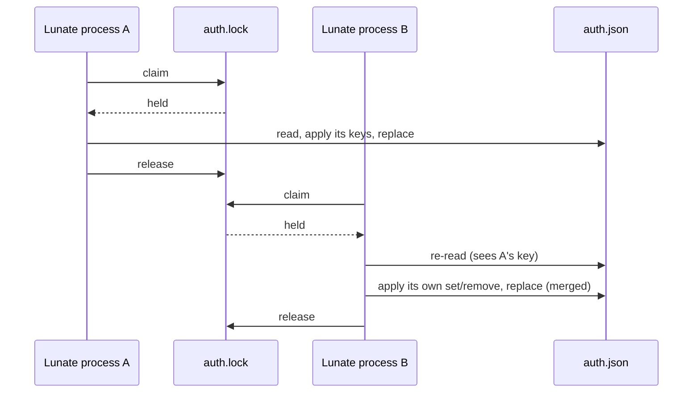

## Context

`AuthStore` owns `~/.lunate/auth.json` (schema 1, `keys: { <name>: <secret> }`). Writing it today is
`Load` → `Set`/`Remove` → `Save`, where `Save` serializes the whole in-memory dictionary and
replaces the file atomically. Two writers exist: the CLI (`lunate auth login`/`logout`) and the
interactive session (`/login`, `/logout`, the auth picker). A third path replaces the file
directly: the setup wizard's commit stages a copy of `auth.json` and replaces the target through
`SetupWizardTransaction`. `settings.json` and `providers.json` already take a `<file>.lock` claim
for their whole read-modify-write (`SettingsStore`, `ProviderStore`) and the wizard's commit takes
those two claims before it seeds, but `auth.json` takes none, so one process's key can be dropped by
another process's stale document.

The claim mechanism is already in the repository: `Lunate.Ai.FileLock` opens the sidecar with
`FileShare.None` and waits on it, and `FileLock.Acquire` refuses with a `TimeoutException` after a
bounded wait. The repository also already parses an auth document twice (`Parse` from `Load`), so
re-reading under the claim reuses that parser.

## Goals / Non-Goals

**Goals:**

- Serialize every auth-store write across processes, including the setup wizard's commit, which
  replaces `auth.json` from a staged copy.
- Merge at key level under the claim: a key another process saved is kept, a key this store set is
  written, a key this store removed is removed.
- Keep a refused claim honest: bounded wait, name the file and the lock, change nothing.
- Leave `Load` unchanged: no claim, no lock file, one complete document.

**Non-Goals:**

- Replacing the setup wizard's staging or its all-or-nothing restore.
- A shared multi-file transaction between the three stores; each keeps its own claim.
- Changing the auth file's schema, sorting or permissions.
- Serializing readers against writers; replacement is atomic, so a reader always sees one document.

## Decisions

1. **`AuthStore.Save` takes the claim, like `ProviderStore.Save`.** Alternatives: documenting why
   the store may stay claim-free (rejected — the card names a real lost update between `auth login`
   and a wizard commit), optimistic retry on a content stamp (adds a field the file does not carry),
   or claiming inside `Load` (would make every read a write path and create lock files for readers).
2. **The save is a read-modify-write with tracked changes, not "write my dictionary".** `Set` and
   `Remove` record the pending change per name; under the claim `Save` re-reads the file, applies
   the pending changes to that reading, writes it, and adopts it as the store's new in-memory
   document. Writing the dictionary instead would still drop another process's key, and a
   three-way merge over the base document is the same thing with more state. A removal wins over a
   concurrent write of the same name: the user asked for the key gone.
3. **A save with no pending change writes nothing and takes no claim.** The document it would write
   is byte-identical, and a needless claim could refuse where today's no-op succeeds. The wizard
   benefits: its staged auth body is a seeded copy, so a commit with no credential does not touch
   `auth.json` (the transaction already skips a byte-equal target).
4. **Same refusal shape as the other two stores.** A ten-second bounded wait, then an
   `InvalidOperationException` naming the auth file and `auth.lock` and saying nothing changed;
   contention is not invalid data. A document that no longer parses under the claim surfaces the
   store's existing `InvalidDataException` (every problem listed, no value printed) and nothing is
   written.
5. **A static in-process gate around `Save`.** `FileLock` refuses a second handle from this process
   too, so two threads saving at once would otherwise make the second wait out the timeout.
   `SettingsStore` and `ProviderStore` guard the same way; `Load` stays ungated because replacement
   is atomic and it must not take a claim.
6. **The wizard's commit claims `auth.json` beside the other two.** Taken with the others before any
   read or seed, released after the last replace, in a fixed order (settings, provider store, auth)
   so two wizard commits cannot deadlock; no other path takes two of these claims at once. The
   staged `AuthStore.Save` runs on the staged path, so its own claim (`<staging>/auth.lock`) is a
   different file and cannot deadlock against the live claim.
7. **The wizard's own `AuthStore` writes stay on the staged copy.** The commit's final
   `live.Set(...)` only updates the caller's in-memory store, so no live `AuthStore.Save` runs while
   the live claim is held.

## Risks / Trade-offs

- **An auth write now waits behind a wizard commit's whole pass** -> The commit claims for one short
  non-interactive pass (the walk is answered before `Commit`), and the writer's bounded wait turns a
  longer collision into an actionable refusal, never a lost key.
- **A removal beats a concurrent write of the same key** -> Deliberate: the user's logout or login
  states the intended final value for that key. Keys are independent, so other keys are unaffected.
- **The re-read can fail where the load succeeded** -> Another process left a malformed document; the
  save refuses with the store's own error and writes nothing rather than overwriting it with a
  guessed shape.
- **A save after a successful save re-tracks from the merged document** -> `Save` adopts the merged
  reading, so a restore path (`Set(previous)` then `Save`) writes exactly that key again.
- **Extra open/read per write** -> One claim handle and one file read on a path that already
  serializes and renames the whole document.

## Migration Plan

No data migration. The first auth write creates the owner-only `auth.lock` sidecar beside
`auth.json`; an older build ignores it. Rolling back leaves the sidecar behind, which is harmless:
`FileLock` claims an open handle, not the file's existence.

## Open Questions

None. No in-force ADR is revisited: ADR-0017's extensions addendum records the lock-file claim this
change reuses, and ADR-0022 keeps the auth store user-scoped and unchanged in shape.
