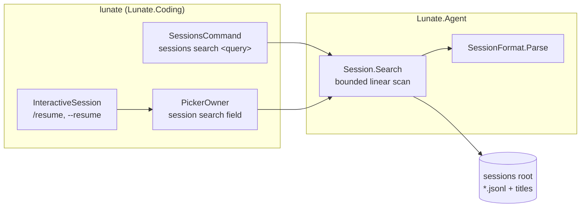

## Context

`Session` (`src/Lunate.Agent/Sessions/`) already owns every read of the session store: `List` reads
one header line per file for the picker, `FindNewest`/`FindById` walk the root the same way, and
`SessionFormat.Parse` turns one JSONL line into a `SessionEntry`. The picker lives behind
`PickerOwner` in `Lunate.Coding` (one consumer loop owns its state) and `InteractiveSession` routes
keys to it; only the model and wizard pickers filter today, and the session picker is documented as
never filtering.

Assumptions: the sessions root is `<LUNATE_HOME>/sessions` (or `--root`-free, since the root comes
from `LunateHome.Store` exactly as the listing's does); a "turn" is a `user` or `assistant` message
entry; the file format is untouched, so no golden fixture changes.

## Goals / Non-Goals

**Goals:**

- One bounded, read-only full-text scan that both the CLI subcommand and the picker share.
- Honest reporting: the bound prints with every search, and a skipped malformed line is counted.
- A picker hit opens the session *at* the matching turn without inventing a new session mechanism.
- No new dependency, no new public API, no session-format change.

**Non-Goals:**

- An index, a cache, a background scanner or an on-disk search store.
- Regex, fuzzy or multi-token queries.
- Searching tool output, compaction summaries, image blobs or extension entries.
- A new slash command; the affordance is the picker's search field named by the card.
- Changing the picker's golden render for an unfiltered session picker.

## Decisions

- **The scan lives in `Lunate.Agent`** (`Session.Search.cs`), beside `Session.List`, because the store
  is the only component allowed to read session files. It reuses `SessionFormat.Parse` per line and
  the existing `EnumerateSessionFiles` recursion. Alternative — search in `Lunate.Coding` with its own
  JSON parsing — would duplicate the format and bypass the header validation.
- **`internal` types, no public API.** `Lunate.Coding` is a friend assembly (`InternalsVisibleTo`), so
  `SessionSearchMatch`/`SessionSearchResult` stay internal and `PublicAPI.Unshipped.txt` is untouched.
  Alternative — a public query surface — is a package promise this card does not approve.
- **Bounds are constants, not flags**: 200 files, 8 MiB of message text, 20 matches. The card asks for
  a stated bound, not a tunable; new long options would also have to be documented in `docs/cli.md`
  and the help/page parity check. The result carries the counters so the CLI and the picker can say
  what happened.
- **Malformed lines are data, not errors.** The scan catches `InvalidDataException` per line, counts
  it and continues. A corrupt header skips the file, matching the listing's rule.
- **The picker re-scans on each filter change** rather than keeping a second index: the query is
  short, the scan is bounded, and the owner's consumer loop (not the UI thread) runs it.
  Alternative — a debounce timer — adds a second writer of picker state.
- **A hit opens the session at its entry by moving the active leaf** (`Session.MoveLeaf`, the record
  `/rewind` already appends), so `ToHistory()` replays exactly up to that turn and the append-only
  file keeps the rest recoverable. Alternative — a viewer that scrolls to the turn — needs a new
  scroll-to-entry surface and does not let the conversation continue from the hit.
- **A pick row's value is `path` for the plain listing and `path + '\u001f' + entryId` for a search
  hit**; one decoder in `Lunate.Coding` keeps the picker's string values unchanged in shape.

## Risks / Trade-offs

- [Typing in the picker runs a file scan per keystroke] -> bounded at 200 files / 8 MiB, run on the
  owner loop; the bound is small enough that the listing's own header reads dominate.
- [Matched tool output would flood results, so it is excluded] -> a user searching for a phrase only
  a tool printed gets no hit; the snippet and the spec say what is searched, and a follow-up can add
  a flag.
- [Moving the leaf writes one `activeLeaf` line into the searched session] -> it is the same
  append-only record `/rewind` writes; the file is never rewritten and the branch survives in `/tree`.
- [Culture-dependent formatting creeps into timestamps/byte counts] -> every formatted value goes
  through `FormattableString.Invariant`/`CultureInfo.InvariantCulture`, as the repo rule requires.

## Migration Plan

Additive: a new subcommand, a new store query and a picker field. Nothing rewrites existing files and
no session schema changes, so there is no migration and the rollback is deleting the command/field.

## Open Questions

- None inside this card. Whether search should widen to tool results (an explicit flag) is a
  follow-up, not a descope of this acceptance.
