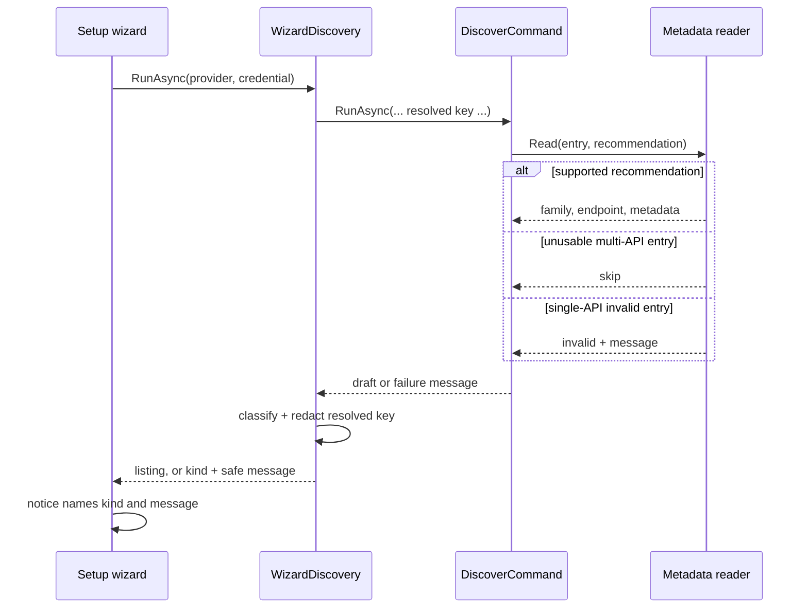

## Context

Discovery is one request through `DiscoverCommand`; `ParseListing` reads each `data` entry with
`DiscoveryModelMetadataReader.TryRead`, and the wizard wraps that call in `WizardDiscovery.RunAsync`.
The reader currently requires the entry's `api` object to carry exactly one family. The live OpenCode
Go listing has an entry with `generate-content` and `interactions`, and a model-level
`recommended_api: "interactions"`. The reader rejects the entry, `ParseListing` turns that into a
whole-listing failure, `WizardDiscovery.Classify` falls through to `Network`, and the wizard notice
prints only the shape.

The API-family set stays the closed set from ADR-0029: `openai-chat`, `openai-responses`,
`anthropic-messages`, `google` and `systemone`. `interactions` is not a family this client can speak,
so the recommendation cannot be adopted blindly.

## Goals / Non-Goals

**Goals:**

- A multi-API entry with a supported recommendation is read through that family and its endpoint.
- A multi-API entry without a usable recommendation is skipped, and every other model in the listing
  still reaches the wizard.
- Listing-body failures classify as `Undecipherable`; transport failures stay `Network`.
- The wizard notice shows the underlying discovery message, with the resolved credential redacted.
- Offline fixtures cover the multi-API entry, the classification and the redacted notice.

**Non-Goals:**

- No new API family (`interactions`) and no change to ADR-0029's closed family set.
- No change to what a single-API entry with unsupported or invalid metadata does: it still fails the
  listing and now classifies as undecipherable.
- No automatic retry, no new picker and no change to the model-check path.

## Decisions

### 1. Recommendation first, skip second, never fail the listing

`DiscoveryModelMetadataReader` returns a three-way outcome: read, skip, invalid. For an `api` object
declaring more than one family (excluding an optional nested `recommended_api` key), the model-level
`recommended_api` is the only candidate. It is used when it names a declared family that maps to a
supported family. A missing, unrecognised, unsupported or invalid selected entry yields *skip*; the
listing loop continues. A single declared family keeps today's path and its *invalid* errors.

Alternatives rejected: falling back to the first supported family ignores the server's routing
intent; failing the listing contradicts the card; mapping `interactions` onto `google` would send the
wrong wire shape through the Google adapter.

### 2. Classify by the failure's origin, not by a list of phrases

`Classify` keeps authentication and rejected-status matching. It then treats a message beginning
`Discovering models from ` as a transport/network failure (the command's own wrapper for transport
exceptions) and every other failure as `Undecipherable`. Listing-body failures therefore need no
per-phrase maintenance, and an unknown target or unusable reference no longer masquerades as network.

### 3. Redact where the credential is known

`WizardDiscovery.RunAsync` already resolves the key it hands to discovery. On failure it redacts that
value from the command's message before returning the result, using the same `[redacted]` marker the
model check uses. The wizard notice can then print `result.Error` verbatim after the failure shape.
Redacting at the discovery boundary means any caller, not only this notice, receives a safe message.

### 4. Fixtures are the evidence

A dedicated `opencode-go-multi-api-models.json` fixture covers: a supported recommendation, the live
`interactions` recommendation, a missing recommendation and a recommendation naming no declared
family. The existing live-listing fixture's Gemini entry is updated to the current live shape so the
live-listing test exercises the regression. A small unreadable-listing fixture echoes a fake
credential in an invalid `base_url`, which lets the notice test prove both the underlying message and
its redaction without a live API.

## Diagram

Dynamic view of the wizard path after the change:

Boundaries: the reader owns per-entry interpretation; the command owns listing-level success and
failure; the wizard owns classification, redaction and the notice. The credential crosses from the
wizard into the command only as the header it already sends.

## Risks / Trade-offs

- **Gemini disappears from the OpenCode Go wizard listing** while its recommended API is
  `interactions` → it remains manually enterable and the model check still decides; adopting an
  unsupported wire would be worse. The skip is the card's stated fallback.
- **A future supported family recommendation starts working without code changes** → the family map
  remains the explicit allow-list; a genuinely new family needs its own change and adapter.
- **Classifying all non-transport failures as undecipherable hides a distinct category** → the
  message is preserved in the notice, and the card asks for listing parse failures not to read as
  network.

## Migration Plan

No stored data changes. Rollback is a revert of the branch commit; fixtures and tests move with it.

## Open Questions

_None._ The family set and its ownership are settled in ADR-0029; this change does not revisit it.
