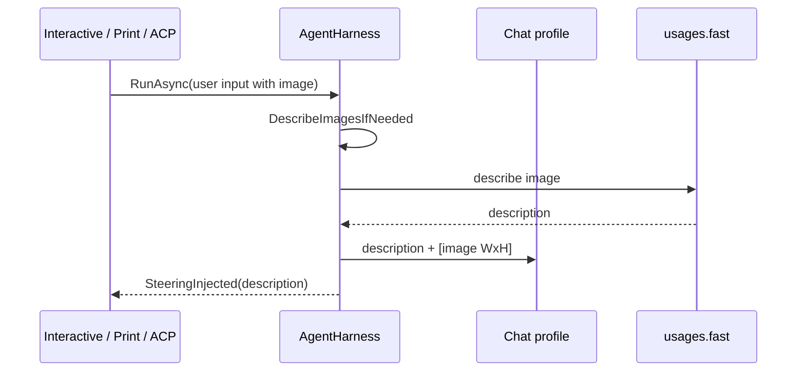
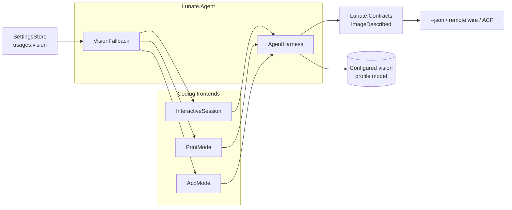

## Context

The merged fallback (#1014) resolves `usages.fast` as the vision profile, attributes the vision
request as `fast`, and announces the description as `SteeringInjected`. The maintainer decision of
2026-11-22 makes vision a role of its own: `usages.vision`, image input as its declared capability
requirement, and a dedicated transcript event. The existing settings schema, schema-4 session
attribution and selection pipeline already carry everything needed, so this is a correction inside
those boundaries, not a new format.

The current path (before this change):

After this change `Fast` is `usages.vision`, the usage attribution is `vision`, and the transcript
kind is `ImageDescribed`.

## Goals / Non-Goals

**Goals:**

- `usages.vision` is the one configured vision profile; a non-vision model in it is treated as
  unset, so today's refusal is unchanged.
- Vision calls are attributed with usage `vision` in schema 4, without a schema version bump.
- The transcript has a dedicated `ImageDescribed` event naming the placeholder, description, profile
  and model.
- ADR-0027 records the usage rule; docs describe `usages.vision`, not `fast`.
- The extension contract and published wire schema move together for the added event case.

**Non-Goals:**

- Building embeddings or image generation. ADR-0027 names their future roles but no consumer exists.
- Re-implementing the fallback, the early image resolver gate or the both-errors failure path.
- Changing the session schema or adding a per-image session entry.

## Decisions

### Decision: `vision` is a usage, not `fast`

A usage is a role with declared capability requirements: `chat` requires text and tools, `decision`
requires structured output, `vision` requires image input; later `embeddings` requires the
embeddings API and `image` requires image output. A new role is one settings key, its requirement
and an attribution value. Overloading `fast` hides the user's fast choice and misattributes spend.

`VisionFallback.Usage` becomes `"vision"`; `SettingsStore.Profiles.ReadUsages` accepts the key;
the profile resolver (`VisionFallback.ResolveProfile`) keeps the existing `SupportsImageInput`
check, so a configured profile whose model does not declare image input yields no fallback.
Interactive, print and ACP already build one usage-client dictionary; they wire the vision profile
under the new key with no other change.

Alternative rejected: keep `fast` and add an alias. It would leave two ways to name one role and
keep the spend under the wrong usage.

### Decision: a dedicated `ImageDescribed` core event

`ImageDescribed` carries `RunId`, `Placeholder`, `Description`, `Profile` and `ModelId`. It is a
core event, not an `ExtensionEvent`: the harness emits it and extensions cannot. It folds into
`AgentEvent` directly. `SteeringInjected` returns to meaning only injected steering.

The new union case moves the contract API version from 1.18.0 to 1.19.0 in lockstep with
`ContractApiVersion` in `Directory.Build.props`, and gets a note under 1.19.0 in
`docs/extensions/README.md`. Precedent is `TodoUpdated` in 1.17.0. The `--json`/wire projection gains
`image_described` with `placeholder`, `description`, `profile` and `modelId`; the published schema is
regenerated from the projection's kind list.

Alternative rejected: keep `SteeringInjected` and add fields. It makes a steering message
indistinguishable from a model-produced description and forces every consumer to parse text.

### Decision: no session schema bump

Schema 4 already writes the usage attribution as a free string (`SessionFormat.ParseUsageAttribution`),
so a vision call records `usage: "vision"` with profile, provider and model under the existing
schema. The transcript event is run-scoped and is not a session entry. No session reading or writing
changes.

### Decision: amend ADR-0027 rather than supersede it

The decision extends ADR-0027's own usage and capability model, so the ADR is amended in place with
a new dated amendment line and a decision clause that names every role and its requirement. A new
ADR would split one model across two records while ADR-0027 remains in force.

### Component view

## Risks / Trade-offs

- **An exhaustive extension switch breaks at compile time.** A new union case is a source break for
  a switch without a fallback arm. Mitigation: bump the contract API version to 1.19.0 and publish
  the version note, the same path `TodoUpdated` took; extensions with a `_` arm are unaffected.
- **A user who configured `fast` as a vision model loses the fallback.** This is the decision: a
  `fast` binding no longer implies vision. Mitigation: the settings validation and docs name
  `usages.vision`, and an unset `vision` keeps the pre-fallback refusal, which is actionable.
- **The vision event is emitted on the run stream, not persisted.** A resumed session re-describes
  images on its first request and emits the event again; that is consistent with the existing
  per-harness description cache and does not change the session file.

## Migration Plan

No data migration. A user with `usages.fast` on a vision model moves that profile to `usages.vision`
to keep the fallback; the old binding keeps working as the fast usage. Rollback is the reverse code
change; sessions written either way are schema 4 and stay readable.

## Open Questions

None. The 2026-11-22 maintainer decision settles the usage key, attribution, event shape and ADR
amendment; this design only records how they land.
