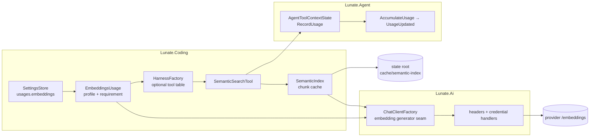
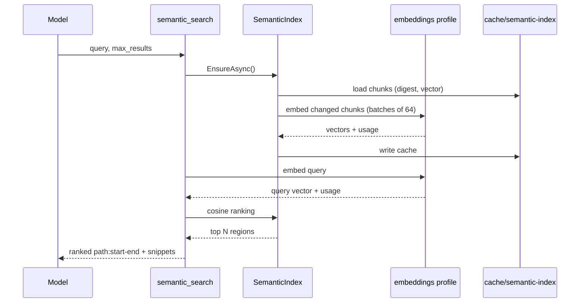

## Context

The `embeddings` capability entry is named in three places and built in none: `ai-layer`'s capability
facts carry `apis: embeddings`, ADR-0027 lists `embeddings` as a usage role whose requirement is the
embeddings API, and `models.json` ships embedding models. #981 decides that repo search is the
consumer, so this change adds the smallest consumer that exercises the whole path: settings →
usage → provider → the provider's `/embeddings` wire → a ranked result the model can read.

The change sits inside existing boundaries. The optional-tool table (`OptionalTools`), the usage
resolver (`ModelSelectionResolver`), the provider transport (`ChatClientFactory`) and schema-4
usage attribution are all in place; nothing here adds a session entry, a second tool protocol or a
new package.

## Goals / Non-Goals

**Goals:**

- `semantic_search` is an optional tool enabled exactly like `grep`/`find`/`ls`, and is offered to
  the model only when it can actually run.
- `usages.embeddings` is the consumer's configuration: one settings key, one requirement
  (the model's declared `embeddings` API), one attribution value.
- The index is a rebuildable cache outside the workspace and outside the session.
- The SWE-bench adapter can run the tool-on and tool-off arms of one subset reproducibly.
- ADR-0027's usage-role amendment is brought up to date: `embeddings` is built.

**Non-Goals:**

- Tuning retrieval quality (rerankers, hybrid search, chunk heuristics beyond line windows).
- A new index format other than "chunks and vectors in JSON under the state root".
- Embedding transports for `anthropic-messages` or `google`; no such wire exists in this build.
- Recording the index anywhere in the session, or adding a session-schema version.
- Running the benchmark comparison itself: it needs Docker and live provider credentials.

## Decisions

### D1 — a fourth optional tool, not a new core tool

The card says "enabled the way `grep`/`find`/`ls` are", so `semantic_search` joins
`OptionalTools.Names` and inherits `tools.extra`, `LUNATE_EXTRA_TOOLS`, `--extra-tools`, the core-name
refusal and the "nothing extra by default" rule. It is read-only and requires no approval, like the
other search tools.

Registration has one extra gate the other three do not need: the tool needs an embeddings profile.
When the name is enabled but the usage does not resolve, the tool is **not registered** and the host
prints one warning naming `usages.embeddings`. The alternative — register and fail every call — puts
a guaranteed error in front of the model and burns a step per attempt.

### D2 — `usages.embeddings` is a role with one requirement

Following ADR-0027 decision 6 as amended, the role costs one settings key, one requirement checked
at resolution, and one attribution value. The requirement is checked the way ADR-0027 decision 3
says capabilities are: a **known** API set without `embeddings` is refused (naming the profile, the
model and the requirement); an **unknown** set is accepted, because unknown is not a known failure.
The resolved family must be `openai-chat` — the only family this build has an embeddings wire for —
and any other family is refused naming it, so a user learns the constraint at configuration time
rather than at first search.

`usages.embeddings` is skipped by the interactive session's chat-usage loop (that loop builds
`IChatClient`s for chat roles); the embeddings client is built by its own resolver.

### D3 — the embeddings wire reuses the provider transport

`ChatClientFactory` gains one internal seam that returns
`IEmbeddingGenerator<string, Embedding<float>>` for a resolved model, built from the same
`OpenAIClient` options the `openai-chat` family uses: the resolved endpoint, the header handler, the
credential-placement handler, and the wire model id. The value never sits in the SDK object; the
credential is placed on the wire by the existing handler. No new package: MEAI's OpenAI adapter
(`AsIEmbeddingGenerator`) and the OpenAI SDK are already referenced by `Lunate.Ai`.

Alternative rejected: hand-rolling JSON over `CreateProviderHttpClient`. It duplicates the request
shape and the usage mapping for no gain, and it would drift from the chat path's error handling.

### D4 — the index is a chunk cache under the state root

The index lives at `<LunateHome.Store>/cache/semantic-index/<workspace-hash>-<model-hash>.json`.
That is outside the workspace (so `git status` never sees it and nothing can commit it) and outside
the session directory (so no session file can grow by it); deleting `cache/semantic-index/` leaves
the product working and costs a re-embed. The cache holds `path`, `startLine`, `endLine`, a SHA-256
of the chunk text and its vector; a chunk is reused when the path and digest are unchanged, so a
one-file edit re-embeds one file. A missing, unreadable or malformed cache is treated as empty; a
write goes through a temp file and a move, so a failed rebuild leaves the previous cache usable.

The walk is `FileIndex.VisibleEntries` — the same `.gitignore` chain, `.git` and symlink rules the
search tools already apply — plus a binary probe and a 256 KiB file cap. Chunks are line windows of
40 lines; the index is capped at 2,000 chunks in deterministic path order. Embeddings are requested
in batches of 64, on the first search call, never at startup.

### D5 — attribution without a session-schema bump

An embeddings call is not a chat message, so it cannot ride an assistant entry. The harness stamps
an internal usage hook into the tool context (`AgentToolContextState.RecordUsage`) that routes to the
one `AccumulateUsage` path: it emits `UsageUpdated` with `ModelUsageAttribution("embeddings", …)` and
charges the run's token budget and spend. The interactive session records an attributed usage the
same way it records a decision usage (`AppendModelUsage`), which is schema 4 and already a free
string. No session version changes; an older session stays readable and produces no embeddings row.

Alternative rejected: a new session entry type for embeddings. It would be a session-format change
for data that is already representable.

### D6 — the benchmark comparison is enabled, not run

`scripts/eval/swebench.py` gains `--lunate-home <dir>`: it copies exactly `settings.json` and
`providers.json` into the run directory's `lunate-home`, which the container script already exposes
as `LUNATE_HOME`. One flag makes both arms reproducible — the tool-on arm's home names
`semantic_search` in `tools.extra` and binds `usages.embeddings`; the tool-off arm passes no home.
The comparison itself (Docker, the official images, live credentials) is a maintainer step after
merge; this change delivers the machinery and the documentation.

### Component view

### Search sequence

## Risks / Trade-offs

- **Indexing cost dominates the benchmark's first step.** A large testbed pays one whole-workspace
  embed on the first search. That is the tool's real cost, so the comparison measures it honestly;
  the 2,000-chunk cap and the 256 KiB file cap bound it.
- **Embedding models are easy to misconfigure.** An unknown capability set is accepted by design;
  a chat model bound to `usages.embeddings` then fails at the provider's `/embeddings` endpoint. The
  error names the profile, the model and the provider reason, which is the actionable outcome.
- **A JSON vectors file is not a vector database.** At 2,000 chunks the file is a few megabytes and
  a full cosine scan is fast; the cap is what keeps that true.
- **`--lunate-home` copies two files into a run directory.** They hold references and profiles, not
  resolved secrets; the redaction pass still scans the run tree, and the adapter copies nothing else
  from the directory.
- **The comparison may retire the tool.** The card says so; the change is written so that removing
  the tool is a revert of this one, not an untangling.

## Migration Plan

No data migration. `usages.embeddings` is an unset-by-default key; an existing settings file loads
unchanged. The index is created on first use and is safe to delete. Rollback is the reverse code
change; sessions written either way are schema 4.

## Open Questions

None inside the card's scope. The benchmark verdict (whether the tool stays) is the card's own
follow-up, and it needs Docker plus live provider credentials.
