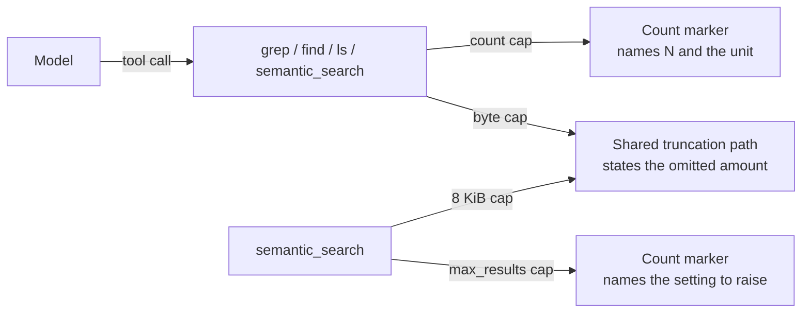

## Context

PR #1035 shipped `semantic_search` and its archived OpenSpec change modified the `agent-tools`
"Optional search tools" requirement. That requirement says all four optional search tools end with
a `[N more …]` line "when a cap cut the result". The shipped tools do not share one marker:

- `grep`, `find` and `ls` end a count-capped result with `[N more matches]`, `[N more files]` and
  `[N more entries]`.
- `semantic_search` ends a `max_results`-capped result with
  `[N shown; more matching regions exist, raise max_results for more]`, because the count cap has a
  setting the model can raise.
- `semantic_search` bounds its whole output to 8 KiB through `WebText.Cap`, whose marker is
  `[search output capped at 8192 bytes]`; every tool's result can additionally be cut by the
  harness truncation path, whose marker states the omitted amount.

The specs under `openspec/specs/` are the source of truth and the archived change cannot be edited,
so the mismatch is corrected with a new `agent-tools` delta and a new archive commit. No tool
behaviour changes.

## Goals / Non-Goals

**Goals:**

- The synced `agent-tools` requirement states the marker each tool actually emits for a count cap,
  and states that byte caps use the shared truncation marker.
- The delta pins `semantic_search`'s count and byte markers with scenarios.
- The existing implementation and tests remain the evidence; no source or test file changes.
- The new change is archived as the branch's last commit, with no hand edit of `openspec/specs/**`.

**Non-Goals:**

- Changing any marker, cap, tool output, test or settings key.
- Changing the `semantic-search` capability spec: its requirement already says the result carries
  "a marker stating the cap", which every shipped marker does.
- Editing `CHANGELOG.md` or adding a release note for an internal spec correction.

## Decisions

### D1 — correct the specification, not the shipped markers

The false claim is the blanket `[N more …]` for every tool and every cap. The shipped markers are
intentional: the `semantic_search` count marker tells the model which argument to raise, and its
byte cap uses the same truncation path as every other bounded output. Forcing `[N more …]` onto a
byte cap would describe a count that does not exist and would diverge from the harness's shared
truncation contract. The spec is therefore narrowed to the real contract.

Alternative rejected: rewrite `semantic_search`'s output to match the old sentence. That is a
behaviour change outside this rework, would break the actionable `max_results` hint and its tests,
and would still leave the byte-cap sentence wrong.

### D2 — one `agent-tools` delta, with the full requirement

OpenSpec's MODIFIED operation carries the complete requirement block, so the delta restates the
whole "Optional search tools" requirement and changes only the marker sentences. `agent-tools` is
the only capability with the false claim; the `semantic-search` capability's requirement is already
accurate and stays untouched, so the contract has one owner and no duplicated wording.

Alternative rejected: also rewrite the `semantic-search` requirement to list the exact markers.
That would duplicate the cross-tool contract and make a spec-only correction touch two capabilities.

### D3 — scenarios pin the two `semantic_search` markers

The requirement names the `grep`/`find`/`ls` markers, and the existing `grep` scenario already pins
`[500 more matches]`. Two scenarios are added for `semantic_search`: one for a count cap and one for
the 8 KiB byte cap. They mirror the shipped tests
(`The_result_count_is_capped_with_a_marker`, `A_query_longer_than_the_byte_cap_is_cut_with_a_marker`
and the aggregate byte-cap tests), so no new test code is needed.

### D4 — the `semantic-search` capability keeps its behaviour spec

Its "A search returns ranked path and line hits" and "The result count is capped" scenarios remain
true; the new `agent-tools` scenarios state the exact marker text that the `semantic-search`
scenarios call "the truncation marker". This split keeps the cross-tool contract in `agent-tools`
and the tool-specific search contract in `semantic-search`.

### Lightweight context view

The diagram is deliberately a component-level sketch, not a new deployment view: the change touches
only the written contract between the four tools and the model. The model sees one result string;
the marker is the only signal of what was omitted, so the spec has to name it per tool.

## Risks / Trade-offs

- **Exact marker text can drift.** The spec now names `[N shown; more matching regions exist, raise
  max_results for more]` and `[search output capped at 8192 bytes]`; a future marker change must
  update the spec through a change. The shipped tests assert the markers, so drift is visible.
- **A spec-only rework may look like no fix.** The reviewer asked for the requirement and behaviour
  to be reconciled; this design chooses the specification because the code already implements the
  better contract. The pull request report points at the tests that prove it.
- **The count marker hardcodes the unit.** `grep` and `find` pluralize; the requirement names the
  plural form and notes the singular, matching the code's `(more == 1 ? "match" : "matches")` shape.

## Migration Plan

No runtime or data migration. Sync the delta into `openspec/specs/agent-tools/spec.md`, then archive
the change as the last commit. If the archive conflicts with `origin/main` later, the repository
rule applies: revert the archive commit, merge, re-archive; never hand-edit the spec.

## Open Questions

None. This is a documentation-contract correction; no in-force ADR needs revisiting and no new
architecture decision is introduced.
