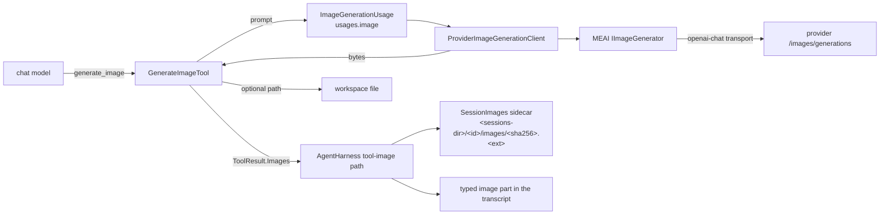

## Context

`usages.image` is named in ADR-0027's 2026-11-22 amendment ("named, not built, requirement: image
output") and nothing resolves it. The image input path (`read`, attachments, the `images` spec) is
already built: images enter a run as `ImageAttachment`s, the loop stores their bytes in the session
sidecar through `SessionImages.Store` and keeps only an `ImageContentReference` (`{"$type":"image",
digest, mime, width, height}`) in the message, and hydration turns a reference into provider content
or a vision-profile description. The capability metadata already carries `image-generation` in the
open API set, and the provider client factory already builds each chat family's transport (endpoint,
declared headers, credential placement).

The card therefore only needs the missing producer: a tool that asks the resolved `image` profile for
an image and hands the bytes to the path that already exists.

## Goals / Non-Goals

**Goals:**

- Prove the `image-generation` capability with a consumer: one tool, one usage resolution, one
  attribution value.
- Keep the generated artefact on the existing session-sidecar contract, so no session schema and no
  new settings key exist beyond `usages.image`.
- Reuse the provider transport rather than add a second HTTP client stack.
- Keep the tool testable with a stub generator; CI never reaches a network.

**Non-Goals:**

- No image editing, no reference-image input, no size/quality/count controls, no streaming.
- No downscaling or re-encoding of the returned bytes; the image limits apply as they do to input.
- No `tools.extra` entry: the usage is the enablement, per the card.
- No session-schema change and no new event kind.

## Decisions

**1. Resolve `usages.image` like `usages.embeddings`.** A new `ImageGenerationUsage` mirrors
`EmbeddingsUsage`: it reads the profile through `ModelSelectionResolver.ResolveChatModel`, refuses a
known output-modality set without `image` and a family other than `openai-chat`, accepts an unknown
capability set, and returns null with one warning naming `usages.image` when the key is unset or the
profile is unusable. Alternative: a hard failure at session start — rejected because the role is
optional and an unused image profile must not stop a session.

**2. Requirement = declared image output, not the API name.** ADR-0027's usage table names the
requirement `image output`, and that maps to the capability fact `OutputModalities`. A model whose
known output modalities exclude `image` is refused; an unknown set is accepted. The
`image-generation` API name stays a capability label, as ADR-0027 decision 3 says API names label but
do not gate, with the usage's own declared requirement doing the check.

**3. One seam, two layers.** `IImageGenerationClient` (Lunate.Coding) is the test seam: prompt in,
bytes + media type + usage out. `ProviderImageGenerationClient` wraps MEAI's `IImageGenerator`,
which `ChatClientFactory.CreateImageGenerator` builds from the same OpenAI client options, declared
headers and credential handler the `openai-chat` family uses. Alternative: call the provider's HTTP
endpoint directly — rejected because it would duplicate the endpoint, header, credential and wire-id
rules the factory already owns.

**4. The artefact goes through `ToolResult.Images`.** The loop already stores tool images in the
session sidecar, emits `ToolCallResult.HasImages`, appends one user-role image message with the typed
part, and keeps the placeholder as the tool-role text. The tool therefore returns the placeholder
plus (when a path was given) the relative path, and the loop does the storing. Alternative: a new
event or a tool-specific session entry — rejected because the session format and the transcript
contract already cover an image a tool produced.

**5. Register only when the usage resolves.** `HarnessFactory.CreateTools` takes a
`Func<ImageGenerationBinding?>` seam like the embeddings one and adds `generate_image` only when it
returns a binding; the interactive, print and ACP frontends pass their resolver. This is the same rule
`semantic_search` follows, minus the `tools.extra` gate, because the card's only settings surface is
the usage.

**6. `ToolRisk.Write`.** The approval model is per tool, not per argument; a generation that may write
a workspace file must therefore carry the write risk, so an `ask` run asks before either form of the
call and `auto-edit` allows it. The stricter no-path case (sidecar-only) is accepted: a generation is
a paid, state-changing call and must not bypass the policy. Alternative: a per-call risk — rejected
because that changes the published tool contract (ADR-0043's closed sets) for one tool.

**7. Validate the returned bytes before attaching.** The tool sniffs magic bytes and dimensions with
`ImageFile.TryReadDimensions` and applies `ImageLimits` (5 MB, 4096 px). A store that accepted an
oversized blob would create a sidecar entry the reader refuses later, so the refusal belongs at the
producer. Downscaling stays unavailable, as the input path says.

**8. Workspace writes follow the write tool's rules.** `Workspace.TryResolve` before the generation
call (so an unrunnable path costs no provider call), directory refusal, parent creation, replacement
of an existing file, a `FileChangeEvent`, and the same `FileMutationQueue` serialization the write
tool uses. Reading `ITextFileAccess`/the read ledger is not reused: an image is binary and has no
stale-text comparison.

**9. Attribute the call to the run.** `ProviderImageGenerationClient` reports its `UsageDetails` and
the tool records `ModelUsageAttribution("image", profile, provider name, provider kind)` through
`AgentToolContextState.RecordUsageFor`, the loop's one accounting path. The interactive session
persists attributed non-chat usage for `image` beside decision and embeddings, so `/cost` and a
resume read it back.

## Risks / Trade-offs

- **A text-only chat model with no vision profile attaches an image it cannot see.** The existing
  `EnsureImagesSupported`/vision-fallback gate then describes it or refuses the next request, exactly
  as it does for a `read` image. Mitigation: the tool result still names the placeholder and the
  workspace path, and the docs state that image work needs a vision chat profile or `usages.vision`.
- **The 5 MB input limit can reject a legitimate generated PNG.** Mitigation: the error names the
  actual size, the limit and the next step (pick a smaller size/model); no silent unreadable blob.
- **A URL-returning provider response cannot be re-fetched.** Mitigation: the seam accepts image
  bytes only and refuses a content item without bytes with a message naming the model, rather than
  fetching an unauthenticated URL.
- **The `openai-chat` family check is a build fact, not a provider contract.** An OpenAI-compatible
  provider without an images endpoint will fail at the call; the provider's error is translated into
  a model-named tool error.
- **Sidecar-only calls are approved like writes.** Stricter than needed; accepted because per-call
  risk would change the tool contract.

## Migration Plan

Additive: no stored data changes, no schema bump, no settings migration (an unset `usages.image`
behaves exactly as before). Removing the tool later removes the consumer and leaves the role and the
capability facts, mirroring the embeddings change.

## Open Questions

None. The behaviour of the `image` role's requirement is fixed by ADR-0027's usage table; this change
appends an amendment recording that the role is built, its requirement, and its `openai-chat` wire.
