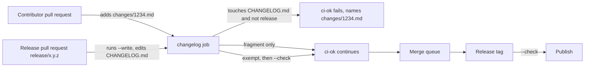

# Design — per-PR changelog fragments

## Context

`CHANGELOG.md` is one shared edit point: every user-visible pull request prepends a line under
`## [Unreleased]`, so the second pull request to land makes every other open one `CONFLICTING` and
GitHub will not enqueue it. The repository already separates prose from code (`scripts/ci-plan.sh`),
has a single aggregate check (`scripts/ci-ok.sh`) and a family of small Python/busybox-style scripts
with self-tests. It also already sees fragments in the wild: sibling pull requests add
`changes/<number>.md` while this change is being written, and the lane's `changelog_fragments.py`
is inert only because the directory does not exist on `main` yet.

In-force ADRs reviewed: 0011 (CSharpier, markdownlint, documentation map) constrains the Markdown
lint and the documentation map; 0008 (release publish flags) is untouched — no build or release
asset changes. No in-force ADR needs revisiting.

## Goals / Non-Goals

**Goals:**

- One writable file per pull request, so two open pull requests never share a line.
- One assembler that deterministically folds fragments into the unreleased section.
- A gate that makes the rule live without blocking the release pull request.
- Leave today's unreleased text and every released section byte-for-byte unchanged.

**Non-Goals:**

- No git merge driver (it only runs where installed and would duplicate entries).
- No automatic fragment creation or a check that every pull request has one.
- No change to the release workflow's build, package or channel steps.
- No new dependency; the assembler uses only the Python 3 standard library.

## Decisions

### The fragment grammar

A fragment is `changes/<decimal-number>.md`, containing exactly one accepted heading and one or more
bullets:

```markdown
### Added

- **A documentation checker and navigation manifest.** … (#749).
```

The accepted headings are the three the card names: `### Added`, `### Changed`, `### Fixed`.
`changes/README.md` is not a fragment. All other names and bodies are diagnostics, not silence:

- a `*.md` that is neither `README.md` nor `<digits>.md` is malformed;
- a heading outside the three is an unknown heading;
- a bullet that does not end with `(#<fragment-number>)` is malformed;
- text outside the heading and its bullets is malformed;
- `1234.md` and `01234.md` are a duplicate for number 1234 (both named).

Exact filenames plus exact headings are what make the assembler's output a function of the tree.

### The generated region uses one marker pair per heading

`--write` cannot own the whole unreleased section: today's `### Fixed` entry must stay where it was
written, and a second `### Fixed` heading would be a duplicate sibling heading under markdownlint's
MD024. So each heading that has fragments gets a generated region at the top of its body:

```markdown
## [Unreleased]

### Fixed

<!-- changelog-fragments:start -->
- **A fragment entry.** … (#794).
<!-- changelog-fragments:end -->

- **The entry written before fragments existed.** … (#584).
```

A heading with no fragments gets no marker; text outside the markers is never rewritten. `--write`
first strips every existing marker region in the unreleased section (so a consumed fragment
disappears), then inserts the regions the fragments require, in the fixed heading order Added,
Changed, Fixed. Within a heading, bullets follow ascending pull-request number. Released sections
are not read for generation and are never written.

### `--check` compares the whole file to the writer's result

`--check` computes the same content `--write` would produce and compares bytes. A clean tree prints
`changelog-assemble: up to date`; a difference prints the fragments whose entries are absent and
tells the reader to run `--write`. This makes the check strict about the marker region (including
blank lines) and silent about everything else, and idempotence follows from the writer being a pure
function of the fragment set plus the text outside the markers.

The script lives at `scripts/changelog-assemble` and accepts `--root <dir>` so tests build trees
under the temp directory instead of the repository.

### The gate is its own CI job, and the aggregate requires it

`scripts/changelog-guard` decides from a `git diff --name-status` file, the pull-request number,
the head branch and the title. It fails when `CHANGELOG.md` is among the changed paths and neither
release signal is present; the failure names `changes/<number>.md`. A dedicated `changelog` job in
`ci.yml` runs it on every non-draft pull request, so it runs for both the docs and full profiles and
cannot be skipped by the profile decision. `ci-ok.sh` takes the job's result: success on a pull
request, skipped outside one, and anything else fails the aggregate with a named reason. The job also
runs `--check` when the pull request's diff includes `CHANGELOG.md` — that is exactly the release
pull request that ran `--write` — so the assembler is verified by the run that uses it.

The job is inert while `changes/README.md` is absent from the pull request's base (`git cat-file -e
"origin/<base>:changes/README.md"`). That is one pull request — this one — which is the last direct
edit of `CHANGELOG.md`; refusing it with nowhere else to write the line would block the change that
makes the rule live. From the next pull request onward the base carries the directory and the guard
runs.

`release.yml` runs `--check` in the gate job before publishing. A fragment merged after the release
pull request was cut therefore fails the tag by name instead of shipping unassembled notes.



Boundaries: the contributor and the release pull request are the two actors; the `changelog` job is
the only new boundary; the merge queue, tag and publish are existing containers. The decision is
local to the diff and the two branch/title strings, so no service or database is involved.

### A fragment is prose, so `ci-plan.sh` gives it the docs profile

`changes/<number>.md` is Markdown that cannot break the build. `ci-plan.sh` gains one allow-list
entry for `changes/*.md` (one level, so a script planted under `changes/` still selects the full
gate), with a self-test case. Without it every one-line fragment would pay the twenty-minute matrix.

### No `AGENTS.md` edit

`AGENTS.md` is protected. The exact edit this change would ask for, for maintainer approval, is this
bullet inserted in `## Rules` after the "A failing golden session test …" bullet:

```markdown
- A pull request writes its release-note line in `changes/<pr-number>.md` and never edits `CHANGELOG.md`; only the release pull request (`release/<version>` or a `chore(release)` title) runs `scripts/changelog-assemble --write`.
```

## Risks / Trade-offs

- **A fragment and its changelog entry can drift while the release is being cut** → `--check` runs on
  the release pull request and again on the tag, and it compares the generated bytes, not a summary.
- **Markers leak into released history if the release step leaves them** → the assembler never reads
  or writes a non-unreleased section, so the markers are inert; the runbook's promotion step removes
  them, and the released text itself is untouched either way.
- **The changelog gate is external to the profile** → it is a separate job in `ci-ok`'s `needs` and
  `ci-ok.sh` fails closed on an unreadable result, with self-test cases for both.
- **The lane's `changelog_fragments.py` is outside this repository** → the repository side matches
  the lane's documented signals (`release/<version>` branch, `chore(release)` title); the PR records
  that the lane itself was not inspected here.
- **An open pull request that edited `CHANGELOG.md` before this lands** → it conflicts with this
  change anyway; it keeps its existing fragment if it has one and removes the hand edit.

## Migration Plan

1. Land `changes/README.md`, this change's own `changes/794.md`, the assembler, the guard and the
   marker region in the current unreleased section.
2. Existing unreleased text stays exactly as written and keeps its place below the generated region;
   the released sections are not touched.
3. Open pull requests already carry their own fragments; a new one adds `changes/<number>.md`.
4. The first release pull request runs `--write`, promotes the unreleased heading to the version and
   deletes the consumed fragments, so the next release starts from an empty unreleased section.
5. Rollback is a revert of the files in this change plus the marker region; fragments are inert text.

## Open Questions

None. The lane-side release/merge behaviour is not in this repository and is reported as such on the
pull request.
