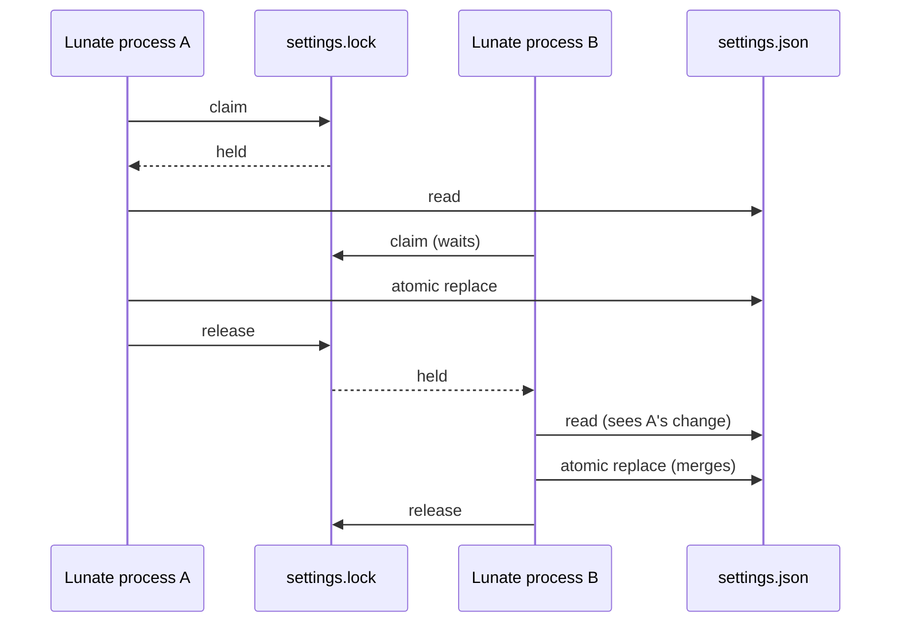

## Context

`SettingsStore` and `ProviderStore` own two user-scoped files under `~/.lunate`: `settings.json`
and `providers.json`. Every mutation is read-modify-write — read the whole JSON document, apply one
change, validate through the same parser that reads it, then replace the file atomically. A
process-local `Lock Gate` serializes threads, but nothing serializes two processes. A TUI and a
child run, two terminals, or the setup wizard and a running session can each read the same document
and each replace it; the later replace silently drops the earlier change. The provider store's
migration path has the same shape: `Load` reads, discovers auth keys that need an entry, and writes
the whole file.

The repository already has the mechanism this needs: `Lunate.Ai.FileLock` takes an exclusive
handle (`FileShare.None`) on a lock file beside the data. The extension trust store and the session
writer claim use it for exactly this reason, and `FileReplacement` already retries a transiently
locked destination.

## Goals / Non-Goals

**Goals:**

- Serialize every settings and provider-store read-modify-write across processes.
- Keep a refused claim honest: bound the wait, name the file and the lock, change nothing.
- Leave reads unchanged: no claim, no lock file created, and a complete document every time.
- Prove it with a real second process, not a share-mode constant.

**Non-Goals:**

- A multi-file transaction spanning `auth.json`, `providers.json` and `settings.json`; the setup
  wizard's staging already gives that commit its own all-or-nothing shape.
- Excluding readers; the lock file exists so readers never touch the claim.
- The auth store: it replaces a whole in-memory document and has no read-modify-write path.
- User-owned workspace files; the edit and write tools keep their mutation queue.

## Decisions

1. **Reuse `FileLock` and a `<file>.lock` sidecar.** Alternatives: a named `Mutex` (Windows
   semantics without a POSIX equivalent), claiming the data file itself (refuses readers, and
   Windows denies the rename while the claim is held), or optimistic retry without a lock (still
   loses an update when both processes read before either writes, and needs a version field the
   files do not carry). The lock-file pattern is already the repository's answer and both stores
   live in `Lunate.Coding`, which may use `Lunate.Ai` internals.
2. **Take the claim inside the existing in-process gate.** The gate already serializes this
   process's reads and writes, and taking one claim per process avoids `FileLock` refusing a second
   handle from this process. The claim is held for the whole read-modify-write and released when
   the atomic replace returns.
3. **Every settings writer takes the claim.** `WriteFavorites`, `WriteProvider`, `WriteProfile`,
   `WriteUsage`, `WriteDecisionsKey`, `WriteTui` and `WriteProfileReasoningLevel` are the complete
   set of read-modify-write writers today; the helper sits in `SettingsStore` beside the gate so a
   new writer cannot forget the in-process half without also seeing the cross-process half.
4. **The provider store claims on write only, and re-reads under the claim.** A read-only `Load`
   must not create a lock file or fail on a read-only store, so `Load` detects migration from the
   first atomic read; only then does it take the claim, re-read, recompute and write. `Save` always
   claims because it is always a write.
5. **A ten-second bound, matching the extension trust store, then an actionable refusal.** A
   write that cannot claim says which file and which lock, and that nothing changed. Contention is
   a different failure from invalid data, so it surfaces as `InvalidOperationException` rather than
   the store's `InvalidDataException`.
6. **The wizard's staged writers keep their own claims, and the target lock is not held across the
   interactive walk.** Holding the target locks from the first seed to the commit would make every
   other process time out for as long as a person takes to answer the wizard. The staged writes
   still take a claim beside the staged copy (which the transaction deletes); the final replace is
   not serialized with a concurrent writer. This is recorded as a risk, not widened into this card.

## Risks / Trade-offs

- **The wizard's seed-to-commit window remains last-writer-wins** -> The window is interactive and
  a second writer during it is rare; a follow-up can re-seed and recompute under the target claims
  at commit time without changing the walk. Named in the PR for #584.
- **A stale lock file looks like contention** -> `FileLock` claims an open handle, not the file's
  existence, so a leftover sidecar after a crash is harmless; the next writer claims it.
- **A writer on a read-only store** -> Settings and provider writes already need a writable
  directory; only the read path was made claim-free, so a read-only store still loads.
- **Extra syscall per write** -> One open/handle-close per read-modify-write, on a path that
  already reads, serializes and renames the whole file.

## Migration Plan

No data migration. The first write creates the owner-only `<store>.lock` sidecar beside the file;
an older build ignores it. Rolling back leaves the sidecar behind, which is harmless.

## Open Questions

None. No in-force ADR is revisited; ADR-0017's addendum records the lock-file claim this change
reuses.
