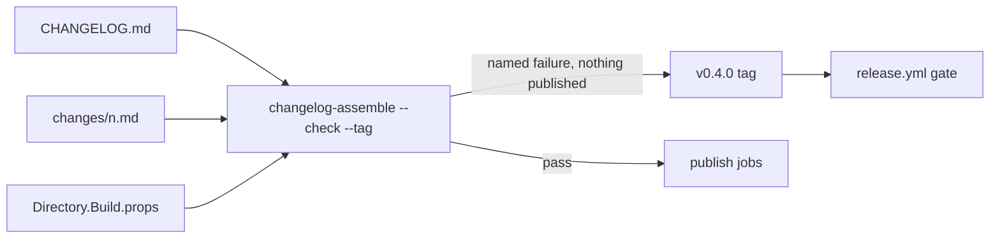

# Design — the tag's version heading in the changelog gate

## Context

`scripts/changelog-assemble --check` proves that `CHANGELOG.md`'s unreleased section is what the
`changes/<n>.md` fragments produce. It is the tag-time proof that no fragment merged after the release
pull request was cut. It does not look at the released sections, so a release pull request that never
ran `--release` — or ran it for another version — passes the gate and publishes notes under whatever
heading the changelog happens to carry.

`release.yml` already has the other half in its own step: the tag must equal `<Version>` in
`Directory.Build.props`. That step reads the tree with `sed`, names no changelog heading, and is a
second place to keep in step with the release contract.

The pieces the check needs already live in the assembler: `UNRELEASED`, the exactly dashed
`RELEASE_DATE` pattern and the calendar check the `--release` mode uses, and `VERSION_ELEMENT` for
`Directory.Build.props`. The release tag's shape (`v<version>`) is the same one `release-contract`
reads.

In-force ADRs reviewed: 0011 (CSharpier, markdownlint, documentation map) — the runbook stays the one
home that describes the release and the new text has to pass the docs checks; 0037 (the gate sized by
event) — this adds no job and no leg, it strengthens the existing tag-time gate step; 0041 (net11.0) —
untouched, no C# is involved; 0002's addendum — the check compares `<Version>` literally and does not
touch the derived versions, so a prerelease tag still spells `0.5.0-rc.1` on both sides. No in-force
ADR is revisited: this is a release-process script.

## Goals / Non-Goals

**Goals**

- One command refuses a tag whose changelog does not carry that tag's release heading, and whose
  `Directory.Build.props` does not carry that tag's version.
- Every refusal names what it expected and what it found.
- The release workflow runs it before anything is published, in the gate job every publish job needs.

**Non-Goals**

- No change to the fragment grammar, `--write`, `--release` or plain `--check`.
- No GitHub API call: this reads the tree, unlike `scripts/release-contract`, which reads `gh` JSON.
- No change to how a release heading is produced; `--release` already writes the exact shape.
- No new job, workflow or release step.

## Decisions

### `--tag` on `changelog-assemble --check`, not a new mode in `release-contract`

The check reads two files the assembler already owns, and the card allows either home.
`release-contract` takes only JSON files produced by `gh`; putting a tree read there would split the
release contract across two sources and duplicate `UNRELEASED`, `RELEASE_DATE` and `VERSION_ELEMENT`.
`--check --tag <tag>` reuses them, and the tag-time step that already runs `--check` gains one
argument instead of gaining a second step.

`--tag` is a modifier, not a fourth mode: `--check` still means "the unreleased section is what the
fragments produce", and the tag adds the released-heading and version proof on top. Passing `--tag`
with `--write`, with `--release`, or with no mode is a usage error (`parser.error`), so a release edit
can never quietly run the tag proof.

### The first level-2 heading below `## [Unreleased]`

The assembler already treats a line starting `## ` as the end of the unreleased section, so the same
boundary decides the release heading: the first `## ` line after `## [Unreleased]`. `### Added` and
its siblings are inside the unreleased section and are never the release heading. If no `## ` line
follows, the failure names the missing section and the expected heading rather than an exception.

The heading is matched as `## [<version>] - <date>` as a whole. A heading without the date, a heading
for another version, and a heading with a date the release process does not spell are different
diagnoses, and each message prints the heading it found and the heading it expected, with
`YYYY-MM-DD` as the expected spelling. The date is verified twice, exactly as `--release` verifies
`--date`: the `RELEASE_DATE` pattern first, because `date.fromisoformat` also accepts `20261201` and
`2026-W49-1`, then the calendar check so `2026-02-30` fails. That one validation helper is now shared
by `--release` and the tag check, so the two cannot spell dates differently.

### `<Version>` is compared literally with the tag's version

`<version>` is the tag with its leading `v` stripped, and `<Version>` in `Directory.Build.props` must
equal it as text. Semantic-version precedence is the wrong comparison here: a tag names one exact
version, and `0.5.0` must not pass while the props say `0.5.0-rc.1`. A tag without the `v` prefix is
refused by name instead of being accepted as a version, because the release process only tags
`v<version>`.

The check collects the heading failure and the props failure in one run — a release pull request that
forgot both the promotion and the bump should not need two tag pushes to learn both.

### The workflow's separate version step is removed

`release.yml`'s "Check tag against version" step compares the tag with `<Version>` with `sed`. The new
check compares the same two values and adds the heading, so keeping both would leave two copies of one
equality and would shadow the new check's `Directory.Build.props` failure in the workflow, since the
older step runs first and exits. The step is deleted, and the tag-guarded changelog step becomes
`python3 scripts/changelog-assemble --check --tag "${GITHUB_REF_NAME}"`; it stays in the `gate` job
that every publish job `needs`, so nothing is published before it passes. On a manual dispatch the
step does not run (the existing `if:` guard), which keeps a dry run from a branch possible.

### Tests drive the script through `--root`

`tests/scripts/test_changelog_assemble.py` already builds a temporary tree per test. The tag cases are
one `run(root, "--check", "--tag", "v0.4.0")` plus assertions on the message: a correct tag, no heading
below the unreleased section, another version's heading, a wrong date spelling, a props mismatch, a
tag without `v`, a prerelease tag, and `--write`/`--release` refusing `--tag`. The workflow wiring is
pinned in `tests/scripts/test_release_workflow.py` as text, as its other cases are: the changelog step
passes `--tag "${GITHUB_REF_NAME}"`, keeps its tag guard, and the gate still precedes every publish
job.

Boundaries: one script and one workflow step; the tree is the only input. There is no service, queue
or store, so a system-context diagram would add nothing beyond the flow above.

## Risks / Trade-offs

- **A release heading with a hand-edited date passes only when it is exactly `YYYY-MM-DD`** → that is
  the shape `--release` writes; a hand edit in another spelling is refused by name, which is the
  intended outcome of the card.
- **A project that tags `0.4.0` without the `v`** → refused by name. The card, `release-contract` and
  the workflow's tag filter all assume `v<version>`.
- **Removing the standalone version step loses its earlier position in the job** → the version
  mismatch is now reported after the merged-release-pull-request check. Both run in the same gate job
  before any publish, and the new message names the same two values plus the changelog heading.
- **The tag check is only exercised at a real tag** → the script's unit tests cover every branch with
  a temporary tree, and the workflow text is pinned by `test_release_workflow.py`; nothing has to be
  published to prove the refusals.
- **`--check` called without `--tag` on a tag would skip the proof** → release.yml is the only caller
  at a tag and passes `--tag`; a test pins that the argument is there.

## Migration Plan

1. Land `--tag` with its tests, the workflow change, the runbook text and this change's fragment.
2. The next release tag runs the stronger gate; no release step changes.
3. Rollback is a revert of this change: plain `--check` is untouched, and the removed version step's
   equality is still enforced by `--check --tag` on any tag cut from the reverted tree only if the
   revert keeps the workflow line together.

## Open Questions

None inside this repository. No in-force ADR needs revisiting.
