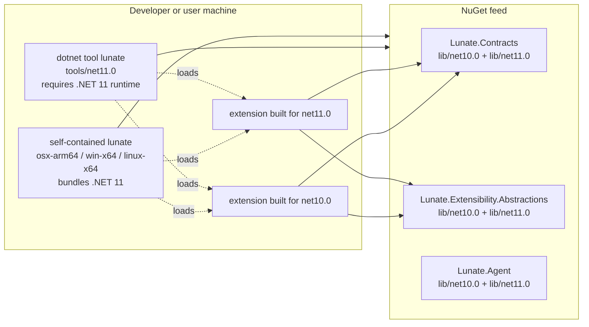

## Context

The repository already pins .NET SDK 11 (`global.json`) and builds the .NET 10 product with it. The
C# 15 / .NET 11 inventory ([`docs/dev/csharp-15.md`](../../../docs/dev/csharp-15.md), #899) records
the probes: union types and closed hierarchies need the `net11.0` BCL (`IUnion`,
`UnionAttribute`, `IsClosedTypeAttribute`); collection-expression arguments and labeled jumps need
only the C# 15 compiler. The inventory's target-framework decision is what this change applies.

Current state after step (a):

- `Directory.Build.props` sets `TargetFramework=net10.0` for every project.
- `Lunate.Coding` packs as a framework-dependent `dotnet tool`, so its current asset is
  `tools/net10.0`.
- The published extension-facing packages (`Lunate.Contracts`,
  `Lunate.Extensibility.Abstractions`, `Lunate.Agent`) each ship one `net10.0` asset.
- Extension compilation already derives its target from the host runtime
  (`SingleFileTarget.Current()`), so it moves with the runtime; only test fixtures and script paths
  hard-code `net10.0`.
- `scripts/perf.sh` (local default 150 ms) and `scripts/memory.sh` (150 MB gate) hold the startup and
  memory budgets calibrated in ADR-0005 / ADR-0009.

## Goals / Non-Goals

**Goals:**

- The self-contained app and every internal project build and run on `net11.0` / C# 15.
- The published extension-facing packages carry both a `net10.0` and a `net11.0` asset, with an
  identical public surface, so an existing extension keeps compiling and loading.
- The `dotnet tool` package is a `net11.0` framework-dependent tool and its release note states the
  .NET 11 runtime requirement.
- Startup and memory are measured again on the .NET 11 publish, with the evidence recorded.

**Non-Goals:**

- No C# 15 refactor (union/closed types) in this change; that is step (c).
- No drop of the `net10.0` contract asset, and no change to `ExtensionApi`.
- No new package, no new public type, no change to the extension lock format.
- No per-runner CI budget re-calibration: only the post-merge runners can measure it.

## Decisions

### 1. The target-framework split

`Directory.Build.props` sets `TargetFramework=net11.0`. The published extension-facing projects
override it with `TargetFrameworks=net10.0;net11.0`:

- `Lunate.Contracts`
- `Lunate.Extensibility.Abstractions`
- `Lunate.Agent`
- `Lunate.Ai` and `Lunate.Ai.Decisions` (the assemblies `Lunate.Agent` carries in its `lib/`)

`Lunate.Extensibility.Testing` stays `net11.0` because it references `Lunate.Coding` (the tool), and
the tool is `net11.0` only. `Mermaid.Terminal` stays `net11.0` because it is not extension-facing and
is a candidate for the step (c) refactor.

Alternative rejected: multi-target the whole graph so the tool keeps a `net10.0` asset. It doubles
every build, contradicts the decision that the app is `net11.0`, and buys a runtime floor the card
explicitly replaces.

### 2. The tool package requires .NET 11

`Lunate.Coding` packs one `tools/net11.0` asset. The package metadata and the changelog fragment say
that `dotnet tool install -g lunate` now needs the .NET 11 runtime; the self-contained installers are
unchanged and still need no runtime. Alternative rejected: carry both `tools/net10.0` and
`tools/net11.0`, which the inventory tested but which the card's acceptance replaces with the
explicit .NET 11 requirement.

### 3. Package layout per asset

`Lunate.Agent` and `Lunate.Extensibility.Testing` use `lib/$(TargetFramework)` in their
`TfmSpecificPackageFile` paths instead of a hard-coded `lib/net10.0`. `Lunate.Agent` then packs its
own `Lunate.Ai.dll` and `Lunate.Ai.Decisions.dll` beside each asset; the contract packages ride the
dependency chain as before.

### 4. Extension compile target follows the host

No product change: `SingleFileTarget.Current()` already produces `net{runtime.Major}.{runtime.Minor}`
from `Environment.Version`. The tests and fixtures that hard-code `ref/net10.0` for finding the
machine's reference pack change to the current TFM; package-asset strings that describe a dependency
package (for example `lib/net10.0/Octokit.dll`) stay as they are, because they model a real package
layout, not the host.

### 5. The template proves the net10 floor; its test project moves to net11

`TemplateExtension.csproj` keeps `TargetFramework=net10.0` explicitly (it is self-contained outside
this repository). `TemplateExtension.Tests.csproj` moves to `net11.0` because the test kit it
consumes is `net11.0`; the copy target reads the extension output at its own `net10.0` path. The
copy end-to-end test asserts the packed contract packages carry both `lib/net10.0` and `lib/net11.0`
entries, so the floor and the new asset are both proven.

### 6. Documentation and scripts follow

Live instructions (`AGENTS.md`, `openspec/config.yaml`, `CONTRIBUTING.md`, `docs/dev/guide.md`,
`docs/dev/csharp-15.md`, `docs/extensions/README.md`, `README.md`, `docs/quickstart.md`,
`docs/dev/distribution.md`) name .NET 11 / C# 15 and the tool's runtime requirement. Live scripts
that address build output use `net11.0`. Historical records (`docs/dev/spikes/**`,
`openspec/changes/archive/**`, `docs/dev/eval/**`) keep their original paths.

### 7. Budgets

Re-measure on the locally published single-file binary with `scripts/perf.sh` and
`scripts/memory.sh`, record the floor/median and peak RSS in this design and in the pull request.
Keep the 150 ms local startup default and the 150 MB memory gate when the measurement is inside their
headroom; the CI matrix values are re-calibrated from the post-merge/nightly runners, which are the
only source of their evidence (ADR-0005, ADR-0009).

## Diagram

Deployment view of what this change ships:

Boundaries: the self-contained binary and the tool are both the `net11.0` host; the extension
packages are the compatibility boundary and carry both assets. Assumption: an extension targeting
`net10.0` binds to the host's `net11.0` contract assembly at load because the public surface is
identical; that is already the loader's behaviour and the reason the net10 asset is kept.

## Risks / Trade-offs

- **A `net10.0` asset of a dependency package does not exist** → the multi-target build restores
  per TFM; the build fails loudly if a package cannot provide a `net10.0` asset, and the dependency
  versions stay unchanged.
- **The public API drifts between assets** → `Microsoft.CodeAnalysis.PublicApiAnalyzers` runs per TFM
  against the same `PublicAPI.*.txt`; a divergence fails the build.
- **The extension test kit can no longer serve a net10 test project** → the template's test project
  moves to `net11.0`; the extension project itself stays `net10.0`, which is the floor that matters.
- **The tool's local roundtrip needs a .NET 11 runtime** → the pinned SDK and CI runners already
  install .NET 11; the changelog and distribution docs state the requirement.
- **A budget regresses on the new runtime** → the local re-measurement catches it before the branch
  is done; a measurement beyond the headroom re-calibrates per ADR-0005/ADR-0009.
- **CI budget values were measured on .NET 10** → keep them until the post-merge/nightly run can
  re-measure; record that as the maintainer's follow-up evidence rather than guessing new numbers.

## Migration Plan

1. Retarget `Directory.Build.props` and the multi-target project files.
2. Update the tests/fixtures and live script paths that name the host TFM.
3. Move the template test project to `net11.0` and assert both contract assets in the copy test.
4. Update live docs and the OpenSpec config; add the changelog fragment.
5. Build Release, run the focused tests, publish locally, measure startup and memory.
6. Roll back by reverting the branch; no data migration is involved.

## Open Questions

- The per-runner CI startup/memory budgets are calibrated from data only the post-merge (main push,
  nightly) runners produce. This change records the local re-measurement and leaves the CI numbers
  untouched; a maintainer re-calibrates them from the first post-merge run if the net11 numbers move
  past their headroom. No in-force ADR needs supersession.
