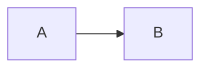

# Mermaid.Terminal

Render a Mermaid `flowchart`/`graph` or `sequenceDiagram` as text for a terminal. The layout and
drawing are a C# port of the MIT-licensed
[`mermaid-ascii`](https://github.com/AlexanderGrooff/mermaid-ascii) renderer, so the output is the
picture that renderer has already been proven to produce. It has no dependency on Lunate and no
dependency outside the base class library.

## Installation

```sh
dotnet add package Mermaid.Terminal
```

## Usage

The source:



Rendered by:

```csharp
using Mermaid.Terminal;

MermaidRenderResult result = MermaidRenderer.Render(
    """
    graph LR
    A --> B
    """,
    width: 80,
    glyphs: MermaidGlyphSet.Unicode
);

if (result is MermaidDiagramResult diagram)
{
    foreach (MermaidLine line in diagram.Lines)
    {
        Console.WriteLine(line.Text);
    }
}
else if (result is MermaidFallbackResult fallback)
{
    Console.WriteLine($"mermaid: {fallback.Reason}");
}
```

That program prints:

```text
┌───┐     ┌───┐
│   │     │   │
│ A ├────►│ B │
│   │     │   │
└───┘     └───┘
```

Each line carries runs tagged `MermaidSpanKind.Frame` (box borders, lines and arrowheads) or
`MermaidSpanKind.Label` (the text the diagram supplied), so a host can paint the drawing dim and
the labels plain, as Lunate's TUI does.

`MermaidGlyphSet.Ascii` draws the same layout with `+ - |` and `> < ^ v`. A diagram that does not
fit the supplied width, a source outside the bounded grammar, or a diagram type this renderer does
not support comes back as `MermaidFallbackResult`: the source lines and one reason, never a partial
picture. `MermaidRenderer.MinimumWidth` is the narrowest width that draws anything; below it the
source is shown.

## What is supported

- `graph`/`flowchart` with `TD`, `TB` or `LR`, node labels in `[]`, `()`, `([])` and `{}`,
  quoted labels and `<br/>` line breaks, and the links `-->`, `---` and `-.->`, with an edge label
  as `-->|text|` or `-- text -->`.
- `sequenceDiagram` with `participant A as Name`, messages over `->`, `-->`, `->>` and `-->>`, and
  `Note over A, B: text`.

Everything else — subgraphs, styles, `classDef`, `click`, other diagram types, fragments such as
`alt`/`loop`, activation and actors — falls back to the source rather than drawing a broken box.

## Licence

MIT. The ported renderer is MIT-licensed; see Lunate's
[third-party licences](https://github.com/lunate-agent/lunate/blob/main/docs/third-party-licences.md).
